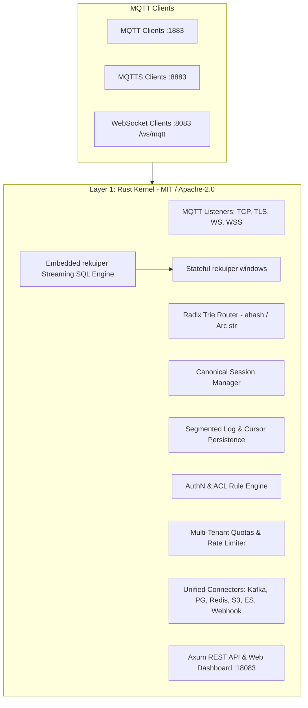
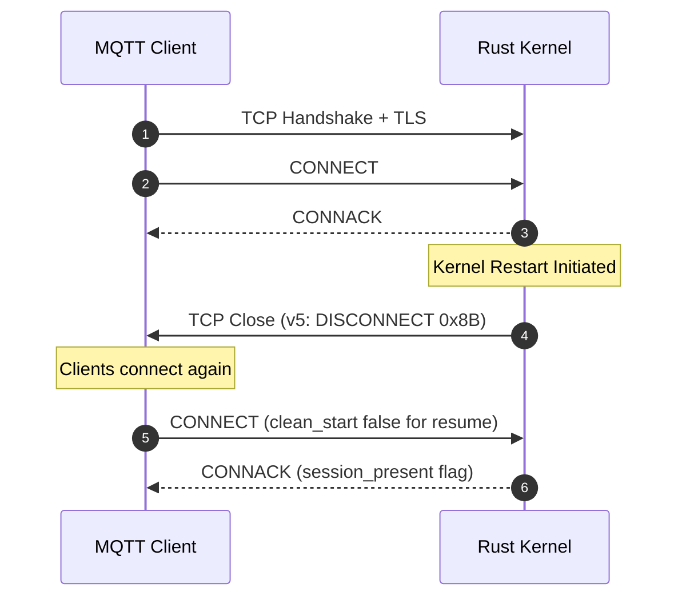
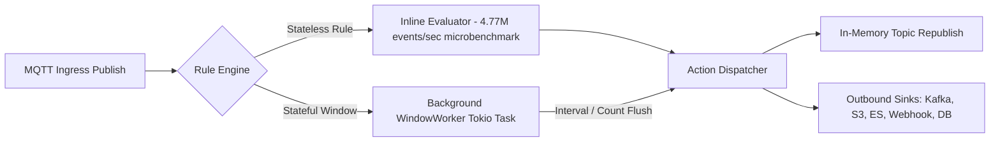

# IndraMQTT Architecture Specification

**IndraMQTT** ([indramqtt.com](https://indramqtt.com)) is a single-node Rust MQTT broker with embedded streaming SQL for cloud deployments and industrial edge systems.

This document describes the internal design of IndraMQTT. It describes concurrency models, data flows and layer decoupling.

In-process microbenchmarks measure routing and rule evaluation. File `crates/broker-node/benches/broker_throughput.rs` contains these microbenchmarks:

- `bench_router_match_throughput` reports hit-path lookups at ~3.05M per second. It uses 1000 installed filters with 3 targets.
- `bench_router_match_throughput` reports fast-miss lookups at ~7.80M per second. It runs single-threaded.
- `bench_sql_ingress_throughput` reports ingress events at ~4.77M per second. It runs single-threaded with 100 percent sink delivery.
- These rates are hardware-dependent function-call rates. They are not end-to-end network throughput.
- Re-run them on your hardware with `cargo test --release --bench broker_throughput -- --nocapture`.
- File `benchmark/results/benchmark_results_v5.json` contains historical end-to-end loopback results from the retired `benchmark_suite/` harness. It contains CPU, memory, OS and network in the `environment` block.

When the kernel stops, it closes the client sockets. Clients connect again. The broker claims no restart immunity. No idle-RSS benchmark exists in-tree. This document claims no idle footprint figure.

---

## 1. High-Level Architecture Overview

IndraMQTT runs as one Rust process. The kernel holds the client sockets and does the broker work.



---

### Cluster design and implementation status

The [cluster crate](crates/broker-cluster) implements SWIM membership and an in-process routing plane. The distributed design calls for Raft metadata and QUIC forwarding. The current broker runs on one node. Startup validation rejects settings that request clustering before listeners bind. Multi-node operation and qualification are tracked in the [roadmap](ROADMAP.md).

### Repository layout

The [broker node](crates/broker-node) starts the process and provides the operator CLI. The [workspace crates](crates) implement the protocol, router, sessions, storage, authentication, SQL, connectors, and management API. Deployment examples live in [deploy](deploy), end-to-end tests in [tests](tests), and configuration schemas in [schemas](schemas).

## 2. Core Architectural Invariants

### 1. Connection != Session (Restart Behaviour)
In some legacy broker designs, a broker node restart or software upgrade tears down all client TCP sockets, triggering massive "reconnect storms" and thundering-herd issues on downstream authentication backends.

In IndraMQTT:
- The **Rust kernel** owns client sockets, TLS sessions, packet framing, and keepalives. It also owns the canonical session, subscription state, inflight QoS tracking, offline queues, and rule engines.
- **Protocol scope**: the kernel listeners accept MQTT 3.1, 3.1.1 and 5 on TCP, TLS, WebSocket and secure WebSocket. They support UNSUBSCRIBE, QoS 0, 1 and 2, retained messages, will, shared subscriptions, topic alias, subscription identifiers and options, PSK and client certificates.
- If the kernel restarts, it closes the client sockets. Clients connect again. Durable sessions resume from the offline store when it keeps them. Clean sessions subscribe again.



---

### 2. MQTT Listeners of the Kernel
Clients connect to the kernel directly over TCP, TLS, WebSocket and secure WebSocket:
* **Direct accept**: the kernel binds each enabled listener and runs the MQTT state machine in the connection task.
* **Opaque Payloads**: Payloads remain zero-copy opaque byte buffers until evaluated by the rules engine.
* **Bounded egress**: a slow subscriber sheds QoS 0 past its backlog bound so one client cannot grow memory without limit.

---

### 3. Lock-Free Radix Trie Subscription Router
The subscription router in `crates/broker-router` is optimized for zero memory allocations on hit paths:
* **Segment Tokens**: Subscription filters (`device/+/temperature`, `sensors/#`, `$share/group1/data`) are parsed into token slices stored with zero-allocation `Arc<str>` and fast hashing (`ahash`).
* **Fast-Miss Traversal**: Walk-only branch evaluation sustains **~7.80M ± 0.20M lookups/sec** on fast-miss lookups in the in-process single-threaded microbenchmark `bench_router_match_throughput` in `crates/broker-node/benches/broker_throughput.rs` (hardware-dependent; re-run locally); not end-to-end network throughput.
* **Hit-Path Saturation**: Evaluates exact and wildcard subscriptions at **~3.05M ± 0.10M lookups/sec** across 1,000 installed filters (3 targets per lookup) in the in-process single-threaded microbenchmark `bench_router_match_throughput` in `crates/broker-node/benches/broker_throughput.rs` (hardware-dependent; re-run locally); not end-to-end network throughput.

---

### 4. Embedded Streaming SQL Engine (`rekuiper`)
IndraMQTT embeds the [`rekuiper-sql`](https://github.com/ankur-paan/rekuiper) stream processing engine directly in-process:



* **Stateless Rules**:
  - 185 scalar functions (trigonometry, math, bitwise, string, datetime, conditionals; catalog length asserted by `test_function_catalog_has_185_entries` in `crates/broker-rules/src/lib.rs`).
  - Evaluated inline on the ingress thread with zero task spawns and zero network loopback at **~4.77M ± 0.10M events/sec** in the in-process single-threaded microbenchmark `bench_sql_ingress_throughput` in `crates/broker-node/benches/broker_throughput.rs` (hardware-dependent; re-run locally; JSON parsing plus `WHERE`/`SELECT` with `Block` backpressure and 100 percent sink delivery); not end-to-end network throughput.
* **Stateful Window Operators**:
  - `TUMBLINGWINDOW`, `HOPPINGWINDOW`, `SLIDINGWINDOW`, `COUNTWINDOW`.
  - Dedicated background Tokio worker tasks with interval bounds injection (`window_start()`, `window_end()`).
  - Multi-event aggregations (`avg`, `sum`, `count`, `min`, `max`, `stddev`, `percentile`).
* **Declarative SQL Routing**:
  - Supports SQL `INTO connector("id")` syntax:
    ```sql
    SELECT clientid, temperature * 1.8 + 32 AS temp_f 
    FROM "factory/+/sensors" 
    WHERE temperature > 40.0 
    INTO connector("kafka-edge")
    ```

---

### 5. Outbound Connectors & Streaming Bridges
Outbound integrations implement the unified `Sink` trait in `crates/broker-connectors`:
```rust
#[async_trait]
pub trait Sink: Send + Sync {
    async fn send(&self, topic: &Topic, payload: &Bytes, qos: QoS) -> Result<(), ConnectorError>;
    fn kind(&self) -> &'static str;
}
```

* **Micro-Batching & Backoff**: Standardized using shared `BatchQueue` and `BackoffState` helpers.
* **Zero External Dependencies in Tests**: All unit and integration tests execute against in-memory mock transports (`MemoryKafkaTransport`, `MockS3Transport`, `MockHttpTransport`, `MemoryDiskLogWriter`, etc.).
* The [connector capability table](crates/broker-connectors/CAPABILITY.md) records each sink’s transport, offline test coverage, and any opt-in service tests.

---

### 6. Bounded Scale Architecture
IndraMQTT ships with finite, configurable bounds on every accumulating queue; nothing on a message path is unbounded by default:
* `window_channel_depth`: Configurable on `RuleEngine` (default 65,536; unbounded only as an explicit operator opt-in, never the default).
* `max_offline_queue`: Configurable on `SessionManager` (default 50,000; `None` = explicit operator opt-in to unbounded, never the default).
* Per-subscriber QoS 0 egress backlog (`session.max_qos0_backlog`, default 1000 in `indramqtt.example.toml`): past it the oldest queued QoS 0 frame sheds so a slow consumer costs bounded memory.
* Connection pools, batch limits, and rotation thresholds are configurable with finite defaults (see `indramqtt.example.toml` and `crates/broker-config/src/schema.rs`).

For full benchmarks and deployment configurations, visit [indramqtt.com](https://indramqtt.com).
