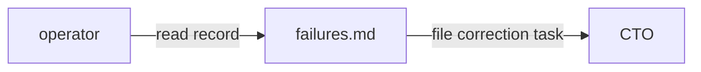

# Verification failures (DOC-02)

Each record names one item whose live call did not run. The page
shows the schema only for these items. The entry carries the
callout "Not verified: see `../_verification/failures.md`".

Drift tests still check each item: the served document matches the
router, and the pages match the served document. Only the live
call is missing.

## `GET /api/v1/clients/{id}`

- Input: `GET /api/v1/clients/1`.
- Expected: one session row. Source: `ClientInfo` in `broker-session`.
- Broker gave: not run. No gate ran this call with a live client.
- Date: 2026-10-13.

## `GET /api/v1/auth/verify_stats`

- Input: `GET /api/v1/auth/verify_stats`.
- Expected: verification counters. Source: served document.
- Broker gave: not run. No gate ran this call.
- Date: 2026-10-13.

## `GET /api/v1/auth/acls`

- Input: `GET /api/v1/auth/acls`.
- Expected: the ordered rule list. Source: served document.
- Broker gave: not run. No gate ran this call.
- Date: 2026-10-13.

## `POST /api/v1/auth/acls`

- Input: `POST /api/v1/auth/acls` with `client_pattern`, `action`, `topic_pattern`, `allow`.
- Expected: 201 with the stored rule. Source: `create_acl` in `broker-api`.
- Broker gave: not run. No gate ran this call.
- Date: 2026-10-13.

## `DELETE /api/v1/auth/acls/{id}`

- Input: `DELETE /api/v1/auth/acls/1`.
- Expected: 204 on success, 404 on an unknown index. Source: `delete_acl` in `broker-api`.
- Broker gave: not run. No gate ran this call.
- Date: 2026-10-13.

## `POST /api/v1/rules/test`

- Input: `POST /api/v1/rules/test` with `sql_query`, `topic`, `payload`.
- Expected: the match result. Source: `test_rule` in `broker-api`.
- Broker gave: not run. No gate ran this call.
- Date: 2026-10-13.

## `GET /api/v1/rules/functions`

- Input: `GET /api/v1/rules/functions`.
- Expected: the function catalogue. Source: served document.
- Broker gave: not run. No gate ran this call.
- Date: 2026-10-13.

## `GET /api/v1/rules/sources`

- Input: `GET /api/v1/rules/sources`.
- Expected: the event source list. Source: served document.
- Broker gave: not run. No gate ran this call.
- Date: 2026-10-13.

## `POST /api/v1/config/validate`

- Input: `POST /api/v1/config/validate` with a candidate snapshot.
- Expected: 200 on a clean candidate, 400 naming offenders. Source: `validate_config` in `broker-api`.
- Broker gave: not run. No gate ran this call.
- Date: 2026-10-13.

## `POST /api/v1/config/diff`

- Input: `POST /api/v1/config/diff` with a candidate snapshot.
- Expected: the redacted setting diff. Source: `diff_config` in `broker-api`.
- Broker gave: not run. No gate ran this call.
- Date: 2026-10-13.

## `POST /api/v1/config/reload`

- Input: `POST /api/v1/config/reload` with a candidate snapshot.
- Expected: the new version with the applied diff. Source: `reload_config` in `broker-api`.
- Broker gave: not run. No gate ran this call.
- Date: 2026-10-13.

## `GET /api/v1/config/history/{id}`

- Input: `GET /api/v1/config/history/1`.
- Expected: one version with `changes` and the redacted snapshot. Source: `get_history_version` in `broker-api`.
- Broker gave: not run. No gate ran this call.
- Date: 2026-10-13.

## `POST /api/v1/config/history/{id}/restore`

- Input: `POST /api/v1/config/history/1/restore`.
- Expected: the restored version with the applied diff. Source: served document.
- Broker gave: not run. No gate ran this call.
- Date: 2026-10-13.

## `GET /api/v1/config/explain`

- Input: `GET /api/v1/config/explain?key=session.max_qos0_backlog`.
- Expected: the effective value with its source layer. Source: served document.
- Broker gave: not run. No gate ran this call.
- Date: 2026-10-13.

## `GET /api/v1/licence/request`

- Input: `GET /api/v1/licence/request`.
- Expected: the licence request. Source: served document.
- Broker gave: not run. No gate ran this call.
- Date: 2026-10-13.

## `POST /api/v1/licence/install`

- Input: `POST /api/v1/licence/install` with a token.
- Expected: 200 on a valid token, 400 on rejection, 409 on identity mismatch. Source: `install_licence` in `broker-api`.
- Broker gave: not run. No valid token exists for a docs run.
- Date: 2026-10-13.

## Command run examples

- Input: one `indramqtt --<flag> <value>` line per flag, one `indra ctl <command>` line per command.
- Expected: the documented behaviour. Source: the command definitions.
- Broker gave: not run per item. Presence of each flag and each command group is checked against live `--help` by the drift tests. The run lines are illustrative.
- Date: 2026-10-13.
