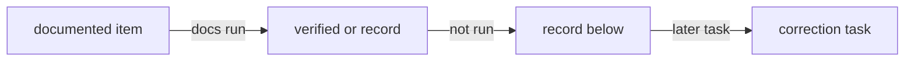
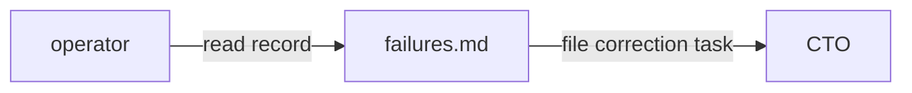

# Verification failures

This file records each docs example that the docs run does not verify end to end. Each record names the item, the exact input, the expected source, what the broker gave, and the date. The CTO turns each record into a correction task.

## Before you start

- Read the row of the connector in [Connectors](../connectors/index.md).
- Each record below covers the send path only. Creation validation runs in the docs run.
- A record is a good result. An unverified claim in a page is not.

## Connector send-path records (DOC-04)

### Kafka send path (2026-10-13)

- Item: `kafka` connector send path.
- Input: `POST /api/v1/connectors` with `bootstrap_servers` `127.0.0.1:9092`, then a publish through a forwarding rule.
- Expected from: the Kafka page of this documentation.
- Broker gave: 201 on creation (or 400 naming the `kafka` feature without the feature build). No record reached a cluster. No cluster ran in the docs run.
- State: not verified.

### PostgreSQL send path (2026-10-13)

- Item: `postgres` connector send path.
- Input: `POST /api/v1/connectors` with `connection_url` `postgresql://u:p@127.0.0.1:5432/db`, then a publish through a forwarding rule.
- Expected from: the PostgreSQL page of this documentation.
- Broker gave: 201 on creation. No row reached a database. No database ran in the docs run.
- State: not verified.

### MySQL send path (2026-10-13)

- Item: `mysql` connector send path.
- Input: `POST /api/v1/connectors` with `connection_url` `mysql://u:p@127.0.0.1:3306/db`, then a publish through a forwarding rule.
- Expected from: the MySQL page of this documentation.
- Broker gave: 201 on creation. No row reached a database. No database ran in the docs run.
- State: not verified.

### MongoDB send path (2026-10-13)

- Item: `mongodb` connector send path.
- Input: `POST /api/v1/connectors` with `connection_string` `mongodb://u:p@127.0.0.1:27017`, then a publish through a forwarding rule.
- Expected from: the MongoDB page of this documentation.
- Broker gave: 201 on creation (or 400 naming the `mongodb` feature without the feature build). No document reached a server. No server ran in the docs run.
- State: not verified.

### Redis send path (2026-10-13)

- Item: `redis` connector send path.
- Input: `POST /api/v1/connectors` with `endpoint` `redis://127.0.0.1:6379` and an `xadd` command, then a publish through a forwarding rule.
- Expected from: the Redis page of this documentation.
- Broker gave: 201 on creation. No command reached a server. No server ran in the docs run.
- State: not verified.

### InfluxDB send path (2026-10-13)

- Item: `influxdb` connector send path.
- Input: `POST /api/v1/connectors` with `endpoint` `http://127.0.0.1:8086`, then a publish through a forwarding rule.
- Expected from: the InfluxDB page of this documentation.
- Broker gave: 201 on creation. No point reached a server. No server ran in the docs run.
- State: not verified.

### ClickHouse send path (2026-10-13)

- Item: `clickhouse` connector send path.
- Input: `POST /api/v1/connectors` with `endpoint` `http://127.0.0.1:8123`, then a publish through a forwarding rule.
- Expected from: the ClickHouse page of this documentation.
- Broker gave: 201 on creation (or 400 naming the `clickhouse` feature without the feature build). No row reached a server. No server ran in the docs run.
- State: not verified.

### MQTT bridge send path (2026-10-13)

- Item: `mqtt_bridge` connector send path.
- Input: `POST /api/v1/connectors` with `broker_address` `mqtt://127.0.0.1:1883`, then a publish through a forwarding rule.
- Expected from: the MQTT bridge page of this documentation.
- Broker gave: 201 on creation. No message reached a remote broker. No remote broker ran in the docs run.
- State: not verified.

### S3 send path (2026-10-13)

- Item: `s3` connector send path.
- Input: `POST /api/v1/connectors` with `endpoint` `http://127.0.0.1:9000`, then a publish through a forwarding rule.
- Expected from: the S3 page of this documentation.
- Broker gave: 201 on creation (or 400 naming the `s3` feature without the feature build). No object reached a store. No store ran in the docs run.
- State: not verified.

### Couchbase send path (2026-11-05)

- Item: `couchbase` connector send path.
- Input: `POST /api/v1/connectors` with `connection_string` `couchbase://127.0.0.1`, bucket `telemetry`, then a publish through a forwarding rule.
- Expected from: the Couchbase page of this documentation.
- Broker gave: 201 on creation (or 400 naming the `couchbase` feature without the feature build). No document reached a cluster. No cluster ran in the docs run.
- State: not verified.

### GCP IoT send path (2026-11-05)

- Item: `gcp_iot` connector send path.
- Input: `POST /api/v1/connectors` with `project_id` `my-iot-project`, `device_id` `edge-7`, then a publish through a forwarding rule.
- Expected from: the GCP IoT page of this documentation.
- Broker gave: 201 on creation (or 400 naming the `gcp_iot` feature without the feature build). No telemetry reached an endpoint. No endpoint ran in the docs run.
- State: not verified.

### GCP Pub/Sub send path (2026-11-05)

- Item: `gcp_pubsub` connector send path.
- Input: `POST /api/v1/connectors` with `project_id` `my-iot-project`, `topic_id` `telemetry-events`, then a publish through a forwarding rule.
- Expected from: the GCP Pub/Sub page of this documentation.
- Broker gave: 201 on creation (or 400 naming the `gcp_pubsub` feature without the feature build). No message reached a topic. No server ran in the docs run.
- State: not verified.

### GreptimeDB send path (2026-11-05)

- Item: `greptimedb` connector send path.
- Input: `POST /api/v1/connectors` with `endpoint` `http://127.0.0.1:4000/v1`, `database` `public`, `table_template` `metrics_${topic_segment_1}`, then a publish through a forwarding rule.
- Expected from: the GreptimeDB page of this documentation.
- Broker gave: 201 on creation. No row reached a server. No server ran in the docs run.
- State: not verified.

## Rule function evaluation records (DOC-04)

### Function call shapes (2026-10-15)

- Item: each `rules/functions.md` call shape except the sample calls.
- Input: `POST /api/v1/rules/test` with `SELECT <call> FROM "sensors/+"`, topic `sensors/kitchen`, payload `{"temperature": 72.5}`.
- Expected from: the call shape column of `rules/functions.md` and the `example` field of `builtin_function_metadata`.
- Broker gave: not run per item. The docs run checks each name against `GET /api/v1/rules/functions` and runs six sample calls (`abs`, `ceil`, `lower`, `upper`, `concat`, `length`). No other call shape ran against the broker.
- State: not verified.

## Next steps

- Verify one record per correction task with a real server.
- Flip the matching row in [Connectors](../connectors/index.md) to `tested end to end` when a repository test proves it.

## Management API records (DOC-02)

Each record names one item whose live call did not run. The page
shows the schema only for these items. The entry carries the
callout "Not verified: see `../_verification/failures.md`".

Drift tests still check each item: the served document matches the
router, and the pages match the served document. Only the live
call is missing.

## `GET /api/v1/clients/{id}`

- Input: `GET /api/v1/clients/1`.
- Expected: one session row. Source: `ClientInfo` in `broker-session`.
- Broker gave: not run. No gate ran this call with a live client.
- Date: 2026-10-13.

## `GET /api/v1/auth/verify_stats`

- Input: `GET /api/v1/auth/verify_stats`.
- Expected: verification counters. Source: served document.
- Broker gave: not run. No gate ran this call.
- Date: 2026-10-13.

## `GET /api/v1/auth/acls`

- Input: `GET /api/v1/auth/acls`.
- Expected: the ordered rule list. Source: served document.
- Broker gave: not run. No gate ran this call.
- Date: 2026-10-13.

## `POST /api/v1/auth/acls`

- Input: `POST /api/v1/auth/acls` with `client_pattern`, `action`, `topic_pattern`, `allow`.
- Expected: 201 with the stored rule. Source: `create_acl` in `broker-api`.
- Broker gave: not run. No gate ran this call.
- Date: 2026-10-13.

## `DELETE /api/v1/auth/acls/{id}`

- Input: `DELETE /api/v1/auth/acls/1`.
- Expected: 204 on success, 404 on an unknown index. Source: `delete_acl` in `broker-api`.
- Broker gave: not run. No gate ran this call.
- Date: 2026-10-13.

## `POST /api/v1/rules/test`

- Input: `POST /api/v1/rules/test` with `sql_query`, `topic`, `payload`.
- Expected: the match result. Source: `test_rule` in `broker-api`.
- Broker gave: not run. No gate ran this call.
- Date: 2026-10-13.

## `GET /api/v1/rules/functions`

- Input: `GET /api/v1/rules/functions`.
- Expected: the function catalogue. Source: served document.
- Broker gave: not run. No gate ran this call.
- Date: 2026-10-13.

## `GET /api/v1/rules/sources`

- Input: `GET /api/v1/rules/sources`.
- Expected: the event source list. Source: served document.
- Broker gave: not run. No gate ran this call.
- Date: 2026-10-13.

## `POST /api/v1/config/validate`

- Input: `POST /api/v1/config/validate` with a candidate snapshot.
- Expected: 200 on a clean candidate, 400 naming offenders. Source: `validate_config` in `broker-api`.
- Broker gave: not run. No gate ran this call.
- Date: 2026-10-13.

## `POST /api/v1/config/diff`

- Input: `POST /api/v1/config/diff` with a candidate snapshot.
- Expected: the redacted setting diff. Source: `diff_config` in `broker-api`.
- Broker gave: not run. No gate ran this call.
- Date: 2026-10-13.

## `POST /api/v1/config/reload`

- Input: `POST /api/v1/config/reload` with a candidate snapshot.
- Expected: the new version with the applied diff. Source: `reload_config` in `broker-api`.
- Broker gave: not run. No gate ran this call.
- Date: 2026-10-13.

## `GET /api/v1/config/history/{id}`

- Input: `GET /api/v1/config/history/1`.
- Expected: one version with `changes` and the redacted snapshot. Source: `get_history_version` in `broker-api`.
- Broker gave: not run. No gate ran this call.
- Date: 2026-10-13.

## `POST /api/v1/config/history/{id}/restore`

- Input: `POST /api/v1/config/history/1/restore`.
- Expected: the restored version with the applied diff. Source: served document.
- Broker gave: not run. No gate ran this call.
- Date: 2026-10-13.

## `GET /api/v1/config/explain`

- Input: `GET /api/v1/config/explain?key=session.max_qos0_backlog`.
- Expected: the effective value with its source layer. Source: served document.
- Broker gave: not run. No gate ran this call.
- Date: 2026-10-13.

## `GET /api/v1/licence/request`

- Input: `GET /api/v1/licence/request`.
- Expected: the licence request. Source: served document.
- Broker gave: not run. No gate ran this call.
- Date: 2026-10-13.

## `POST /api/v1/licence/install`

- Input: `POST /api/v1/licence/install` with a token.
- Expected: 200 on a valid token, 400 on rejection, 409 on identity mismatch. Source: `install_licence` in `broker-api`.
- Broker gave: not run. No valid token exists for a docs run.
- Date: 2026-10-13.

## Command run examples

- Input: one `indramqtt --<flag> <value>` line per flag, one `indra ctl <command>` line per command.
- Expected: the documented behaviour. Source: the command definitions.
- Broker gave: not run per item. Presence of each flag and each command group is checked against live `--help` by the drift tests. The run lines are illustrative.
- Date: 2026-10-13.

## DX-01 command line records (2026-10-15)

The DX-01 verifier runs each CLI example through the real
binary (`indramqtt --help`, `indra ctl <group> --help`).
All 107 CLI items verify. No CLI item holds a failure
record. Each entry of `reference/cli.md` cites its file
under `docs/_verified/cli/`. Wave DX2 owns the other
areas. Their counts come from `entries.py --coverage`.

## DX2-002 item `fn-null`

- Input: rules/test `SELECT null() AS n FROM "sensors/+"` on `sensors/kitchen`.
- Expected: the cased match results in the example.
- Broker gave: `rules/test gave 400: {"error":"invalid sql_query: line 1, column 12: expected keyword FROM"}`.
- Date: 2026-10-17.

## DX2-016 item `action-gcp_pubsub_consumer`

- Input: POST /api/v5/actions type `gcp_pubsub_consumer` name `dx2-action-gcp_pubsub_consumer` wants 201; POST /api/v5/actions type `gcp_pubsub_consumer` name `dx2-action-gcp_pubsub_consumer` wants 400.
- Expected: the cased create results in the example.
- Broker gave: `create gcp_pubsub_consumer/dx2-action-gcp_pubsub_consumer gave 400: {'code': 'BAD_REQUEST', 'message': 'unknown action type: gcp_pubsub_consumer'}`.
- Date: 2026-11-05.

## DX2-017 item `action-test`

- Input: POST /api/v5/actions type `test` name `dx2-action-test` wants 201; POST /api/v5/actions type `test` name `dx2-action-test` wants 400.
- Expected: the cased create results in the example.
- Broker gave: `create test/dx2-action-test gave 400: {'code': 'BAD_REQUEST', 'message': 'unknown action type: test'}`.
- Date: 2026-11-05.

## DX2-019 item `couchbase`

- Input: `python3 docs/_tools/verify.py --area connectors --item couchbase` with `COUCHBASE_URL`, `COUCHBASE_USERNAME`, `COUCHBASE_PASSWORD`, `COUCHBASE_BUCKET` from a real server.
- Expected: the docs run writes `docs/_verified/connectors/couchbase.json` through the broker rule path.
- Broker gave: not run. No server ran in this task. The page checks creation only. The send path stays not verified.
- Date: 2026-11-05.

## DX2-020 item `gcp_iot`

- Input: `python3 docs/_tools/verify.py --area connectors --item gcp_iot` with `GCP_IOT_MQTT_URL`, `GCP_IOT_PRIVATE_KEY_FILE` from a real server.
- Expected: the docs run writes `docs/_verified/connectors/gcp_iot.json` through the broker rule path.
- Broker gave: not run. No server ran in this task. The page checks creation only. The send path stays not verified.
- Date: 2026-11-05.

## DX2-021 item `gcp_pubsub`

- Input: `python3 docs/_tools/verify.py --area connectors --item gcp_pubsub` with `PUBSUB_EMULATOR_HOST`, `PUBSUB_PROJECT`, `PUBSUB_TOPIC`, `PUBSUB_SUBSCRIPTION` from a real server.
- Expected: the docs run writes `docs/_verified/connectors/gcp_pubsub.json` through the broker rule path.
- Broker gave: not run. No server ran in this task. The page checks creation only. The send path stays not verified.
- Date: 2026-11-05.

## DX2-022 item `greptimedb`

- Input: `python3 docs/_tools/verify.py --area connectors --item greptimedb` with `GREPTIMEDB_ENDPOINT`, `GREPTIMEDB_DATABASE`, `GREPTIMEDB_TABLE` from a real server.
- Expected: the docs run writes `docs/_verified/connectors/greptimedb.json` through the broker rule path.
- Broker gave: not run. No server ran in this task. The page checks creation only. The send path stays not verified.
- Date: 2026-11-05.

## DX2-023 item `influxdb`

- Input: `python3 docs/_tools/verify.py --area connectors --item influxdb` with `INFLUXDB_ENDPOINT`, `INFLUXDB_ORG`, `INFLUXDB_BUCKET`, `INFLUXDB_TOKEN` from a real server.
- Expected: the docs run writes `docs/_verified/connectors/influxdb.json` through the broker rule path.
- Broker gave: not run. No server ran in this task. The page checks creation only. The send path stays not verified.
- Date: 2026-11-05.

## DX2-024 item `iotdb`

- Input: `python3 docs/_tools/verify.py --area connectors --item iotdb` with `IOTDB_ENDPOINT`, `IOTDB_USER`, `IOTDB_PASSWORD`, `IOTDB_DEVICE` from a real server.
- Expected: the docs run writes `docs/_verified/connectors/iotdb.json` through the broker rule path.
- Broker gave: not run. No server ran in this task. The page checks creation only. The send path stays not verified.
- Date: 2026-11-06.

## DX2-025 item `kafka`

- Input: `python3 docs/_tools/verify.py --area connectors --item kafka` with `KAFKA_BOOTSTRAP_SERVERS`, `KAFKA_TOPIC` from a real server.
- Expected: the docs run writes `docs/_verified/connectors/kafka.json` through the broker rule path.
- Broker gave: not run. No server ran in this task. The page checks creation only. The send path stays not verified.
- Date: 2026-11-06.

## DX2-026 item `mongodb`

- Input: `python3 docs/_tools/verify.py --area connectors --item mongodb` with `MONGODB_URL`, `MONGODB_DATABASE`, `MONGODB_COLLECTION` from a real server.
- Expected: the docs run writes `docs/_verified/connectors/mongodb.json` through the broker rule path.
- Broker gave: not run. No server ran in this task. The page checks creation only. The send path stays not verified.
- Date: 2026-11-06.

## DX2-027 item `mqtt_bridge`

- Input: `python3 docs/_tools/verify.py --area connectors --item mqtt_bridge` with `MQTT_BRIDGE_URL`, `MQTT_BRIDGE_TOPIC`, `MQTT_BRIDGE_CLIENT_ID` from a real server.
- Expected: the docs run writes `docs/_verified/connectors/mqtt_bridge.json` through the broker rule path.
- Broker gave: not run. No server ran in this task. The page checks creation only. The send path stays not verified.
- Date: 2026-11-06.

## DX2-028 item `mssql`

- Input: `python3 docs/_tools/verify.py --area connectors --item mssql` with `MSSQL_HOST`, `MSSQL_PORT`, `MSSQL_DATABASE`, `MSSQL_TABLE`, `MSSQL_USER`, `MSSQL_PASSWORD` from a real server.
- Expected: the docs run writes `docs/_verified/connectors/mssql.json` through the broker rule path.
- Broker gave: not run. No server ran in this task. The page checks creation only. The send path stays not verified.
- Date: 2026-11-06.

## DX2-029 item `mysql`

- Input: `python3 docs/_tools/verify.py --area connectors --item mysql` with `MYSQL_HOST`, `MYSQL_PORT`, `MYSQL_DATABASE`, `MYSQL_TABLE`, `MYSQL_USER`, `MYSQL_PASSWORD`, `MYSQL_NATIVE_USER` from a real server.
- Expected: the docs run writes `docs/_verified/connectors/mysql.json` through the broker rule path.
- Broker gave: not run. No server ran in this task. The page checks creation only. The send path stays not verified.
- Date: 2026-11-06.

## DX2-030 item `opc_ua`

- Input: `python3 docs/_tools/verify.py --area connectors --item opc_ua` with `OPCUA_ENDPOINT`, `OPCUA_USERNAME`, `OPCUA_PASSWORD` from a real server.
- Expected: the docs run writes `docs/_verified/connectors/opc_ua.json` through the broker rule path.
- Broker gave: not run. No server ran in this task. The page checks creation only. The send path stays not verified.
- Date: 2026-11-06.

## DX2-031 item `opentsdb`

- Input: `python3 docs/_tools/verify.py --area connectors --item opentsdb` with `OPENTSDB_HTTP_URL`, `OPENTSDB_TELNET_ADDR`, `OPENTSDB_QUERY_URL` from a real server.
- Expected: the docs run writes `docs/_verified/connectors/opentsdb.json` through the broker rule path.
- Broker gave: not run. No server ran in this task. The page checks creation only. The send path stays not verified.
- Date: 2026-11-06.

## DX2-032 item `oracle`

- Input: `python3 docs/_tools/verify.py --area connectors --item oracle` with `ORACLE_HOST`, `ORACLE_PORT`, `ORACLE_SERVICE`, `ORACLE_USER`, `ORACLE_PASSWORD`, `ORACLE_TABLE` from a real server.
- Expected: the docs run writes `docs/_verified/connectors/oracle.json` through the broker rule path.
- Broker gave: not run. No server ran in this task. The page checks creation only. The send path stays not verified.
- Date: 2026-11-06.

## DX2-033 item `postgres`

- Input: `python3 docs/_tools/verify.py --area connectors --item postgres` with `POSTGRES_HOST`, `POSTGRES_PORT`, `POSTGRES_DATABASE`, `POSTGRES_USER`, `POSTGRES_PASSWORD`, `POSTGRES_MD5_USER`, `POSTGRES_MD5_PASSWORD`, `POSTGRES_TABLE` from a real server.
- Expected: the docs run writes `docs/_verified/connectors/postgres.json` through the broker rule path.
- Broker gave: not run. No server ran in this task. The page checks creation only. The send path stays not verified.
- Date: 2026-11-06.

## DX2-034 item `pulsar`

- Input: `python3 docs/_tools/verify.py --area connectors --item pulsar` with `PULSAR_URL`, `PULSAR_HTTP_URL`, `PULSAR_TOPIC`, `PULSAR_SUBSCRIPTION` from a real server.
- Expected: the docs run writes `docs/_verified/connectors/pulsar.json` through the broker rule path.
- Broker gave: not run. No server ran in this task. The page checks creation only. The send path stays not verified.
- Date: 2026-11-06.

## DX2-035 item `rabbitmq`

- Input: `python3 docs/_tools/verify.py --area connectors --item rabbitmq` with `RABBITMQ_HOST`, `RABBITMQ_PORT`, `RABBITMQ_USERNAME`, `RABBITMQ_PASSWORD`, `RABBITMQ_EXCHANGE`, `RABBITMQ_QUEUE` from a real server.
- Expected: the docs run writes `docs/_verified/connectors/rabbitmq.json` through the broker rule path.
- Broker gave: not run. No server ran in this task. The page checks creation only. The send path stays not verified.
- Date: 2026-11-06.

## DX2-036 item `redis`

- Input: `python3 docs/_tools/verify.py --area connectors --item redis` with `REDIS_HOST`, `REDIS_PORT`, `REDIS_PASSWORD`, `REDIS_DB` from a real server.
- Expected: the docs run writes `docs/_verified/connectors/redis.json` through the broker rule path.
- Broker gave: not run. No server ran in this task. The page checks creation only. The send path stays not verified.
- Date: 2026-11-06.

## DX2-038 item `sparkplug_b`

- Input: `python3 docs/_tools/verify.py --area connectors --item sparkplug_b` with `SPARKPLUG_MQTT_URL`, `SPARKPLUG_GROUP_ID`, `SPARKPLUG_NODE_ID` from a real server.
- Expected: the docs run writes `docs/_verified/connectors/sparkplug_b.json` through the broker rule path.
- Broker gave: not run. No server ran in this task. The page checks creation only. The send path stays not verified.
- Date: 2026-11-07.

## DX2-039 item `tdengine`

- Input: `python3 docs/_tools/verify.py --area connectors --item tdengine` with `TDENGINE_URL`, `TDENGINE_USER`, `TDENGINE_PASSWORD`, `TDENGINE_DATABASE` from a real server.
- Expected: the docs run writes `docs/_verified/connectors/tdengine.json` through the broker rule path.
- Broker gave: not run. No server ran in this task. The page checks creation only. The send path stays not verified.
- Date: 2026-11-07.

## DX2-040 item `timescaledb`

- Input: `python3 docs/_tools/verify.py --area connectors --item timescaledb` with `TIMESCALEDB_HOST`, `TIMESCALEDB_PORT`, `TIMESCALEDB_DATABASE`, `TIMESCALEDB_USER`, `TIMESCALEDB_PASSWORD`, `TIMESCALEDB_TABLE` from a real server.
- Expected: the docs run writes `docs/_verified/connectors/timescaledb.json` through the broker rule path.
- Broker gave: not run. No server ran in this task. The page checks creation only. The send path stays not verified.
- Date: 2026-11-08.

## DX2-041 item `alloydb`

- Input: docs harness creation check `POST /api/v1/connectors` kind `alloydb`. No live server ran in this task.
- Expected: the docs run writes `docs/_verified/connectors/alloydb.json` through the broker rule path.
- Broker gave: not run. No server ran in this task. The page checks creation only. The send path stays not verified.
- Date: 2026-11-08.

## DX2-041 item `aws_iot`

- Input: docs harness creation check `POST /api/v1/connectors` kind `aws_iot`. No live server ran in this task.
- Expected: the docs run writes `docs/_verified/connectors/aws_iot.json` through the broker rule path.
- Broker gave: not run. No server ran in this task. The page checks creation only. The send path stays not verified.
- Date: 2026-11-08.

## DX2-041 item `aws_timestream`

- Input: docs harness creation check `POST /api/v1/connectors` kind `aws_timestream`. No live server ran in this task.
- Expected: the docs run writes `docs/_verified/connectors/aws_timestream.json` through the broker rule path.
- Broker gave: not run. No server ran in this task. The page checks creation only. The send path stays not verified.
- Date: 2026-11-08.

## DX2-042 item `azure_blob`

- Input: docs harness creation check `POST /api/v1/connectors` kind `azure_blob`. No live server ran in this task.
- Expected: the docs run writes `docs/_verified/connectors/azure_blob.json` through the broker rule path.
- Broker gave: not run. No server ran in this task. The page checks creation only. The send path stays not verified.
- Date: 2026-11-08.

## DX2-042 item `azure_blob_storage`

- Input: docs harness creation check `POST /api/v5/connectors` type `azure_blob_storage`. No live server ran in this task.
- Expected: the docs run writes `docs/_verified/connectors/azure_blob_storage.json` through the broker rule path.
- Broker gave: not run. No server ran in this task. The page checks creation only. The send path stays not verified.
- Date: 2026-11-08.

## DX2-042 item `azure_event_grid`

- Input: docs harness creation check `POST /api/v1/connectors` kind `azure_event_grid` plus `POST /api/v5/actions` type `azure_event_grid`. No live server ran in this task.
- Expected: the docs run writes `docs/_verified/connectors/azure_event_grid.json` through the broker rule path.
- Broker gave: not run. No server ran in this task. The page checks creation only. The send path stays not verified.
- Date: 2026-11-08.

## DX2-043 item `azure_event_hub_producer`

- Input: docs harness creation check `POST /api/v1/connectors` kind `azure_event_hub_producer` and `POST /api/v5/connectors` type `azure_event_hub_producer`. No live server ran in this task.
- Expected: a real Event Hubs namespace accepts the batch through the broker rule path.
- Broker gave: not run. No Event Hubs namespace ran in this task. The page checks creation only. The send path stays not verified.
- Date: 2026-11-08.

## DX2-043 item `azure_eventhubs`

- Input: docs harness creation check `POST /api/v5/connectors` type `azure_eventhubs` without a key, then `POST /api/v1/connectors` kind `azure_eventhubs` with the full config. No live server ran in this task.
- Expected: a real Event Hubs namespace accepts the batch through the broker rule path.
- Broker gave: not run. No Event Hubs namespace ran in this task. The page checks creation only. The send path stays not verified.
- Date: 2026-11-08.

## DX2-043 item `azure_iot`

- Input: docs harness creation check `POST /api/v5/connectors` type `azure_iot` without a key, then `POST /api/v1/connectors` kind `azure_iot` with the full config. No live server ran in this task.
- Expected: a real IoT Hub accepts the device-to-cloud publish through the broker rule path.
- Broker gave: not run. No IoT Hub ran in this task. The page checks creation only. The send path stays not verified.
- Date: 2026-11-08.

## DX2-044 item `bigquery`

- Input: docs harness creation check `POST /api/v1/connectors` kind `bigquery` with the full config. No live server ran in this task.
- Expected: a real BigQuery dataset accepts the rows through the broker rule path.
- Broker gave: not run. No BigQuery dataset ran in this task. The page checks creation only. The send path stays not verified.
- Date: 2026-11-08.

## DX2-044 item `cassandra`

- Input: docs harness creation check `POST /api/v1/connectors` kind `cassandra` with the full config. No live server ran in this task.
- Expected: a real Cassandra cluster accepts the rows through the broker rule path.
- Broker gave: not run. No Cassandra cluster ran in this task. The page checks creation only. The send path stays not verified.
- Date: 2026-11-08.

## DX2-044 item `clickhouse`

- Input: docs harness creation check `POST /api/v1/connectors` kind `clickhouse` with the full config. No live server ran in this task.
- Expected: a real ClickHouse server accepts the rows through the broker rule path.
- Broker gave: not run. No ClickHouse server ran in this task. The page checks creation only. The send path stays not verified.
- Date: 2026-11-08.

## DX2-045 item `cockroachdb`

- Input: docs harness creation check `POST /api/v1/connectors` kind `cockroachdb` with the full config, and `POST /api/v5/connectors` type `cockroachdb`. No live server ran in this task.
- Expected: a real CockroachDB cluster accepts the rows through the broker rule path.
- Broker gave: not run. No CockroachDB cluster ran in this task. The page checks creation only. The send path stays not verified.
- Date: 2026-11-08.

## DX2-045 item `confluent`

- Input: docs harness creation check `POST /api/v1/connectors` kind `confluent` with the full config, and `POST /api/v5/connectors` type `confluent`. No live server ran in this task.
- Expected: a real Confluent cluster accepts the records through the broker rule path.
- Broker gave: not run. No Confluent cluster ran in this task. The page checks creation only. The send path stays not verified.
- Date: 2026-11-08.

## DX2-045 item `confluent_producer`

- Input: docs harness creation check `POST /api/v1/connectors` kind `confluent_producer` and `POST /api/v5/connectors` type `confluent_producer`. No live server ran in this task.
- Expected: a real Confluent cluster accepts the records through the broker rule path.
- Broker gave: not run. No Confluent cluster ran in this task. The page checks creation only. The send path stays not verified.
- Date: 2026-11-08.

## DX2-046 item `console`

- Input: docs harness creation check `POST /api/v1/connectors` kind `console` and `POST /api/v5/connectors` type `console`, plus a rule that forwards one published message to the connector.
- Expected: the broker log holds one INFO line `connector event` with the topic, the QoS, and the payload preview.
- Broker gave: the docs harness reads no broker log file. The page checks creation and the rule action counter only. The log line text stays not verified.
- Date: 2026-11-08.

## DX2-046 item `databricks`

- Input: docs harness creation check `POST /api/v1/connectors` kind `databricks` with the full config, and `POST /api/v5/connectors` type `databricks`. No live workspace ran in this task.
- Expected: a real Databricks workspace accepts the rows through the broker rule path.
- Broker gave: not run. No Databricks workspace ran in this task. The page checks creation only. The send path stays not verified.
- Date: 2026-11-08.

## DX2-046 item `datalayers`

- Input: docs harness creation check `POST /api/v1/connectors` kind `datalayers` with the full config, and `POST /api/v5/connectors` type `datalayers`. No live server ran in this task.
- Expected: a real Datalayers server accepts the records through the broker rule path.
- Broker gave: not run. No Datalayers server ran in this task. The page checks creation only. The send path stays not verified.
- Date: 2026-11-08.

## DX2-047 item `disk_log`

- Input: docs harness creation check `POST /api/v1/connectors` kind `disk_log` with the full config, and `POST /api/v5/connectors` type `disk_log`. The harness forwards one message through a rule and reads the active segment.
- Expected: the crash-recovery qualification writes 5000 rows through the connector manager, simulates a kill mid-write, reopens, and reads the retained rows back.
- Broker gave: not run. The docs run does not run the crash-recovery qualification. Rotation, gzip, and retention stay proven by repository unit tests only.
- Date: 2026-11-08.

## DX2-047 item `doris`

- Input: docs harness creation check `POST /api/v1/connectors` kind `doris` with the full config, and `POST /api/v5/connectors` type `doris`. No live cluster ran in this task.
- Expected: a real Apache Doris cluster accepts the rows through the broker rule path.
- Broker gave: not run. No Apache Doris cluster ran in this task. The page checks creation only. The send path stays not verified.
- Date: 2026-11-08.

## DX2-047 item `dynamo`

- Input: docs harness creation check `POST /api/v1/connectors` kind `dynamo` with the full config, and `POST /api/v5/connectors` type `dynamo`. No live table ran in this task.
- Expected: a real DynamoDB table accepts the items through the broker rule path.
- Broker gave: not run. No DynamoDB table ran in this task. The default build refuses the kind with 400 and names the `dynamodb` feature. The page checks creation only. The send path stays not verified.
- Date: 2026-11-08.

## DX2-048 item `dynamodb`

- Input: docs harness creation check `POST /api/v1/connectors` kind `dynamodb` with the full config, and `POST /api/v5/connectors` type `dynamodb`. No live table ran in this task.
- Expected: a real DynamoDB table accepts the items through the broker rule path.
- Broker gave: not run. No DynamoDB table ran in this task. The default build refuses the kind with 400 and names the `dynamodb` feature. The page checks creation only. The send path stays not verified.
- Date: 2026-11-08.

## DX2-048 item `elasticsearch`

- Input: docs harness creation check `POST /api/v1/connectors` kind `elasticsearch` with the full config, and `POST /api/v5/connectors` type `elasticsearch`. No live server ran in this task.
- Expected: a real Elasticsearch server accepts the documents through the broker rule path.
- Broker gave: not run. No Elasticsearch server ran in this task. The default build refuses the kind with 400 and names the `elasticsearch` feature. The page checks creation only. The send path stays not verified.
- Date: 2026-11-08.

## DX2-048 item `gcp_pubsub_consumer`

- Input: docs harness check `POST /api/v5/sources` with type `gcp_pubsub_consumer`, and `POST /api/v5/connectors` type `gcp_pubsub_consumer`. No Pub/Sub service ran in this task.
- Expected: a real Google Cloud Pub/Sub subscription delivers messages through the broker rule path.
- Broker gave: not run. The source store keeps the registration and the enable flag, and this build has no Pub/Sub pull loop. The connector route maps the name to the `gcp_pubsub` sink runtime; the default build refuses it with 400 and names the `gcp_pubsub` feature. The page checks registration and creation only. The pull path and the send path stay not verified.
- Date: 2026-11-08.

## DX2-049 item `gcp_pubsub_producer`

- Input: docs harness check `POST /api/v1/connectors` kind `gcp_pubsub_producer` (refused) and `POST /api/v5/connectors` type `gcp_pubsub_producer`. No Pub/Sub service ran in this task.
- Expected: a real Google Cloud Pub/Sub topic accepts the published messages through the broker rule path.
- Broker gave: not run. The v1 route refuses the name with 400 because the name is an alias. The v5 route maps the name to the `gcp_pubsub` sink runtime; the default build refuses it with 400 and names the `gcp_pubsub` feature. The page checks the refusal and the creation only. The send path stays not verified.
- Date: 2026-11-08.

## DX2-049 item `http`

- Input: docs harness check `POST /api/v1/connectors` kind `http` and `POST /api/v5/connectors` type `http`, then one publish through a forwarding rule to a local HTTP receiver. No external HTTP service ran in this task.
- Expected: an external HTTP endpoint accepts the posted batch through the broker rule path.
- Broker gave: the docs run posts one message to a local loopback receiver and prints `http`. The v1 route stores the runtime as `webhook`. The remote endpoint and its authentication stay not verified.
- Date: 2026-11-08.

## DX2-049 item `kafka_consumer`

- Input: docs harness check `POST /api/v5/sources` with type `kafka_consumer`, and `POST /api/v5/connectors` type `kafka_consumer`. No Kafka cluster ran in this task.
- Expected: a real Kafka cluster delivers records through the broker ingress and sink paths.
- Broker gave: not run. The source store keeps the registration and the enable flag, and this build has no Kafka pull loop. The v1 route refuses the name with 400 because the name is an alias. The v5 connector route maps the name to the `kafka` sink runtime; the default build refuses it with 400 and names the `kafka` feature. The page checks registration and creation only. The pull path and the send path stay not verified.
- Date: 2026-11-08.

## DX2-050 item `kafka_producer`

- Input: docs harness check `POST /api/v1/connectors` kind `kafka_producer` (refused) and `POST /api/v5/connectors` type `kafka_producer`. No Kafka cluster ran in this task.
- Expected: a real Kafka cluster accepts the records through the broker rule path. Source: the `kafka` sink code comment in `crates/broker-connectors/src/kafka.rs`.
- Broker gave: not run. The v1 route refuses the name with 400 because the name is an alias. The v5 route maps the name to the `kafka` sink runtime; the default build refuses it with 400 and names the `kafka` feature. The page checks the refusal and the creation only. The send path stays not verified.
- Date: 2026-11-08.

## DX2-050 item `kinesis`

- Input: docs harness check `POST /api/v1/connectors` kind `kinesis` and `POST /api/v5/connectors` type `kinesis`. No Amazon Kinesis stream ran in this task.
- Expected: a real Kinesis stream accepts the `PutRecords` batches through the broker rule path. Source: the `kinesis` sink code comment in `crates/broker-connectors-enterprise/src/kinesis.rs`.
- Broker gave: not run. Both routes gate the kind behind the `kinesis` feature; the default build refuses it with 400 and names the feature. The page checks the refusal and the creation only. The send path stays not verified.
- Date: 2026-11-08.

## DX2-050 item `mqtt`

- Input: docs harness check `POST /api/v1/connectors` kind `mqtt` (refused) and `POST /api/v5/connectors` type `mqtt`. No remote MQTT broker ran in this task.
- Expected: a remote MQTT broker accepts the PUBLISH frames through the broker rule path. Source: the `mqtt_bridge` sink code comment in `crates/broker-connectors/src/mqtt_bridge.rs`.
- Broker gave: not run. The v1 route refuses `mqtt`; it accepts `mqtt_bridge`. The v5 route maps `mqtt` to the `mqtt_bridge` runtime and creates the connector in the default build. No message reached a remote broker. The page checks the refusal and the creation only. The send path stays not verified.
- Date: 2026-11-08.

## DX2-051 item `oci_streaming`

- Input: docs harness check `POST /api/v1/connectors` kind `oci_streaming` and `POST /api/v5/connectors` type `oci_streaming`, then one publish through a forwarding rule to a local loopback receiver. No OCI tenancy ran in this task.
- Expected: a real OCI Streaming stream accepts the signed `PutMessages` bodies through the broker rule path. Source: the OCI Streaming sink module comment in `crates/broker-connectors-enterprise/src/oci_streaming.rs`.
- Broker gave: the docs run sends one signed `PutMessages` body to a local receiver and prints `delivered`. The receiver checks the stream path, the signature header, and the base64 key and value. The real service, its signature check, offset commit, and key rotation stay not verified.
- Date: 2026-11-08.

## DX2-051 item `opents`

- Input: docs check `POST /api/v1/connectors` kind `opents` (refused) and `POST /api/v5/connectors` type `opents`, then one publish through a forwarding rule to a local HTTP receiver. No external OpenTSDB server ran in this task.
- Expected: a real OpenTSDB server stores the points through the broker rule path. Source: the OpenTSDB sink module comment in `crates/broker-connectors/src/opentsdb.rs`.
- Broker gave: the docs run sends one `/api/put?summary` point to a local receiver and prints `delivered`. The receiver checks the metric, the value, and the tag. The real server stays not verified.
- Date: 2026-11-08.

## DX2-051 item `pgsql`

- Input: docs check `POST /api/v1/connectors` kind `pgsql` (refused) and `POST /api/v5/connectors` type `pgsql`, then one publish through a forwarding rule to a local TCP listener. No PostgreSQL server ran in this task.
- Expected: a real PostgreSQL server accepts the fixed insert through the broker rule path. Source: the PostgreSQL sink module comment and the v5 `pgsql` branch in `crates/broker-api/src/v5/rules.rs`.
- Broker gave: the docs run reads the PostgreSQL startup message from a local listener and prints `connected`. The listener checks the user and the database. No server completes authentication or the insert. The insert stays not verified.
- Date: 2026-11-08.

## DX2-052 item `redshift`

- Input: docs harness check `POST /api/v1/connectors` kind `redshift` and `POST /api/v5/connectors` type `redshift`, then one publish through a forwarding rule to a local Data API receiver. No Redshift cluster ran in this task.
- Expected: a real Redshift database executes the inserted rows through the broker rule path. Source: the Redshift sink module comment in `crates/broker-connectors-enterprise/src/redshift.rs`.
- Broker gave: the docs run sends one signed `BatchExecuteStatement` body to a local receiver and prints `delivered`. The receiver checks the database, the workgroup, the SQL, the topic, the client id, and the payload, and answers `FINISHED` to the status poll. The real service, its SQL execution, and its signature check stay not verified.
- Date: 2026-11-08.

## DX2-052 item `s3`

- Input: docs harness check `POST /api/v1/connectors` kind `s3` and `POST /api/v5/connectors` type `s3`. No object store ran in this task.
- Expected: a real S3 or S3-compatible bucket accepts the `PutObject` bodies through the broker rule path. Source: the S3 sink module comment in `crates/broker-connectors/src/s3.rs`.
- Broker gave: not run. The default build refuses the kind with 400 and names the `s3` feature. A feature build creates the connector. No object reached a bucket. The page checks the refusal, the creation, and the bucket validation only. The send path stays not verified.
- Date: 2026-11-08.

## DX2-052 item `s3_tables`

- Input: docs harness check `POST /api/v1/connectors` kind `s3_tables` and `POST /api/v5/connectors` type `s3_tables`, then one publish through a forwarding rule to a local S3 receiver. No S3 Tables service ran in this task.
- Expected: a real S3 Tables table accepts the gzip data files and the table commit through the broker rule path. Source: the S3 Tables sink module comment in `crates/broker-connectors-enterprise/src/s3_tables.rs`.
- Broker gave: the docs run sends one signed gzip data file to a local receiver and prints `delivered`. The receiver checks the partition path, the gzip body, the content type, and the signature header. The real service, the table commit, and its signature check stay not verified.
- Date: 2026-11-08.

## DX2-053 item `s3tables`

- Input: docs harness check `POST /api/v1/connectors` kind `s3tables` and `POST /api/v5/connectors` type `s3tables`. It sends one publish through a forwarding rule to a local S3 receiver. No S3 Tables service ran in this task.
- Expected: a real S3 Tables table accepts the gzip data files and the table commit through the broker rule path. Source: the S3 Tables sink module comment in `crates/broker-connectors-enterprise/src/s3_tables.rs`.
- Broker gave: the docs run sends one signed gzip data file to a local receiver and prints `delivered`. The receiver checks the partition path, the gzip body, the content type, and the signature header. The real service, the table commit, and its signature check stay not verified.
- Date: 2026-11-08.

## DX2-053 item `snowflake`

- Input: docs harness check `POST /api/v1/connectors` kind `snowflake` and `POST /api/v5/connectors` type `snowflake`. It sends one publish through a forwarding rule to a local rows receiver. No Snowflake account ran in this task.
- Expected: a real Snowflake account accepts the JSON row arrays and commits the offset token through the broker rule path. Source: the Snowflake sink module comment in `crates/broker-connectors-enterprise/src/snowflake.rs`.
- Broker gave: the docs run sends one rows request to a local receiver and prints `delivered`. The receiver checks the channel path, the RS256 JWT issuer and subject, the role header, and the row body. The real service, its authentication, and its row ingest stay not verified.
- Date: 2026-11-08.

## DX2-053 item `snowflake_streaming`

- Input: docs harness check `POST /api/v1/connectors` kind `snowflake_streaming` and `POST /api/v5/connectors` type `snowflake_streaming`. No Snowflake account ran in this task.
- Expected: a connector create stores the name through the broker management route. Source: the connector type registry in `crates/broker-config/src/lib.rs`.
- Broker gave: not run. Both connector routes refuse the name with 400 because it is not a connector type. The v5 actions route accepts the name, stores the posted type, and registers no live sink. The page checks the refusals and the action create only. The send path stays not verified.
- Date: 2026-11-08.

## DX2-054 item `sqlserver`

- Input: docs harness check `POST /api/v1/connectors` kind `sqlserver` with the full config, and `POST /api/v5/connectors` type `sqlserver`. No SQL Server instance ran in this task.
- Expected: a real SQL Server instance accepts the typed rows through the broker rule path. Source: the MSSQL sink module comment in `crates/broker-connectors-enterprise/src/mssql.rs`.
- Broker gave: not run. Creation validates the settings and opens no socket. The page checks creation, the aliases, and the empty-host refusal only. The send path stays not verified.
- Date: 2026-11-08.

## DX2-054 item `tablestore`

- Input: docs harness check `POST /api/v1/connectors` kind `tablestore` and `POST /api/v5/connectors` type `tablestore`, then one publish through a forwarding rule to a local OTS receiver. No Alibaba Cloud instance ran in this task.
- Expected: a real Tablestore instance accepts the signed `BatchWriteRow` bodies through the broker rule path. Source: the Tablestore sink module comment in `crates/broker-connectors-enterprise/src/tablestore.rs`.
- Broker gave: the docs run sends one signed `BatchWriteRow` body to a local receiver and prints `delivered`. The receiver checks the path, the headers, the signature, and the row body. The real service and its own signature check stay not verified.
- Date: 2026-11-08.

## DX2-054 item `test`

- Input: docs harness check `POST /api/v1/connectors` kind `test` (refused) and `POST /api/v5/connectors` type `test`, plus a rule that forwards one published message to the connector.
- Expected: the broker log holds one INFO line `connector event` with the topic, the QoS, and the payload preview. Source: the console logger sink in `crates/broker-connectors/src/lib.rs`.
- Broker gave: the v1 route answers 400 with `unknown connector kind`. The v5 route answers 201 and registers the console logger sink. The docs harness reads no broker log file. The page checks the refusal, the creation, and the rule action counter only. The log line text stays not verified.
- Date: 2026-11-08.

## DX2-055 item `timescale`

- Input: docs harness check `POST /api/v1/connectors` kind `timescale` with the full config, and `POST /api/v5/connectors` type `timescale`. No TimescaleDB instance ran in this task.
- Expected: a real TimescaleDB instance accepts the bound hypertable rows through the broker rule path. Source: the TimescaleDB sink module comment in `crates/broker-connectors/src/timescaledb.rs`.
- Broker gave: the v1 route answers 201 and registers the `timescaledb` runtime. The v5 route answers 201, stores the posted type, and registers no live sink, so it reads back `disconnected`. Creation validates only and writes no row. The send path stays not verified.
- Date: 2026-11-08.

## DX2-055 item `timestream`

- Input: docs harness check `POST /api/v1/connectors` kind `timestream` and `POST /api/v5/connectors` type `timestream`, then one publish through a forwarding rule to a local ingest receiver. No Amazon Timestream service ran in this task.
- Expected: the real Timestream service accepts the signed `WriteRecords` bodies through the broker rule path. Source: the Timestream sink module comment in `crates/broker-connectors-enterprise/src/timestream.rs`.
- Broker gave: the docs run sends one signed `WriteRecords` body to a local receiver and prints `delivered`. The receiver checks the target, the content type, the SigV4 signature, and the record body. The real service and its own signature check stay not verified.
- Date: 2026-11-08.

## DX2-055 item `webhook`

- Input: docs harness check `POST /api/v1/connectors` kind `webhook` with auth, a custom header, a URL template, and a signature. Also check `POST /api/v5/connectors` type `webhook` with a URL. Then publish once for each connector through a forwarding rule to a local receiver. No external HTTPS receiver ran in this task.
- Expected: an external HTTPS receiver accepts the requests and checks the HMAC signature. Source: the HTTP sink module comment in `crates/broker-connectors/src/http.rs`.
- Broker gave: the docs run sends the two requests to a local HTTP receiver and prints `delivered`. The receiver checks the v1 path, auth header, custom header, HMAC-SHA256 signature, and body. It checks the v5 path, topic header, QoS header, and body. The HTTPS path and a third-party signature check stay not verified.
- Date: 2026-11-08.

## DX2-056 item `session.keep_alive_grace`

- Input: the configuration in `docs/_examples/config/session.keep_alive_grace.toml` and this action: Read `GET /api/v5/configs/global_zone`.
- Expected: The live global zone reports the configured keepalive multiplier 5.0. Source: `crates/broker-node/src/native.rs` sets the keepalive deadline with a fixed 1.5 multiplier and does not read this field.
- Broker gave: `Traceback (most recent call last):
  File "<stdin>", line 5, in <module>
AssertionError: 1.5`.
- Date: 2026-11-09.

## DX2-056 item `session.max_inflight_messages`

- Input: the configuration in `docs/_examples/config/session.max_inflight_messages.toml` and this action: Connect a v5 client and read `GET /api/v5/clients/<id>`.
- Expected: A new session reports the configured inflight maximum of five. Source: The schema documents the field at `crates/broker-config/src/schema.rs`, and the live window is set in `crates/broker-node/src/main.rs`.
- Broker gave: `Traceback (most recent call last):
  File "<stdin>", line 5, in <module>
AssertionError: 100`.
- Date: 2026-11-09.

## DX2-056 item `delayed.max_secs`

- Input: the configuration in `docs/_examples/config/delayed.max_secs.toml` and this action: Publish one `$delayed/1/...` and one `$delayed/10/...` message, then read the subscriber and the log.
- Expected: A one-second deferral arrives, and a ten-second deferral above the cap is dropped with a warning. Source: `crates/broker-node/src/main.rs` applies the bound, and `crates/broker-delayed/src/lib.rs` drops a request above it.
- Broker gave: `binary indramqtt is missing`.
- Date: 2026-11-09.

## DX2-056 item `gateway.coap_bind`

- Input: the configuration in `docs/_examples/config/gateway.coap_bind.toml` and this action: Send a CoAP POST to `/ps/docs/coap` and read the MQTT subscriber.
- Expected: A CoAP POST to `/ps/docs/coap` publishes on topic `docs/coap`, and a subscriber receives the payload. Source: `crates/broker-node/src/main.rs` binds the UDP gateway when the setting is not empty.
- Broker gave: `binary indramqtt is missing`.
- Date: 2026-11-09.

## DX2-056 item `logging.level`

- Input: the configuration in `docs/_examples/config/logging.level.toml` and this action: Start the broker and read its log file.
- Expected: At the info level, the broker log holds the startup info line. Source: `crates/broker-node/src/main.rs` starts the log output at the configured level.
- Broker gave: `binary indramqtt is missing`.
- Date: 2026-11-09.

## DX2-056 item `node.brokerlink_bind`

- Input: the configuration in `docs/_examples/config/node.brokerlink_bind.toml` and this action: Dial the configured address, then connect one MQTT client to the kernel.
- Expected: No socket listens on the configured address, and the kernel still serves MQTT. Source: `crates/broker-node/src/main.rs` warns about the deprecated setting and starts no edge socket.
- Broker gave: `binary indramqtt is missing`.
- Date: 2026-11-09.

## DX2-056 item `node.data_dir`

- Input: the configuration in `docs/_examples/config/node.data_dir.toml` and this action: Read the node list with `GET /api/v5/nodes` and check the directory.
- Expected: The node reports the configured state directory and the broker creates it. Source: `crates/broker-node/src/main.rs` loads the registry and the offline store from the configured directory at boot.
- Broker gave: `binary indramqtt is missing`.
- Date: 2026-11-09.

## DX2-056 item `node.id`

- Input: the configuration in `docs/_examples/config/node.id.toml` and this action: Read the node list with `GET /api/v5/nodes`.
- Expected: The v5 nodes list names the configured node `docs-node-7`. Source: `crates/broker-node/src/main.rs` fixes the node name at boot, and `crates/broker-api/src/v5/nodes.rs` renders it.
- Broker gave: `binary indramqtt is missing`.
- Date: 2026-11-09.

## DX2-056 item `observability.monitor_sample_secs`

- Input: the configuration in `docs/_examples/config/observability.monitor_sample_secs.toml` and this action: Wait two seconds and read `GET /api/v5/monitor`.
- Expected: The monitor list grows past one sample within three seconds at a one-second interval. Source: `crates/broker-node/src/main.rs` starts the sampler at the configured interval.
- Broker gave: `binary indramqtt is missing`.
- Date: 2026-11-09.

## DX2-056 item `persistence.stream_dir`

- Input: the configuration in `docs/_examples/config/persistence.stream_dir.toml` and this action: Publish one message and read the journal files in the configured directory.
- Expected: The configured directory holds a journal file with the published payload. Source: `crates/broker-node/src/main.rs` opens the journal when the setting is not empty.
- Broker gave: `binary indramqtt is missing`.
- Date: 2026-11-09.

## DX2-056 item `session.max_offline_queue`

- Input: the configuration in `docs/_examples/config/session.max_offline_queue.toml` and this action: Detach a v5 session, publish six QoS 1 messages, and read `GET /api/v5/clients/<id>`.
- Expected: A detached durable session keeps at most the configured three queued messages. Source: `crates/broker-node/src/main.rs` applies the bound to the session manager before any listener binds.
- Broker gave: `binary indramqtt is missing`.
- Date: 2026-11-09.

## DX2-056 item `session.max_packet_size`

- Input: the configuration in `docs/_examples/config/session.max_packet_size.toml` and this action: Connect a v5 client, read CONNACK property 0x27, then publish an oversize packet.
- Expected: The v5 CONNACK advertises 2048 bytes, and an oversize publish closes the connection. Source: `crates/broker-node/src/main.rs` applies the cap, and `crates/broker-node/src/native.rs` enforces the read limit.
- Broker gave: `binary indramqtt is missing`.
- Date: 2026-11-09.

## DX2-056 item `session.max_qos0_backlog`

- Input: the configuration in `docs/_examples/config/session.max_qos0_backlog.toml` and this action: Flood a stalled QoS 0 subscriber and read `GET /api/v1/metrics`.
- Expected: A flood to a subscriber that stops reading sheds QoS 0 frames, so the shed counter is above zero. Source: `crates/broker-node/src/main.rs` applies the bound, and `crates/broker-router/src/lib.rs` sheds the oldest frame past it.
- Broker gave: `binary indramqtt is missing`.
- Date: 2026-11-09.

## DX2-056 item `session.max_qos1_inflight`

- Input: the configuration in `docs/_examples/config/session.max_qos1_inflight.toml` and this action: Publish ten QoS 1 messages to a subscriber that does not acknowledge them, then read `GET /api/v5/clients/<id>`.
- Expected: The live session reports the configured window of five, and ten unacknowledged messages spill past it. Source: `crates/broker-node/src/main.rs` applies the window to the session manager before any listener binds.
- Broker gave: `binary indramqtt is missing`.
- Date: 2026-11-09.

## DX2-056 item `session.max_qos1_spill`

- Input: the configuration in `docs/_examples/config/session.max_qos1_spill.toml` and this action: Publish 150 QoS 1 messages to a subscriber that does not acknowledge them, then read `GET /api/v5/clients/<id>`.
- Expected: A session with the default window of 100 and a spill of two tracks at most 102 unacknowledged messages. Source: `crates/broker-node/src/main.rs` applies the spill bound to the session manager before any listener binds.
- Broker gave: `binary indramqtt is missing`.
- Date: 2026-11-09.

## DX2-056 item `session.max_session_expiry_secs`

- Input: the configuration in `docs/_examples/config/session.max_session_expiry_secs.toml` and this action: Connect a v5 client with session expiry 3600 and read `GET /api/v5/clients/<id>`.
- Expected: A v5 client that asks for 3600 seconds gets the configured cap of 60 seconds. Source: `crates/broker-node/src/main.rs` applies the cap, and `crates/broker-api/src/v5/clients.rs` reports the stored value.
- Broker gave: `binary indramqtt is missing`.
- Date: 2026-11-09.

## DX2-056 item `session.topic_alias_maximum`

- Input: the configuration in `docs/_examples/config/session.topic_alias_maximum.toml` and this action: Connect a v5 client and read the CONNACK property 0x22.
- Expected: The v5 CONNACK advertises Topic Alias Maximum 5. Source: `crates/broker-node/src/main.rs` applies the value, and `crates/broker-node/src/native.rs` writes it into CONNACK.
- Broker gave: `binary indramqtt is missing`.
- Date: 2026-11-09.

## DX2-057 item `licence.install_file`

- Input: the configuration in `docs/_examples/config/licence.install_file.toml` and this action: Start the broker with an install file path and check that it runs.
- Expected: The broker installs the licence token from the given path and exits. Source: `crates/broker-config/src/schema.rs` documents `licence.install_file` as the path to install the licence token from and exit.
- Broker gave: `broker exited at boot: Error: "cannot read licence file /tmp/docs-licence-install.key: No such file or directory (os error 2)"
; broker log: Error: "cannot read licence file /tmp/docs-licence-install.key: No such file or directory (os error 2)"
`.
- Date: 2026-11-09.

## DX2-057 item `licence.license_file`

- Input: the configuration in `docs/_examples/config/licence.license_file.toml` and this action: Start the broker with a license file path and check that `/healthz` answers OK.
- Expected: The broker accepts the license key file path and starts. Source: `crates/broker-config/src/schema.rs` documents `licence.license_file` as the path to the enterprise cryptographic license key file.
- Broker gave: `broker exited at boot: Error: Load { file: "/tmp/dx-config-uxp_5hf1/cfg/conf.d/99-example.toml", reason: "`licence.license_file` value \"/tmp/docs-license.key\" is not supported in this release: the broker keeps the stored licence and never reads this path (field `licence.license_file`)" }
; broker log: Error: Load { file: "/tmp/dx-config-uxp_5hf1/cfg/conf.d/99-example.toml", reason: "`licence.license_file` value \"/tmp/docs-license.key\" is not supported in this release: the broker keeps the stored licence and never reads this path (field `licence.license_file`)" }
`.
- Date: 2026-11-09.

## DX2-057 item `licence.request_out`

- Input: the configuration in `docs/_examples/config/licence.request_out.toml` and this action: Start the broker with a request output path and check that the request file exists.
- Expected: The broker writes the installation licence request to the given path and exits. Source: `crates/broker-config/src/schema.rs` documents `licence.request_out` as the path to write the installation licence request to and exit.
- Broker gave: `broker exited at boot: Licence request written to /tmp/docs-licence-request.json
Licence request for installation '02c8e234ddf60e04f2f3de7c60d701bddcca220f5f04d02ee4f71457aca84fd4af' (product 0.1.0): max_nodes=3, features=[clustering]. Send this file to sales to receive a licence bound to this installation.
; broker log: Licence request written to /tmp/docs-licence-request.json
Licence request for installation '02c8e234ddf60e04f2f3de7c60d701bddcca220f5f04d02ee4f71457aca84fd4af' (product 0.1.0): max_nodes=3, features=[clustering]. Send this file to sales to receive a licence bound to this installation.
`.
- Date: 2026-11-09.

## DX2-057 item `licence.trusted_keys_path`

- Input: the configuration in `docs/_examples/config/licence.trusted_keys_path.toml` and this action: Start the broker with a trusted keys path and check that `/healthz` answers OK.
- Expected: The broker accepts the trusted keys path and starts. Source: `crates/broker-config/src/schema.rs` documents `licence.trusted_keys_path` as trusted licence-signing keys: a JSON file or directory of JSON files.
- Broker gave: `broker exited at boot: Error: "cannot load trusted licence keys from /tmp/docs-trusted-keys.json: cannot open trusted keys at /tmp/docs-trusted-keys.json: No such file or directory (os error 2)"
; broker log: Error: "cannot load trusted licence keys from /tmp/docs-trusted-keys.json: cannot open trusted keys at /tmp/docs-trusted-keys.json: No such file or directory (os error 2)"
`.
- Date: 2026-11-09.

## DX2-057 item `licence.license_key`

- Input: the configuration in `docs/_examples/config/licence.license_key.toml` and this action: Start the broker with a license key and check that `/healthz` answers OK.
- Expected: The broker installs the enterprise license key at boot. Source: `crates/broker-node/src/main.rs` installs the file value into the licence store, and a bad key refuses boot.
- Broker gave: `broker exited at boot: Error: "licence.license_key install refused: malformed: unsupported licence token format (expected INDRA-ENT-V2)"; broker log: Error: "licence.license_key install refused: malformed: unsupported licence token format (expected INDRA-ENT-V2)"`.
- Date: 2026-11-09.

## DX2-062 item `jwks.issuer`

- Input: the configuration in `docs/_examples/config/jwks.issuer.toml` and this action: Connect with a JWT while the endpoint carries the configured issuer.
- Expected: A token that carries the configured issuer verifies against the live endpoint and the CONNECT succeeds. Source: `crates/broker-auth/src/jwks.rs` checks `iss` after signature verification against a cached key from the endpoint.
- Broker gave: `Traceback (most recent call last):
  File "<stdin>", line 13, in <module>
AssertionError: (32, '0004')`.
- Date: 2026-11-09.

## DX2-062 item `jwks.audience`

- Input: the configuration in `docs/_examples/config/jwks.audience.toml` and this action: Connect with a JWT while the endpoint carries the configured audience.
- Expected: A token that carries the configured audience verifies against the live endpoint and the CONNECT succeeds. Source: `crates/broker-auth/src/jwks.rs` checks `aud` after signature verification against a cached key from the endpoint.
- Broker gave: `Traceback (most recent call last):
  File "<stdin>", line 13, in <module>
AssertionError: (32, '0004')`.
- Date: 2026-11-09.

## DX2-062 item `jwks.refresh_period_secs`

- Input: the configuration in `docs/_examples/config/jwks.refresh_period_secs.toml` and this action: Connect with a JWT while the endpoint refreshes on a two-minute period.
- Expected: The background refresh keeps keys fresh on the configured period and a token verifies against the live endpoint. Source: `crates/broker-auth/src/jwks.rs` spawns the background refresh with `refresh_period_secs`, and CONNECT verifies against cached keys.
- Broker gave: `Traceback (most recent call last):
  File "<stdin>", line 13, in <module>
AssertionError: (32, '0004')`.
- Date: 2026-11-09.

## DX2-062 item `jwks.fetch_timeout_ms`

- Input: the configuration in `docs/_examples/config/jwks.fetch_timeout_ms.toml` and this action: Connect with a JWT while one fetch may take three seconds.
- Expected: One fetch completes within the configured timeout against the live endpoint and the CONNECT succeeds. Source: `crates/broker-auth/src/jwks.rs` bounds each JWKS fetch with `fetch_timeout_ms` before it stores the keys.
- Broker gave: `Traceback (most recent call last):
  File "<stdin>", line 13, in <module>
AssertionError: (32, '0004')`.
- Date: 2026-11-09.

## DX2-062 item `jwks.refresh_timeout_ms`

- Input: the configuration in `docs/_examples/config/jwks.refresh_timeout_ms.toml` and this action: Connect with a JWT while the CONNECT may wait three seconds for the refresh.
- Expected: A CONNECT waits up to the configured refresh bound while the live endpoint answers, then succeeds. Source: `crates/broker-auth/src/jwks.rs` polls the cache until `refresh_timeout_ms` while a fetch is in flight.
- Broker gave: `Traceback (most recent call last):
  File "<stdin>", line 13, in <module>
AssertionError: (32, '0004')`.
- Date: 2026-11-09.

## DX2-062 item `jwks.cache_max_keys`

- Input: the configuration in `docs/_examples/config/jwks.cache_max_keys.toml` and this action: Connect with a JWT while the cache holds sixteen keys.
- Expected: The live endpoint serves rotation keys, the cache holds sixteen of them, and a token verifies. Source: `crates/broker-auth/src/jwks.rs` truncates each refresh to `cache_max_keys` entries sorted by key id.
- Broker gave: `Traceback (most recent call last):
  File "<stdin>", line 13, in <module>
AssertionError: (32, '0004')`.
- Date: 2026-11-09.

## DX2-062 item `jwks.cache_ttl_secs`

- Input: the configuration in `docs/_examples/config/jwks.cache_ttl_secs.toml` and this action: Connect with a JWT while a cached key stays valid for two minutes.
- Expected: A cached key stays valid for two minutes against the live endpoint and a token verifies. Source: `crates/broker-auth/src/jwks.rs` treats entries older than `cache_ttl_secs` as a miss and refreshes them.
- Broker gave: `Traceback (most recent call last):
  File "<stdin>", line 13, in <module>
AssertionError: (32, '0004')`.
- Date: 2026-11-09.

## DX2-062 item `jwks.clock_skew_secs`

- Input: the configuration in `docs/_examples/config/jwks.clock_skew_secs.toml` and this action: Connect with a JWT while the broker tolerates thirty seconds of drift.
- Expected: A token near expiry verifies against the live endpoint within the configured skew, and the CONNECT succeeds. Source: `crates/broker-auth/src/jwks.rs` applies `clock_skew_secs` as leeway to the token time checks.
- Broker gave: `Traceback (most recent call last):
  File "<stdin>", line 13, in <module>
AssertionError: (32, '0004')`.
- Date: 2026-11-09.

## DX2-062 item `jwks.ca_cert`

- Input: the configuration in `docs/_examples/config/jwks.ca_cert.toml` and this action: Connect with a JWT while the broker trusts the private issuer CA.
- Expected: A token verifies against the private issuer that the configured CA signs, and the CONNECT succeeds. Source: `crates/broker-node/src/main.rs` hands `jwks.ca_cert` to the JWKS client as the extra trusted CA file.
- Broker gave: `Traceback (most recent call last):
  File "<stdin>", line 13, in <module>
AssertionError: (32, '0004')`.
- Date: 2026-11-09.

## DX2-062 item `dbauth.connect_timeout_ms`

- Input: the configuration in `docs/_examples/config/dbauth.connect_timeout_ms.toml` and this action: Connect with a password while a database connect may take two seconds.
- Expected: A lookup reaches the live database within the configured connect bound and the CONNECT succeeds. Source: `crates/broker-auth/src/db.rs` bounds each source connect with `connect_timeout_ms` before it fails closed.
- Broker gave: `Traceback (most recent call last):
  File "<stdin>", line 12, in <module>
AssertionError: (32, '0004')`.
- Date: 2026-11-09.

## DX2-062 item `dbauth.read_timeout_ms`

- Input: the configuration in `docs/_examples/config/dbauth.read_timeout_ms.toml` and this action: Connect with a password while one lookup may take two seconds.
- Expected: One lookup round-trip completes within the configured read bound and the CONNECT succeeds. Source: `crates/broker-auth/src/db.rs` bounds each authentication lookup with `read_timeout_ms` before it fails closed.
- Broker gave: `Traceback (most recent call last):
  File "<stdin>", line 12, in <module>
AssertionError: (32, '0004')`.
- Date: 2026-11-09.

## DX2-062 item `dbauth.cache_size`

- Input: the configuration in `docs/_examples/config/dbauth.cache_size.toml` and this action: Connect twice with a password while the cache holds 512 verdicts.
- Expected: A second CONNECT with the same credentials hits the verdict cache and succeeds without a new lookup. Source: `crates/broker-auth/src/db.rs` keeps at most `cache_size` verdicts per source behind `cache_ttl_secs`.
- Broker gave: `Traceback (most recent call last):
  File "<stdin>", line 16, in <module>
AssertionError: (32, '0004')`.
- Date: 2026-11-09.

## DX2-062 item `dbauth.cache_ttl_secs`

- Input: the configuration in `docs/_examples/config/dbauth.cache_ttl_secs.toml` and this action: Connect twice with a password while a verdict stays valid for thirty seconds.
- Expected: A cached verdict stays valid for thirty seconds and a second CONNECT succeeds without a new lookup. Source: `crates/broker-auth/src/db.rs` treats cache entries older than `cache_ttl_secs` as a miss.
- Broker gave: `Traceback (most recent call last):
  File "<stdin>", line 16, in <module>
AssertionError: (32, '0004')`.
- Date: 2026-11-09.

## DX2-062 item `webhook.pool_size`

- Input: the configuration in `docs/_examples/config/webhook.pool_size.toml` and this action: Connect with a password while the pool holds four requests.
- Expected: The endpoint verdict allows the CONNECT while four concurrent requests share the pool. Source: `crates/broker-node/src/main.rs` hands `webhook.pool_size` to the webhook client, and `crates/broker-auth/src/webhook.rs` permits that many in-flight checks.
- Broker gave: `Traceback (most recent call last):
  File "<stdin>", line 12, in <module>
AssertionError: (32, '0004')`.
- Date: 2026-11-09.

## DX2-062 item `webhook.timeout_ms`

- Input: the configuration in `docs/_examples/config/webhook.timeout_ms.toml` and this action: Connect with a password while one request may take three seconds.
- Expected: One endpoint round-trip completes within the configured timeout and the CONNECT succeeds. Source: `crates/broker-auth/src/webhook.rs` bounds each verdict request with `timeout_ms` before it fails closed.
- Broker gave: `Traceback (most recent call last):
  File "<stdin>", line 12, in <module>
AssertionError: (32, '0004')`.
- Date: 2026-11-09.

## DX2-062 item `webhook.breaker_reset_ms`

- Input: the configuration in `docs/_examples/config/webhook.breaker_reset_ms.toml` and this action: Open the breaker with a denied CONNECT, then connect again after the reset wait.
- Expected: An open breaker admits one probe after the configured wait, and the CONNECT succeeds when the endpoint answers. Source: `crates/broker-auth/src/webhook.rs` moves an open breaker to half-open after `breaker_reset_ms` and admits one probe.
- Broker gave: `Traceback (most recent call last):
  File "<stdin>", line 18, in <module>
AssertionError: (32, '0004')`.
- Date: 2026-11-09.

## DX2-062 item `webhook.cache_size`

- Input: the configuration in `docs/_examples/config/webhook.cache_size.toml` and this action: Connect twice with a password while the cache holds 512 verdicts.
- Expected: A second CONNECT with the same credentials hits the verdict cache and succeeds without a new request. Source: `crates/broker-auth/src/webhook.rs` keeps at most `cache_size` verdicts and serves hits without network use.
- Broker gave: `Traceback (most recent call last):
  File "<stdin>", line 16, in <module>
AssertionError: (32, '0004')`.
- Date: 2026-11-09.

## DX2-062 item `webhook.cache_ttl_secs`

- Input: the configuration in `docs/_examples/config/webhook.cache_ttl_secs.toml` and this action: Connect twice with a password while a verdict stays valid for thirty seconds.
- Expected: A cached verdict stays valid for thirty seconds and a second CONNECT succeeds without a new request. Source: `crates/broker-auth/src/webhook.rs` drops cache entries older than `cache_ttl_secs` on read.
- Broker gave: `Traceback (most recent call last):
  File "<stdin>", line 16, in <module>
AssertionError: (32, '0004')`.
- Date: 2026-11-09.

## DX2-059 item `listeners.tcp.backlog`

- Input: the configuration in `docs/_examples/config/listeners.tcp.backlog.toml` and this action: Read the live listener value for the configured accept queue.
- Expected: The live listener reports the configured accept queue 2048. Source: `crates/broker-node/src/native.rs` passes the file value to the socket at bind.
- Broker gave: `GET /api/v5/listeners/tcp:default` returns 200. The body holds no `backlog` field. `detail_json` omits backlog for built-in rows and `tcp_options` is None.
- Date: 2026-11-10.

## DX2-059 item `listeners.api.enabled`

- Input: the configuration in `docs/_examples/config/listeners.api.enabled.toml` and this action: Dial the API port and the MQTT port with the API off.
- Expected: With the API off, the health endpoint refuses and MQTT accepts. Source: `crates/broker-node/src/main.rs` opens no socket when the flag is false.
- Broker gave: The docs runner waits for `/healthz` on the API port. A run with the flag off never reaches the action. The broker opens no API socket per `main.rs:12192`.
- Date: 2026-11-10.

## DX2-063 item `quotas.default_max_connections`

- Input: the configuration in `docs/_examples/config/quotas.default_max_connections.toml` and this action: Connect one client per username with a default cap of one.
- Expected: With a default cap of one, the second connection of a second username is refused. Source: `crates/broker-config/src/schema.rs` documents the default cap, but no CONNECT path reads it: per-user quotas stay unlimited unless the user row sets them.
- Broker gave: `Traceback (most recent call last):
  File "<stdin>", line 23, in <module>
AssertionError: (32, '0000')`.
- Date: 2026-11-11.

## DX2-063 item `quotas.default_max_publish_rate`

- Input: the configuration in `docs/_examples/config/quotas.default_max_publish_rate.toml` and this action: Publish a burst of ten and count the deliveries with a default rate of one.
- Expected: With a default rate of one message per second, a burst of ten loses most messages. Source: `crates/broker-config/src/schema.rs` documents the default rate, but no publish path reads it: per-user quotas stay unlimited unless the user row sets them.
- Broker gave: `Traceback (most recent call last):
  File "<stdin>", line 34, in <module>
AssertionError: 10`.
- Date: 2026-11-11.

## DX2-063 item `quotas.burst_multiplier`

- Input: the configuration in `docs/_examples/config/quotas.burst_multiplier.toml` and this action: Publish a burst of sixty and count the deliveries with a multiplier of 1.0.
- Expected: With a rate of ten and a burst multiplier of 1.0, a burst of sixty delivers only about ten. Source: `crates/broker-config/src/schema.rs` documents the burst multiplier, but no publish path reads it: the per-user burst defaults to the rate itself.
- Broker gave: `Traceback (most recent call last):
  File "<stdin>", line 34, in <module>
AssertionError: 60`.
- Date: 2026-11-11.
