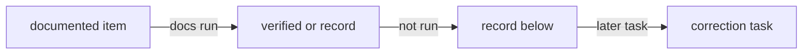
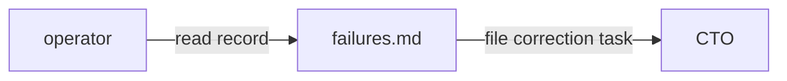

# Verification failures

This file records each docs example that the docs run does not verify end to end. Each record names the item, the exact input, the expected source, what the broker gave, and the date. The CTO turns each record into a correction task.

## Before you start

- Read the row of the connector in [Connectors](../connectors/index.md).
- Each record below covers the send path only. Creation validation runs in the docs run.
- A record is a good result. An unverified claim in a page is not.

## Connector send-path records (DOC-04)

### Kafka send path (2026-10-13)

- Item: `kafka` connector send path.
- Input: `POST /api/v1/connectors` with `bootstrap_servers` `127.0.0.1:9092`, then a publish through a forwarding rule.
- Expected from: the Kafka page of this documentation.
- Broker gave: 201 on creation (or 400 naming the `kafka` feature without the feature build). No record reached a cluster. No cluster ran in the docs run.
- State: not verified.

### PostgreSQL send path (2026-10-13)

- Item: `postgres` connector send path.
- Input: `POST /api/v1/connectors` with `connection_url` `postgresql://u:p@127.0.0.1:5432/db`, then a publish through a forwarding rule.
- Expected from: the PostgreSQL page of this documentation.
- Broker gave: 201 on creation. No row reached a database. No database ran in the docs run.
- State: not verified.

### MySQL send path (2026-10-13)

- Item: `mysql` connector send path.
- Input: `POST /api/v1/connectors` with `connection_url` `mysql://u:p@127.0.0.1:3306/db`, then a publish through a forwarding rule.
- Expected from: the MySQL page of this documentation.
- Broker gave: 201 on creation. No row reached a database. No database ran in the docs run.
- State: not verified.

### MongoDB send path (2026-10-13)

- Item: `mongodb` connector send path.
- Input: `POST /api/v1/connectors` with `connection_string` `mongodb://u:p@127.0.0.1:27017`, then a publish through a forwarding rule.
- Expected from: the MongoDB page of this documentation.
- Broker gave: 201 on creation (or 400 naming the `mongodb` feature without the feature build). No document reached a server. No server ran in the docs run.
- State: not verified.

### Redis send path (2026-10-13)

- Item: `redis` connector send path.
- Input: `POST /api/v1/connectors` with `endpoint` `redis://127.0.0.1:6379` and an `xadd` command, then a publish through a forwarding rule.
- Expected from: the Redis page of this documentation.
- Broker gave: 201 on creation. No command reached a server. No server ran in the docs run.
- State: not verified.

### InfluxDB send path (2026-10-13)

- Item: `influxdb` connector send path.
- Input: `POST /api/v1/connectors` with `endpoint` `http://127.0.0.1:8086`, then a publish through a forwarding rule.
- Expected from: the InfluxDB page of this documentation.
- Broker gave: 201 on creation. No point reached a server. No server ran in the docs run.
- State: not verified.

### ClickHouse send path (2026-10-13)

- Item: `clickhouse` connector send path.
- Input: `POST /api/v1/connectors` with `endpoint` `http://127.0.0.1:8123`, then a publish through a forwarding rule.
- Expected from: the ClickHouse page of this documentation.
- Broker gave: 201 on creation (or 400 naming the `clickhouse` feature without the feature build). No row reached a server. No server ran in the docs run.
- State: not verified.

### MQTT bridge send path (2026-10-13)

- Item: `mqtt_bridge` connector send path.
- Input: `POST /api/v1/connectors` with `broker_address` `mqtt://127.0.0.1:1883`, then a publish through a forwarding rule.
- Expected from: the MQTT bridge page of this documentation.
- Broker gave: 201 on creation. No message reached a remote broker. No remote broker ran in the docs run.
- State: not verified.

### S3 send path (2026-10-13)

- Item: `s3` connector send path.
- Input: `POST /api/v1/connectors` with `endpoint` `http://127.0.0.1:9000`, then a publish through a forwarding rule.
- Expected from: the S3 page of this documentation.
- Broker gave: 201 on creation (or 400 naming the `s3` feature without the feature build). No object reached a store. No store ran in the docs run.
- State: not verified.

### Couchbase send path (2026-11-05)

- Item: `couchbase` connector send path.
- Input: `POST /api/v1/connectors` with `connection_string` `couchbase://127.0.0.1`, bucket `telemetry`, then a publish through a forwarding rule.
- Expected from: the Couchbase page of this documentation.
- Broker gave: 201 on creation (or 400 naming the `couchbase` feature without the feature build). No document reached a cluster. No cluster ran in the docs run.
- State: not verified.

### GCP IoT send path (2026-11-05)

- Item: `gcp_iot` connector send path.
- Input: `POST /api/v1/connectors` with `project_id` `my-iot-project`, `device_id` `edge-7`, then a publish through a forwarding rule.
- Expected from: the GCP IoT page of this documentation.
- Broker gave: 201 on creation (or 400 naming the `gcp_iot` feature without the feature build). No telemetry reached an endpoint. No endpoint ran in the docs run.
- State: not verified.

### GCP Pub/Sub send path (2026-11-05)

- Item: `gcp_pubsub` connector send path.
- Input: `POST /api/v1/connectors` with `project_id` `my-iot-project`, `topic_id` `telemetry-events`, then a publish through a forwarding rule.
- Expected from: the GCP Pub/Sub page of this documentation.
- Broker gave: 201 on creation (or 400 naming the `gcp_pubsub` feature without the feature build). No message reached a topic. No server ran in the docs run.
- State: not verified.

### GreptimeDB send path (2026-11-05)

- Item: `greptimedb` connector send path.
- Input: `POST /api/v1/connectors` with `endpoint` `http://127.0.0.1:4000/v1`, `database` `public`, `table_template` `metrics_${topic_segment_1}`, then a publish through a forwarding rule.
- Expected from: the GreptimeDB page of this documentation.
- Broker gave: 201 on creation. No row reached a server. No server ran in the docs run.
- State: not verified.

## Rule function evaluation records (DOC-04)

### Function call shapes (2026-10-15)

- Item: each `rules/functions.md` call shape except the sample calls.
- Input: `POST /api/v1/rules/test` with `SELECT <call> FROM "sensors/+"`, topic `sensors/kitchen`, payload `{"temperature": 72.5}`.
- Expected from: the call shape column of `rules/functions.md` and the `example` field of `builtin_function_metadata`.
- Broker gave: not run per item. The docs run checks each name against `GET /api/v1/rules/functions` and runs six sample calls (`abs`, `ceil`, `lower`, `upper`, `concat`, `length`). No other call shape ran against the broker.
- State: not verified.

## Next steps

- Verify one record per correction task with a real server.
- Flip the matching row in [Connectors](../connectors/index.md) to `tested end to end` when a repository test proves it.

## Management API records (DOC-02)

Each record names one item whose live call did not run. The page
shows the schema only for these items. The entry carries the
callout "Not verified: see `../_verification/failures.md`".

Drift tests still check each item: the served document matches the
router, and the pages match the served document. Only the live
call is missing.

## `GET /api/v1/clients/{id}`

- Input: `GET /api/v1/clients/1`.
- Expected: one session row. Source: `ClientInfo` in `broker-session`.
- Broker gave: not run. No gate ran this call with a live client.
- Date: 2026-10-13.

## `GET /api/v1/auth/verify_stats`

- Input: `GET /api/v1/auth/verify_stats`.
- Expected: verification counters. Source: served document.
- Broker gave: not run. No gate ran this call.
- Date: 2026-10-13.

## `GET /api/v1/auth/acls`

- Input: `GET /api/v1/auth/acls`.
- Expected: the ordered rule list. Source: served document.
- Broker gave: not run. No gate ran this call.
- Date: 2026-10-13.

## `POST /api/v1/auth/acls`

- Input: `POST /api/v1/auth/acls` with `client_pattern`, `action`, `topic_pattern`, `allow`.
- Expected: 201 with the stored rule. Source: `create_acl` in `broker-api`.
- Broker gave: not run. No gate ran this call.
- Date: 2026-10-13.

## `DELETE /api/v1/auth/acls/{id}`

- Input: `DELETE /api/v1/auth/acls/1`.
- Expected: 204 on success, 404 on an unknown index. Source: `delete_acl` in `broker-api`.
- Broker gave: not run. No gate ran this call.
- Date: 2026-10-13.

## `POST /api/v1/rules/test`

- Input: `POST /api/v1/rules/test` with `sql_query`, `topic`, `payload`.
- Expected: the match result. Source: `test_rule` in `broker-api`.
- Broker gave: not run. No gate ran this call.
- Date: 2026-10-13.

## `GET /api/v1/rules/functions`

- Input: `GET /api/v1/rules/functions`.
- Expected: the function catalogue. Source: served document.
- Broker gave: not run. No gate ran this call.
- Date: 2026-10-13.

## `GET /api/v1/rules/sources`

- Input: `GET /api/v1/rules/sources`.
- Expected: the event source list. Source: served document.
- Broker gave: not run. No gate ran this call.
- Date: 2026-10-13.

## `POST /api/v1/config/validate`

- Input: `POST /api/v1/config/validate` with a candidate snapshot.
- Expected: 200 on a clean candidate, 400 naming offenders. Source: `validate_config` in `broker-api`.
- Broker gave: not run. No gate ran this call.
- Date: 2026-10-13.

## `POST /api/v1/config/diff`

- Input: `POST /api/v1/config/diff` with a candidate snapshot.
- Expected: the redacted setting diff. Source: `diff_config` in `broker-api`.
- Broker gave: not run. No gate ran this call.
- Date: 2026-10-13.

## `POST /api/v1/config/reload`

- Input: `POST /api/v1/config/reload` with a candidate snapshot.
- Expected: the new version with the applied diff. Source: `reload_config` in `broker-api`.
- Broker gave: not run. No gate ran this call.
- Date: 2026-10-13.

## `GET /api/v1/config/history/{id}`

- Input: `GET /api/v1/config/history/1`.
- Expected: one version with `changes` and the redacted snapshot. Source: `get_history_version` in `broker-api`.
- Broker gave: not run. No gate ran this call.
- Date: 2026-10-13.

## `POST /api/v1/config/history/{id}/restore`

- Input: `POST /api/v1/config/history/1/restore`.
- Expected: the restored version with the applied diff. Source: served document.
- Broker gave: not run. No gate ran this call.
- Date: 2026-10-13.

## `GET /api/v1/config/explain`

- Input: `GET /api/v1/config/explain?key=session.max_qos0_backlog`.
- Expected: the effective value with its source layer. Source: served document.
- Broker gave: not run. No gate ran this call.
- Date: 2026-10-13.

## `GET /api/v1/licence/request`

- Input: `GET /api/v1/licence/request`.
- Expected: the licence request. Source: served document.
- Broker gave: not run. No gate ran this call.
- Date: 2026-10-13.

## `POST /api/v1/licence/install`

- Input: `POST /api/v1/licence/install` with a token.
- Expected: 200 on a valid token, 400 on rejection, 409 on identity mismatch. Source: `install_licence` in `broker-api`.
- Broker gave: not run. No valid token exists for a docs run.
- Date: 2026-10-13.

## Command run examples

- Input: one `indramqtt --<flag> <value>` line per flag, one `indra ctl <command>` line per command.
- Expected: the documented behaviour. Source: the command definitions.
- Broker gave: not run per item. Presence of each flag and each command group is checked against live `--help` by the drift tests. The run lines are illustrative.
- Date: 2026-10-13.

## DX-01 command line records (2026-10-15)

The DX-01 verifier runs each CLI example through the real
binary (`indramqtt --help`, `indra ctl <group> --help`).
All 107 CLI items verify. No CLI item holds a failure
record. Each entry of `reference/cli.md` cites its file
under `docs/_verified/cli/`. Wave DX2 owns the other
areas. Their counts come from `entries.py --coverage`.

## DX2-002 item `fn-null`

- Input: rules/test `SELECT null() AS n FROM "sensors/+"` on `sensors/kitchen`.
- Expected: the cased match results in the example.
- Broker gave: `rules/test gave 400: {"error":"invalid sql_query: line 1, column 12: expected keyword FROM"}`.
- Date: 2026-10-17.

## DX2-016 item `action-gcp_pubsub_consumer`

- Input: POST /api/v5/actions type `gcp_pubsub_consumer` name `dx2-action-gcp_pubsub_consumer` wants 201; POST /api/v5/actions type `gcp_pubsub_consumer` name `dx2-action-gcp_pubsub_consumer` wants 400.
- Expected: the cased create results in the example.
- Broker gave: `create gcp_pubsub_consumer/dx2-action-gcp_pubsub_consumer gave 400: {'code': 'BAD_REQUEST', 'message': 'unknown action type: gcp_pubsub_consumer'}`.
- Date: 2026-11-05.

## DX2-017 item `action-test`

- Input: POST /api/v5/actions type `test` name `dx2-action-test` wants 201; POST /api/v5/actions type `test` name `dx2-action-test` wants 400.
- Expected: the cased create results in the example.
- Broker gave: `create test/dx2-action-test gave 400: {'code': 'BAD_REQUEST', 'message': 'unknown action type: test'}`.
- Date: 2026-11-05.

## DX2-019 item `couchbase`

- Input: `python3 docs/_tools/verify.py --area connectors --item couchbase` with `COUCHBASE_URL`, `COUCHBASE_USERNAME`, `COUCHBASE_PASSWORD`, `COUCHBASE_BUCKET` from a real server.
- Expected: the docs run writes `docs/_verified/connectors/couchbase.json` through the broker rule path.
- Broker gave: not run. No server ran in this task. The page checks creation only. The send path stays not verified.
- Date: 2026-11-05.

## DX2-020 item `gcp_iot`

- Input: `python3 docs/_tools/verify.py --area connectors --item gcp_iot` with `GCP_IOT_MQTT_URL`, `GCP_IOT_PRIVATE_KEY_FILE` from a real server.
- Expected: the docs run writes `docs/_verified/connectors/gcp_iot.json` through the broker rule path.
- Broker gave: not run. No server ran in this task. The page checks creation only. The send path stays not verified.
- Date: 2026-11-05.

## DX2-021 item `gcp_pubsub`

- Input: `python3 docs/_tools/verify.py --area connectors --item gcp_pubsub` with `PUBSUB_EMULATOR_HOST`, `PUBSUB_PROJECT`, `PUBSUB_TOPIC`, `PUBSUB_SUBSCRIPTION` from a real server.
- Expected: the docs run writes `docs/_verified/connectors/gcp_pubsub.json` through the broker rule path.
- Broker gave: not run. No server ran in this task. The page checks creation only. The send path stays not verified.
- Date: 2026-11-05.

## DX2-022 item `greptimedb`

- Input: `python3 docs/_tools/verify.py --area connectors --item greptimedb` with `GREPTIMEDB_ENDPOINT`, `GREPTIMEDB_DATABASE`, `GREPTIMEDB_TABLE` from a real server.
- Expected: the docs run writes `docs/_verified/connectors/greptimedb.json` through the broker rule path.
- Broker gave: not run. No server ran in this task. The page checks creation only. The send path stays not verified.
- Date: 2026-11-05.

## DX2-023 item `influxdb`

- Input: `python3 docs/_tools/verify.py --area connectors --item influxdb` with `INFLUXDB_ENDPOINT`, `INFLUXDB_ORG`, `INFLUXDB_BUCKET`, `INFLUXDB_TOKEN` from a real server.
- Expected: the docs run writes `docs/_verified/connectors/influxdb.json` through the broker rule path.
- Broker gave: not run. No server ran in this task. The page checks creation only. The send path stays not verified.
- Date: 2026-11-05.

## DX2-024 item `iotdb`

- Input: `python3 docs/_tools/verify.py --area connectors --item iotdb` with `IOTDB_ENDPOINT`, `IOTDB_USER`, `IOTDB_PASSWORD`, `IOTDB_DEVICE` from a real server.
- Expected: the docs run writes `docs/_verified/connectors/iotdb.json` through the broker rule path.
- Broker gave: not run. No server ran in this task. The page checks creation only. The send path stays not verified.
- Date: 2026-11-06.

## DX2-025 item `kafka`

- Input: `python3 docs/_tools/verify.py --area connectors --item kafka` with `KAFKA_BOOTSTRAP_SERVERS`, `KAFKA_TOPIC` from a real server.
- Expected: the docs run writes `docs/_verified/connectors/kafka.json` through the broker rule path.
- Broker gave: not run. No server ran in this task. The page checks creation only. The send path stays not verified.
- Date: 2026-11-06.

## DX2-026 item `mongodb`

- Input: `python3 docs/_tools/verify.py --area connectors --item mongodb` with `MONGODB_URL`, `MONGODB_DATABASE`, `MONGODB_COLLECTION` from a real server.
- Expected: the docs run writes `docs/_verified/connectors/mongodb.json` through the broker rule path.
- Broker gave: not run. No server ran in this task. The page checks creation only. The send path stays not verified.
- Date: 2026-11-06.

## DX2-027 item `mqtt_bridge`

- Input: `python3 docs/_tools/verify.py --area connectors --item mqtt_bridge` with `MQTT_BRIDGE_URL`, `MQTT_BRIDGE_TOPIC`, `MQTT_BRIDGE_CLIENT_ID` from a real server.
- Expected: the docs run writes `docs/_verified/connectors/mqtt_bridge.json` through the broker rule path.
- Broker gave: not run. No server ran in this task. The page checks creation only. The send path stays not verified.
- Date: 2026-11-06.

## DX2-028 item `mssql`

- Input: `python3 docs/_tools/verify.py --area connectors --item mssql` with `MSSQL_HOST`, `MSSQL_PORT`, `MSSQL_DATABASE`, `MSSQL_TABLE`, `MSSQL_USER`, `MSSQL_PASSWORD` from a real server.
- Expected: the docs run writes `docs/_verified/connectors/mssql.json` through the broker rule path.
- Broker gave: not run. No server ran in this task. The page checks creation only. The send path stays not verified.
- Date: 2026-11-06.

## DX2-029 item `mysql`

- Input: `python3 docs/_tools/verify.py --area connectors --item mysql` with `MYSQL_HOST`, `MYSQL_PORT`, `MYSQL_DATABASE`, `MYSQL_TABLE`, `MYSQL_USER`, `MYSQL_PASSWORD`, `MYSQL_NATIVE_USER` from a real server.
- Expected: the docs run writes `docs/_verified/connectors/mysql.json` through the broker rule path.
- Broker gave: not run. No server ran in this task. The page checks creation only. The send path stays not verified.
- Date: 2026-11-06.

## DX2-030 item `opc_ua`

- Input: `python3 docs/_tools/verify.py --area connectors --item opc_ua` with `OPCUA_ENDPOINT`, `OPCUA_USERNAME`, `OPCUA_PASSWORD` from a real server.
- Expected: the docs run writes `docs/_verified/connectors/opc_ua.json` through the broker rule path.
- Broker gave: not run. No server ran in this task. The page checks creation only. The send path stays not verified.
- Date: 2026-11-06.

## DX2-031 item `opentsdb`

- Input: `python3 docs/_tools/verify.py --area connectors --item opentsdb` with `OPENTSDB_HTTP_URL`, `OPENTSDB_TELNET_ADDR`, `OPENTSDB_QUERY_URL` from a real server.
- Expected: the docs run writes `docs/_verified/connectors/opentsdb.json` through the broker rule path.
- Broker gave: not run. No server ran in this task. The page checks creation only. The send path stays not verified.
- Date: 2026-11-06.
