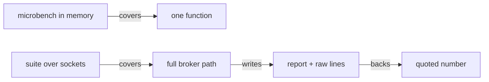

# Benchmarks

This page points to measured results and to the commands that reproduce them. Use it before you quote a number or plan capacity. You get the method, the limits, and the raw data.




Source: `docs/_data/microbench.json`. The script `docs/_tools/render_charts.py` draws the chart. The values come from `BENCHMARKS.md` and `crates/broker-node/benches/broker_throughput.rs`.

| Test | Rate | Unit |
|---|---|---|
| Router hit-path | 3.05 | million lookups/s |
| Router fast-miss | 7.80 | million lookups/s |
| Rule engine ingress | 4.77 | million events/s |

The rates are single-threaded and in memory. They change with the hardware. They are not network values. They are in-process lookup and filter rates, not rates over the network.

## Broker comparison

The [November 14 four-CPU measurements](../../benchmark/2026-11-14.md) cover MQTT 5 throughput and idle-client memory for IndraMQTT and EMQX, plus a repeated MQTT 3.1.1 SQL republish test. The [October 5 one-CPU comparison](../../benchmark/README.md) includes EMQX and rumqttd, its harness, and raw load-step results.

## Microbenchmarks

The router and rule engine microbenchmarks measure one function in one thread, in memory. They are not network values. They change with the hardware. Run them on your hardware:

```sh no-test
# Slow: runs release benchmarks. The example test does not run it.
cargo test --release --bench broker_throughput -- --nocapture
```

The source is `crates/broker-node/benches/broker_throughput.rs`. The method is in `BENCHMARKS.md`. End-to-end loopback results live in `benchmark/`.

## Suite method

The suite in `benchmark/suite` measures one broker on a fixed budget over sockets. It pins 4 cores and bounded memory to the broker. It runs load generators on other cores. It uses 128 B payloads unless a scenario says otherwise. Full detail lives in `benchmark/suite/README.md`.

- Each scenario starts a fresh broker in a container with 4 pinned cores and bounded memory.
- Subscribers connect first and stay for all steps. Each step starts new publishers.
- A step lasts 300 s by default. The first 60 s stay out of the averages.
- Load numbers come from the counters of the broker itself (`GET /api/v5/metrics`). The publish counter of the generator counts each publish twice, so the suite never uses it. The suite subtracts the probe traffic (1000 msg/s in and out).
- A latency probe on its own core sends 1000 msg/s and records end-to-end latency under the main load.
- A step passes on delivery of 90 percent or more, a live broker, no generator limit flag, level memory, level p99 latency, and a drain below 30 s.

| Suite scenario | Content |
|---|---|
| `s1-qos0`, `s1-qos1`, `s1-qos2` | 1000 publishers, 1000 subscribers, 1000 topics, rising rate |
| `s2-payload` | 20000 msg/s inbound, QoS 1, sizes 128 B, 1 KiB, 4 KiB, 8 KiB |
| `s3-fanin` | 2000 publishers, 100 subscribers in 20 shared groups of 5, QoS 1 |
| `s3-fanout` | 10 publishers, 2000 subscribers, 200 per topic, QoS 1 |

## How to run the suite

Set the generator settings first. The suite has no default. A full run takes many hours. Short runs diagnose only and never count as results.

```sh no-test
# Needs Linux, Docker, and 10 or more permitted cores. The example test does not run it.
export LOADGEN_IMAGE=<generator-image>
export LOADGEN_BIN=<generator-binary>
bash benchmark/suite/build-probe.sh
bash benchmark/suite/run_all.sh <source-dir> <commit-label> /tmp/bench-out
```

Run the unit tests of the suite:

```sh no-test
# Needs the suite directory. The example test does not run it.
cd benchmark/suite && python3 -m unittest
```

## How to read the report

`run_all.sh` writes one directory with `<scenario>.jsonl` (one line per step), `<scenario>.csv`, `<scenario>.summary.json`, `all-scenarios.csv`, `env.json`, and `report.html`. Open `report.html` for the page. Read `env.json` for CPU, memory, OS, and core split.

- The recommended load is the step with CPU nearest 75 percent. Steps with a limit flag or delivery below 90 percent do not count.
- A step with flag `generator_limited` shows a generator limit, not a broker limit. Do not use it for a broker claim.
- `delivery_ratio` is delivered messages divided by received messages times the fan-out.
- Limits of the method: each step runs once, the generator shares the machine with the broker, the probe adds 1000 msg/s that the suite subtracts, and latency covers probe pairs only.

## Rules for numbers

Quote a number only with its hardware, its scenario and its repeats. A figure that still rises at cutoff is "still rising at cutoff", never final. Report the slow cases first.

## Check that it works

Start the broker with this file. The health endpoint returns `OK`.

```toml test
[node]
id = "docs-benchmarks"

[listeners.tcp]
bind = "0.0.0.0:1883"

[listeners.api]
bind = "0.0.0.0:18083"

[logging]
level = "warn"
```

```sh test
python3 - <<'PY'
import os, socket
port = int(os.environ.get("API_PORT", "18083"))
sock = socket.create_connection(("127.0.0.1", port), timeout=5)
sock.sendall(b"GET /healthz HTTP/1.0\r\nHost: docs\r\n\r\n")
print(sock.makefile().read().strip().splitlines()[-1])
PY
```

```output
OK
```

## Next steps

- Size a host in [Sizing](../operations/sizing.md).
- Read the full method in `benchmark/suite/README.md`.
