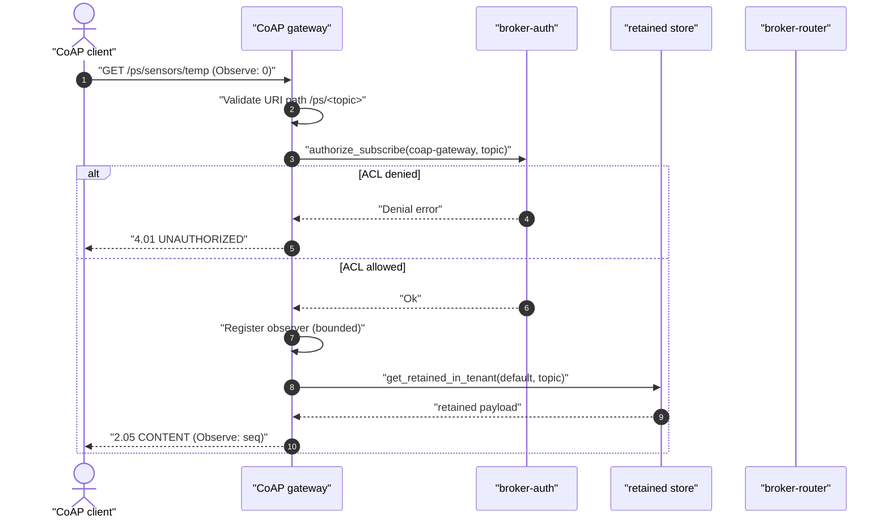

# CoAP gateway

The CoAP gateway translates UDP datagrams into internal MQTT publish and subscribe actions. Use it to connect constrained devices that cannot run a TCP stack or MQTT client. You get one binary that serves CoAP and MQTT with shared access control.



## Before you start

- Install the binaries from [Install](../getting-started/install.md).
- Keep UDP port 5683 free for CoAP traffic.
- Keep ports 1883 and 18083 free for MQTT and API.
- Pick an API key with 16 characters or more.

## Method mapping

The gateway maps CoAP methods on `/ps/<topic>` to MQTT operations.

| CoAP Method | Observe Option | MQTT Action | Access Control | Success Code | Failure Code |
|---|---|---|---|---|---|
| `GET` | Absent | Read retained | Subscribe (`coap-gateway`) | `2.05 CONTENT` | `4.01 UNAUTHORIZED` / `4.04 NOT FOUND` |
| `GET` | `0` (register) | Observe topic | Subscribe (`coap-gateway`) | `2.05 CONTENT` | `4.01 UNAUTHORIZED` |
| `POST` / `PUT` | Any | Publish retained | Publish (`coap-gateway`) | `2.04 CHANGED` | `4.01 UNAUTHORIZED` |
| `DELETE` | Any | Clear retained | Publish (`coap-gateway`) | `2.02 DELETED` | `4.01 UNAUTHORIZED` |

> [!NOTE]
> The gateway bounds observer memory to 65536 total entries across all topics. It caps each topic at 32 observers. When the table reaches capacity, the gateway rejects observer registration. It then serves the request as a standard read without the Observe option.

## Minimal example

This file enables TCP, the API listener, and default settings.

```toml test
[node]
id = "docs-coap-gateway"

[listeners.tcp]
bind = "0.0.0.0:1883"

[listeners.api]
bind = "0.0.0.0:18083"

[logging]
level = "warn"

[auth]
allow_anonymous = true
```

The gateway listener binds a dedicated UDP socket. Add `[gateway]` to your configuration.

```toml no-test
# CoAP gateway requires a dedicated UDP bind address.
[gateway]
coap_bind = "0.0.0.0:5683"
```

## Check that it works

Validate the configuration directory before you start. The command prints `ok`.

```sh test
"${INDRAMQTT_BIN:-indramqtt}" --config-dir "${DOCS_CFG_DIR:-./docs-start}" --check-config
```

```output
ok
```

Configure access rules for the CoAP gateway using the management API. The call returns 201.

```sh test
python3 - <<'PY'
import json, os, urllib.request
port = os.environ.get("API_PORT", "18083")
key = os.environ["API_KEY"]

def call(method, path, body=None):
    req = urllib.request.Request(
        f"http://127.0.0.1:{port}{path}",
        data=None if body is None else json.dumps(body).encode(),
        method=method,
        headers={"Authorization": f"Bearer {key}", "Content-Type": "application/json"},
    )
    with urllib.request.urlopen(req, timeout=5) as res:
        return res.status

status = call("POST", "/api/v1/auth/acls",
              {"client_pattern": "coap-gateway", "action": "subscribe",
               "topic_pattern": "coap/telemetry", "allow": True})
assert status == 201
print(status)
PY
```

```output
201
```

## Limits

- `MAX_COAP_OBSERVERS` caps total observers at 65536 entries.
- `MAX_OBSERVED_TOPICS` caps distinct observed topics at 2048.
- `MAX_OBSERVERS_PER_TOPIC` caps observers on a single topic at 32.
- The CoAP gateway serves the default tenant only. Requests cannot access other tenants.
- Requests with invalid topic syntax return `4.00 BAD REQUEST`.

## Next steps

- Configure authentication with [Authentication](../security/authentication.md).
- Enforce access control rules with [Authorization](../security/authorization.md).
- Inspect listeners with [Listeners](./listeners.md).
- See every setting in the [settings reference](../reference/settings.md).
