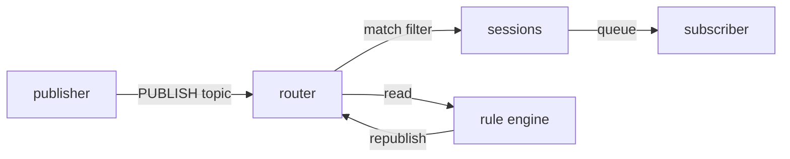

# Concepts

One process does all broker work. It holds the client sockets and it routes, stores and rules each message. There is no second process.



## Topics

A publisher sends to a topic such as `factory/line-1/heat`. A subscriber registers a filter. `+` stands for one level. `#` stands for the rest. `factory/+/heat` gets heat from each line. `factory/#` gets all factory data.

## Delivery classes

QoS 0 sends at most once. QoS 1 sends at least once. QoS 2 sends exactly once. The publisher selects the class for each message.

## Sessions

A session holds subscriptions, unacknowledged messages and the offline queue. A durable session stays after a disconnect and resumes on the next connect. A clean session starts empty. The offline queue has a bound. See `session.max_offline_queue` in the [settings reference](../reference/settings.md).

## Retained messages

A publisher marks a message as retained. The broker keeps the last retained message of each topic. A new subscriber gets it at once.

## Last will

A client registers a will at connect. The broker publishes the will if the client drops without a clean disconnect.

## Shared subscriptions

Many clients share one subscription with `$share/<group>/<filter>`. Each message reaches one member of the group.

## Delayed messages

A publish to `$delayed/<seconds>/<topic>` arrives after the delay. The delay has an upper bound. See `delayed.max_secs` in the [settings reference](../reference/settings.md).

## Check that it works

Start the broker with this file. It allows anonymous clients. See [First start](../getting-started/first-start.md) for the start command.

```toml test
[node]
id = "docs-concepts"

[listeners.tcp]
bind = "0.0.0.0:1883"

[listeners.api]
bind = "0.0.0.0:18083"

[logging]
level = "warn"

[auth]
allow_anonymous = true

[session]
max_offline_queue = 50000
```

Subscribe to `docs/hello`. Publish `hello-docs` to it. The subscriber prints the payload.

```sh test
python3 - <<'PY'
import os, socket, struct
mqtt_port = int(os.environ.get("MQTT_PORT", "1883"))

def packet(kind, body):
    return bytes([kind, len(body)]) + body

def field(data):
    return struct.pack(">H", len(data)) + data

def connect(sock, client_id):
    sock.sendall(packet(0x10, b"\x00\x04MQTT\x04\x02\x00\x3c" + field(client_id)))
    assert sock.recv(4) == b"\x20\x02\x00\x00"

topic = b"docs/hello"
sub = socket.create_connection(("127.0.0.1", mqtt_port), timeout=5)
connect(sub, b"docs-sub")
sub.sendall(packet(0x82, b"\x00\x01" + field(topic) + b"\x00"))
assert sub.recv(5)[:1] == b"\x90"
pub = socket.create_connection(("127.0.0.1", mqtt_port), timeout=5)
connect(pub, b"docs-pub")
pub.sendall(packet(0x30, field(topic) + b"hello-docs"))
sub.settimeout(5)
print(sub.recv(100).split(topic)[-1].decode())
PY
```

```output
hello-docs
```
