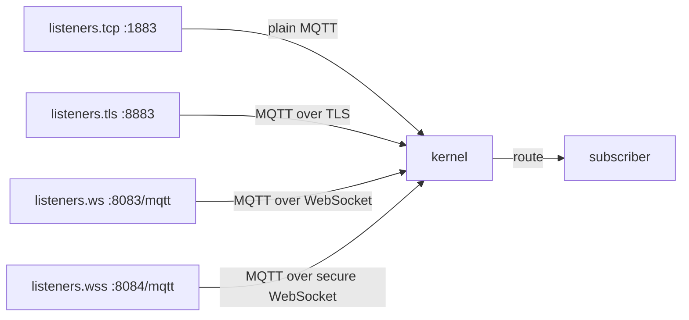

# Listeners

The broker serves MQTT on four listeners. Use TCP inside a trusted network. Use TLS or secure WebSocket on an open network. You get one binary with all four.



## Before you start

- Install the binaries from [Install](../getting-started/install.md).
- Keep ports 1883, 8083 and 18083 free.
- Pick an API key with 16 characters or more.

## The four listeners

| Listener | Setting | Default | Use it when |
|---|---|---|---|
| TCP | `listeners.tcp` | On, `0.0.0.0:1883` | Clients run inside a trusted network. |
| TLS | `listeners.tls` | Off, `0.0.0.0:8883` | Clients cross an open network. |
| WebSocket | `listeners.ws` | On, `0.0.0.0:8083`, path `/mqtt` | Clients run in a browser. |
| Secure WebSocket | `listeners.wss` | Off, `0.0.0.0:8084`, path `/mqtt` | Browser clients cross an open network. |

> **Warning:** Browsers cannot open raw sockets. A browser client needs WebSocket or secure WebSocket.

## Minimal example

This file enables TCP and WebSocket. These are the defaults.

```toml test
[node]
id = "docs-listeners"

[listeners.tcp]
bind = "0.0.0.0:1883"

[listeners.ws]
bind = "0.0.0.0:8083"
path = "/mqtt"

[listeners.api]
bind = "0.0.0.0:18083"

[logging]
level = "warn"

[auth]
allow_anonymous = true
```

A secure listener needs certificate files. The broker refuses to start without them. See [TLS](../security/tls.md) for the TLS file and [Pre-shared keys](../security/psk.md) for the PSK file.

```toml no-test
# Needs certificate files on disk. The docs test boots without them.
[listeners.tls]
enabled = true
bind = "0.0.0.0:8883"
cert_file = "/etc/indramqtt/server.pem"
key_file = "/etc/indramqtt/server.key"
```

## Check that it works

Validate the directory before you start. The command prints `ok`.

```sh test
"${INDRAMQTT_BIN:-indramqtt}" --config-dir "${DOCS_CFG_DIR:-./docs-start}" --check-config
```

```output
ok
```

Subscribe to `docs/listeners`. Publish `hello-listeners` to it. The subscriber prints the payload.

```sh test
python3 - <<'PY'
import os, socket, struct
mqtt_port = int(os.environ.get("MQTT_PORT", "1883"))

def packet(kind, body):
    return bytes([kind, len(body)]) + body

def field(data):
    return struct.pack(">H", len(data)) + data

def connect(sock, client_id):
    sock.sendall(packet(0x10, b"\x00\x04MQTT\x04\x02\x00\x3c" + field(client_id)))
    assert sock.recv(4) == b"\x20\x02\x00\x00"

topic = b"docs/listeners"
sub = socket.create_connection(("127.0.0.1", mqtt_port), timeout=5)
connect(sub, b"docs-listeners-sub")
sub.sendall(packet(0x82, b"\x00\x01" + field(topic) + b"\x00"))
assert sub.recv(5)[:1] == b"\x90"
pub = socket.create_connection(("127.0.0.1", mqtt_port), timeout=5)
connect(pub, b"docs-listeners-pub")
pub.sendall(packet(0x30, field(topic) + b"hello-listeners"))
sub.settimeout(5)
print(sub.recv(100).split(topic)[-1].decode())
PY
```

```output
hello-listeners
```

## Limits

- `listeners.tcp.max_connections` caps concurrent TCP clients. Default is 1000000. One million connections fits a large single-node deployment.
- `listeners.tcp.backlog` caps pending accepts. Default is 1024. 1024 pending accepts absorb connection bursts.
- `session.max_packet_size` caps each packet in bytes. Default is 1048576. 1 MiB matches the server limit.
- A secure listener without certificate files refuses startup. It logs the missing setting.

## Next steps

- Guard the listeners with [TLS](../security/tls.md) or [Pre-shared keys](../security/psk.md).
- Add users with [Authentication](../security/authentication.md).
- See every setting in the [settings reference](../reference/settings.md).
