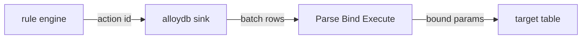
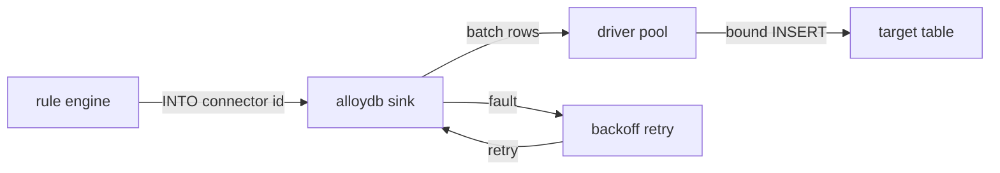

# AlloyDB connector

The AlloyDB connector runs one statement per batch. It speaks the PostgreSQL wire protocol with the maintained driver, including bound parameters. It pools one session per `pool_size` entry.

Use it when AlloyDB must hold telemetry. You get one parse per batch with your own statement.



## Before you start

- Run AlloyDB. Note the host, database, and user.
- Create the target table. Match its columns to the statement.
- This kind ships in the default build. No feature flag is necessary.

## Settings

Set connector `type` to `alloydb`.

| Setting | Required | Meaning |
|---|---|---|
| `server` | yes | `Host[:Port]`. Default port is 5432. |
| `database` | yes | Database name. |
| `username` | yes | Database user. |
| `password` | no | Database password. Accepts `file:` and `env:` references. |
| `pool_size` | no | Server sessions. Default is 8. Range is 1 to 1024. |
| `ssl` | no | `{"enable": true}` uses TLS with the system roots. `verify_none` is refused. |
| `disable_prepared_statements` | no | Only `false` is accepted. Every send prepares. |
| `application_name` | no | Must be absent. The runtime never stamps it. |

Set action `type` to `alloydb` and `parameters.sql` to the statement.

| Marker | Value |
|---|---|
| `$1` | Topic. |
| `$2` | QoS. |
| `$3` | Payload. |

The statement must name at least one marker from `$1` to `$3`. Values bind out of band. A quote in a value never escapes into the text.

Example:

```json
{
  "name": "adb-sink-1",
  "type": "alloydb",
  "connector": "adb-conn-1",
  "parameters": {
    "sql": "INSERT INTO t_mqtt_msg(topic, qos, payload) VALUES ($1, $2, $3)"
  }
}
```

> [!NOTE]
> The docs run creates this shape. Creation validates only; it touches no database. The send path needs an AlloyDB instance.

## Check that it works

Create the connector and the action. The broker answers 201 for each.

```toml test
[node]
id = "docs-connector-alloydb"

[listeners.tcp]
bind = "0.0.0.0:1883"

[listeners.api]
bind = "0.0.0.0:18083"

[logging]
level = "warn"

[auth]
allow_anonymous = true
```

```sh test
python3 - <<'PY'
import json, os, urllib.request
port = os.environ.get("API_PORT", "18083")
key = os.environ["API_KEY"]
def call(method, path, body=None):
    import urllib.error
    req = urllib.request.Request(
        f"http://127.0.0.1:{port}{path}",
        data=json.dumps(body).encode() if body is not None else None,
        method=method,
        headers={"Authorization": f"Bearer {key}", "Content-Type": "application/json"})
    try:
        with urllib.request.urlopen(req, timeout=5) as res:
            assert res.status in (200, 201, 204), res.status
            return json.load(res) if res.status != 204 else {}
    except urllib.error.HTTPError as e:
        assert e.code == 404, e.code
        return {}
call("DELETE", "/api/v5/actions/adb-sink-1")
call("DELETE", "/api/v5/connectors/adb-conn-1")
conn = call("POST", "/api/v5/connectors", {"name": "adb-conn-1", "type": "alloydb",
    "server": "127.0.0.1:5432", "database": "db", "username": "u"})
assert conn["type"] == "alloydb", conn
act = call("POST", "/api/v5/actions", {"name": "adb-sink-1", "type": "alloydb",
    "connector": "adb-conn-1",
    "parameters": {"sql": "INSERT INTO t(topic) VALUES ($1)"}})
print(act["status"])
PY
```

```output
disconnected
```

## Limits

- A missing `server`, `database`, or `username` is refused with 400 and names the field.
- A missing `parameters.sql` is refused with 400.
- `ssl.verify_none` and custom TLS files are refused with 400.
- A dead server counts each fire as failed. The broker keeps serving.

## Next steps

- Feed the action from a rule in [Actions](../rules/actions.md).
- See every kind in [Connectors](./index.md).

## Reference form (v1 API)

The reference form uses the v1 connector API. The v5 form above uses connector and action documents. This section keeps the reference page.

The AlloyDB connector writes each rule result as one table row. It sends bound parameters through the maintained driver with one round trip per row. It buffers rows and flushes full or stale batches.

Use it when relational rows must land in AlloyDB tables. You get one insert per row in each batch with your own column mapping.



### Before you start

- Run an AlloyDB instance or a compatible PostgreSQL endpoint. Note the host and the database.
- Create the target table with the mapped columns.
- This kind ships in the default build. No feature flag is necessary.

### Settings

Set `kind` to `alloydb`. The broker also accepts `google_alloydb` and `alloy_db`. It stores the kind as `alloydb`.

| Setting | Required | Meaning |
|---|---|---|
| `host` | yes | Instance IP or host name. An empty value is refused. |
| `port` | no | Port. Default 5432. |
| `database` | yes | Database name. An empty value is refused. |
| `username` | yes | Database user. An empty value is refused. |
| `auth` | yes | Object with `type` `password`, `iam_token`, or `iam_auto`. A `password` needs a non-empty `password`. An `iam_token` needs a non-empty `token`. An `iam_auto` fetches a short-lived token at connect time. |
| `table` | yes | Target table name. An empty value is refused. |
| `column_mappings` | no | Array of `source_field` to `db_column` rows with an optional `data_type` hint. Default is none. |
| `batch_size` | no | Rows per batch. Default 1000. |
| `buffer_capacity` | no | Accepted. The sink build does not read it as a bound. |
| `timeout_ms` | no | Connect and query deadline. Default 5000. Minimum 1. |
| `tls` | no | Use TLS. Default true. Set false only for a local endpoint without certificates. |
| `ca_bundle_pem` | no | Extra CA bundle in PEM form. It must hold `BEGIN CERTIFICATE` when set. |
| `tls_ca_file` | no | Path to a PEM bundle file. An empty value is refused. |

Example:

```json
{
  "id": "alloydb-1",
  "kind": "alloydb",
  "config": {
    "host": "10.0.0.1",
    "port": 5432,
    "database": "telemetry",
    "username": "postgres",
    "auth": {"type": "password", "password": "secret"},
    "table": "readings",
    "column_mappings": [{"source_field": "device_id", "db_column": "device_id"}],
    "batch_size": 100,
    "timeout_ms": 5000
  }
}
```

> [!NOTE]
> The docs run creates this shape. Creation validates only; it opens no socket. The send path needs an AlloyDB instance. See the failure record in [Verification failures](../_verification/failures.md).

### Check that it works

Create the connector. The broker answers 201 with the kind.

```toml test
# Reference form run.
[node]
id = "docs-connector-alloydb"

[listeners.tcp]
bind = "0.0.0.0:1883"

[listeners.api]
bind = "0.0.0.0:18083"

[logging]
level = "warn"

[auth]
allow_anonymous = true
```

```sh test
python3 - <<'PY'
import json, os, urllib.request
port = os.environ.get("API_PORT", "18083")
key = os.environ["API_KEY"]
body = json.dumps({"id": "alloydb-1", "kind": "alloydb",
                   "config": {"host": "10.0.0.1",
                              "port": 5432,
                              "database": "telemetry",
                              "username": "postgres",
                              "auth": {"type": "password", "password": "secret"},
                              "table": "readings",
                              "batch_size": 100,
                              "timeout_ms": 5000}}).encode()
req = urllib.request.Request(
    f"http://127.0.0.1:{port}/api/v1/connectors", data=body, method="POST",
    headers={"Authorization": f"Bearer {key}", "Content-Type": "application/json"})
with urllib.request.urlopen(req, timeout=5) as res:
    assert res.status == 201
    print(json.load(res)["kind"])
PY
```

```output
alloydb
```

### Limits

- An empty `host`, `database`, `username`, or `table` is refused with 400.
- An empty `password` or a blank `iam_token` is refused with 400.
- A `ca_bundle_pem` without `BEGIN CERTIFICATE` is refused with 400. An empty `tls_ca_file` is refused with 400.
- The production path uses `PgDriverAlloydbTransport` through the maintained driver. The memory transport serves offline unit tests only.
- A wrong password fails closed with a connection error.
- A failed flush restores rows in order and backs off. Backoff waits 2s, then doubles to 30s. Flushes fail fast during backoff.
- The connect deadline is 5 seconds. The statement deadline is 5 seconds.
- The connector runs behind the rule engine bounded queue. A slow server sheds load; it never stalls publishers.
- The tier is enterprise. The kind ships in the default build.

### Next steps

- Feed the connector from a rule in [Actions](../rules/actions.md).
- See every kind in [Connectors](./index.md).

## Known limits in this release

The broker accepts the fields in this list. The broker does not apply them in this release.

- `batch_size` (the batch size)
- `batch_timeout_ms` (the batch wait time)

To set batching, use `resource_opts` in the action. The broker applies `resource_opts`.

A later release applies these fields.
