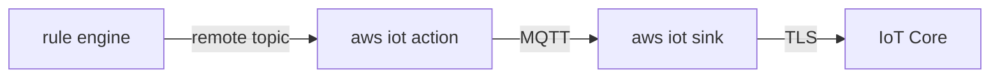

# AWS IoT connector

The AWS IoT connector bridges rule results to AWS IoT Core topics over mutual TLS.

Use it for device telemetry in AWS. The action names the remote topic.



## Status

This kind is pending. The reference 6.3.0 has no schema for it, and the CEO kept it out of the MVP on 2026-11-08.
The broker refuses connector and action create and update with `400 BAD_REQUEST`.
A stored record does not start and reports `disconnected`.
The driver code stays in the tree for a later decision.

## Before you start

- Create an IoT thing with certificates.
- Keep the client certificate and key.
- The kind is pending, so the broker answers 400 for every create.

## Settings

| Connector setting | Required | Meaning |
|---|---|---|
| `endpoint` | yes | IoT endpoint host with port. |
| `region` | no | AWS region. Default `us-east-1`. |
| `client_id` | no | Bridge client ID. Default `indra-bridge`. |
| `client_cert_pem` | yes | Client certificate. |
| `client_key_pem` | yes | Client key. |

| Action setting | Required | Meaning |
|---|---|---|
| `remote_topic` | yes | Remote topic template. |

Example action:

```json
{
  "name": "aws-iot-events",
  "type": "aws_iot",
  "connector": "aws-iot-local",
  "parameters": {
    "remote_topic": "aws/telemetry/device-1"
  }
}
```

## QoS mapping

- Ingress QoS 0 stays 0 on egress.
- Ingress QoS 1 stays 1 on egress.
- Ingress QoS 2 downgrades to 1 on egress.
- QoS 0 is fire-and-forget with no PUBACK.
- QoS 1 waits for PUBACK.
- A dead server counts one failed forward for QoS 1.

## Limits

- A missing certificate or topic answers 400 and names the field.
- SigV4 WebSocket has no transport and is refused.
- Live qualification is not planned while the kind is pending.

## Next steps

- Feed the connector from a rule in [Actions](../rules/actions.md).
- See every kind in [Connectors](./index.md).

## Check that it works

Create the connector with test material. The broker answers 400 and prints `ok`.

```toml test
[node]
id = "docs-connector-aws-iot"

[listeners.tcp]
bind = "0.0.0.0:1883"

[listeners.api]
bind = "0.0.0.0:18083"

[logging]
level = "warn"

[auth]
allow_anonymous = true
```

```sh test
python3 - <<'PY'
import json, os, urllib.request
port = os.environ.get("API_PORT", "18083")
key = os.environ["API_KEY"]
body = json.dumps({"name": "docs-awsiot-1", "type": "aws_iot",
                   "endpoint": "127.0.0.1:8883", "client_cert_pem": "cert",
                   "client_key_pem": "key"}).encode()
req = urllib.request.Request(
    f"http://127.0.0.1:{port}/api/v5/connectors", data=body, method="POST",
    headers={"Authorization": f"Bearer {key}", "Content-Type": "application/json"})
try:
    with urllib.request.urlopen(req, timeout=5) as res:
        status, created = res.status, json.load(res)
except urllib.error.HTTPError as err:
    status, created = err.code, json.load(err)
assert status == 400, (status, created)
assert "aws_iot" in created["message"], created
print("ok")
PY
```

```output
ok
```
