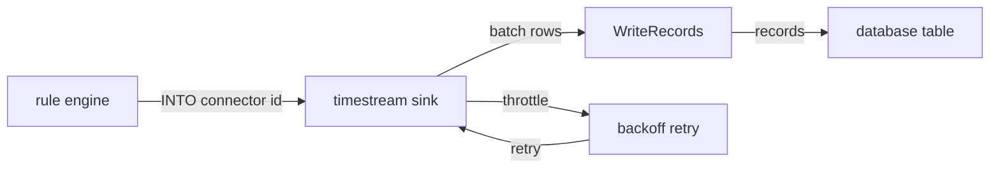

# AWS Timestream connector

The AWS Timestream connector writes each rule result as one Timestream record. It batches rows into `WriteRecords` calls with typed measures. It buffers rows and flushes full or stale batches.

Use it when metrics must land in Timestream tables. You get one record per result row with your own dimensions and measure mapping.



## Before you start

- Note the Timestream `database_name`, `table_name`, and `region`.
- Keep an access key id and a secret access key.
- This kind ships in the default build. No feature flag is necessary.

## Settings

Set `kind` to `aws_timestream`. The broker also accepts `timestream` and `ts`. It stores the kind as `timestream`.

| Setting | Required | Meaning |
|---|---|---|
| `database_name` | yes | Timestream database name. An empty value is refused. |
| `table_name` | yes | Timestream table name. An empty value is refused. |
| `region` | yes | AWS region. An empty value is refused. |
| `endpoint` | no | Custom ingest endpoint. It must start with `http://` or `https://`. Default is `https://ingest.timestream.{region}.amazonaws.com`. |
| `access_key_id` | yes | AWS access key id. An empty value is refused. |
| `secret_access_key` | yes | AWS secret access key. An empty value is refused. |
| `session_token` | no | STS session token for temporary credentials. Default is none. |
| `dimensions` | no | Dimension templates with `${topic}`, `${client_id}`, `${qos}`, `${timestamp}`, and `${payload.<field>}`. Default is none. An empty name is refused. |
| `time_unit` | no | `milliseconds`, `microseconds`, or `nanoseconds`. Default is `milliseconds`. |
| `measure_name_template` | no | Measure name template. Default is `metrics`. |
| `multi_measure_mappings` | no | Payload field to measure type (`DOUBLE`, `BIGINT`, `BOOLEAN`, `VARCHAR`, `TIMESTAMP`). Default is none. A bad type is refused. |
| `batch_size` | no | Records per `WriteRecords` call. Default 100. A value of 0 is refused. |
| `batch_bytes` | no | Batch byte limit. Default 1048576. A value of 0 is refused. |
| `linger_ms` | no | Linger before a partial batch flushes. Default 20. |
| `max_retries` | no | Retries on throttles and partials. Default 4. `null` means no limit. |
| `initial_backoff_ms` | no | First retry delay. Default 100. Minimum 1. |
| `max_backoff_ms` | no | Retry delay ceiling. Default 2500. Minimum 1. |
| `timeout_ms` | no | Request deadline. Default 5000. Minimum 1. |

Example:

```json
{
  "id": "ts-1",
  "kind": "aws_timestream",
  "config": {
    "database_name": "iot_database",
    "table_name": "telemetry",
    "region": "us-east-1",
    "access_key_id": "AKID",
    "secret_access_key": "secret",
    "dimensions": {},
    "time_unit": "milliseconds",
    "multi_measure_mappings": {"temperature": "DOUBLE"},
    "batch_size": 50,
    "batch_bytes": 65536,
    "linger_ms": 20,
    "max_retries": 2,
    "initial_backoff_ms": 10,
    "max_backoff_ms": 100
  }
}
```

> [!NOTE]
> The docs run creates this shape. Creation validates only; it writes no record. The send path needs a Timestream endpoint. The service is closed to new customers. See the failure record in [Verification failures](../_verification/failures.md).

## Check that it works

Create the connector. The broker answers 201 with the stored kind `timestream`.

```toml test
[node]
id = "docs-connector-aws-timestream"

[listeners.tcp]
bind = "0.0.0.0:1883"

[listeners.api]
bind = "0.0.0.0:18083"

[logging]
level = "warn"

[auth]
allow_anonymous = true
```

```sh test
python3 - <<'PY'
import json, os, urllib.request
port = os.environ.get("API_PORT", "18083")
key = os.environ["API_KEY"]
body = json.dumps({"id": "ts-1", "kind": "aws_timestream",
                   "config": {"database_name": "iot_database",
                              "table_name": "telemetry",
                              "region": "us-east-1",
                              "access_key_id": "AKID",
                              "secret_access_key": "secret",
                              "dimensions": {},
                              "time_unit": "milliseconds",
                              "multi_measure_mappings": {"temperature": "DOUBLE"},
                              "batch_size": 50,
                              "batch_bytes": 65536,
                              "linger_ms": 20,
                              "max_retries": 2,
                              "initial_backoff_ms": 10,
                              "max_backoff_ms": 100}}).encode()
req = urllib.request.Request(
    f"http://127.0.0.1:{port}/api/v1/connectors", data=body, method="POST",
    headers={"Authorization": f"Bearer {key}", "Content-Type": "application/json"})
with urllib.request.urlopen(req, timeout=5) as res:
    assert res.status == 201
    print(json.load(res)["kind"])
PY
```

```output
timestream
```

## Limits

- An empty `database_name`, `table_name`, `region`, or `access_key_id` is refused with 400. An empty `secret_access_key` is refused with 400.
- An `endpoint` outside `http://` and `https://` is refused with 400.
- An empty dimension name is refused with 400. An empty measure field is refused with 400. A measure type outside the five allowed values is refused with 400.
- A `batch_size` of 0 is refused with 400. A `batch_bytes` of 0 is refused with 400.
- The production path uses `HttpTimestreamTransport` through the maintained HTTP client. The memory transport serves offline unit tests only.
- A row with no measures fails the batch with a dispatch error. A bad timestamp or a bad scalar fails the row.
- A throttled batch retries with backoff. A rejected batch restores rows in order and backs off. Backoff starts at 100ms and caps at 2500ms.
- The connector runs behind the rule engine bounded queue. A slow endpoint sheds load; it never stalls publishers.
- The tier is enterprise. The kind ships in the default build. The live service stays not verified for this task.

## Next steps

- Feed the connector from a rule in [Actions](../rules/actions.md).
- See every kind in [Connectors](./index.md).
