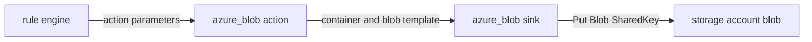

# Azure Blob Storage connector

The Azure Blob connector writes one blob for each rule result. It signs each request with the storage account shared key.

Use it when cold storage must keep telemetry files in Azure. You get one blob under the container and blob name that the action names.



## Before you start

- Create a storage account and a container.
- Note the account name and the account key.
- For a full build, enable `--features azure_blob`. The default build answers 400 and names the feature.

## Settings

The connector holds the account. The action holds the container and blob name.

| Connector setting | Required | Meaning |
|---|---|---|
| `account_name` | yes | Storage account name. |
| `account_key` | yes | Base64 storage account key. |
| `endpoint` | no | Custom endpoint, for example a local emulator. |

| Action setting | Required | Meaning |
|---|---|---|
| `container` | yes | Target container. |
| `blob` | yes | Blob name template. |
| `content` | no | Only the documented default `${.}` is supported. |

Example action:

```json
{
  "name": "azure-cold",
  "type": "azure_blob_storage",
  "connector": "azure-account",
  "parameters": {"container": "telemetry", "blob": "event/${topic}/${timestamp}.json"}
}
```

## Limits

- A missing account, key, container or blob answers 400 and names the field.
- A custom `content`, `headers` or ACL value is refused. The driver writes the projected event body.
- The data path keeps the action key, the container and the blob from the action. It invents no target.

## Next steps

- Feed the connector from a rule in [Actions](../rules/actions.md).
- See every kind in [Connectors](./index.md).

## Check that it works

Create the connector. The broker answers 201 with the kind when the build holds the feature, else 400 names it. Both answers print `ok`.

```toml test
[node]
id = "docs-connector-azure-blob"

[listeners.tcp]
bind = "0.0.0.0:1883"

[listeners.api]
bind = "0.0.0.0:18083"

[logging]
level = "warn"

[auth]
allow_anonymous = true
```

```sh test
python3 - <<'PY'
import json, os, urllib.request
port = os.environ.get("API_PORT", "18083")
key = os.environ["API_KEY"]
body = json.dumps({"name": "docs-azure-1", "type": "azure_blob",
                   "account_name": "mydeviceblobs", "account_key": "YUtJRA=="}).encode()
req = urllib.request.Request(
    f"http://127.0.0.1:{port}/api/v5/connectors", data=body, method="POST",
    headers={"Authorization": f"Bearer {key}", "Content-Type": "application/json"})
try:
    with urllib.request.urlopen(req, timeout=5) as res:
        status, created = res.status, json.load(res)
except urllib.error.HTTPError as err:
    status, created = err.code, json.load(err)
assert status in (201, 400), (status, created)
if status == 201:
    assert created["type"] == "azure_blob", created
else:
    assert "azure" in created["message"], created
print("ok")
PY
```

```output
ok
```
