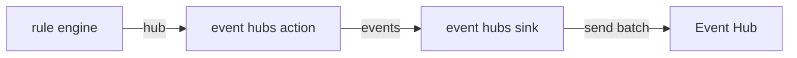

# Azure Event Hubs connector

The Azure Event Hubs connector sends rule results as events in one hub.

Use it for event streaming in Azure. The action names the hub.



## Before you start

- Create a namespace and hub.
- Create a SAS policy with send access.
- For a full build, enable `--features azure_eventhubs`. The default build answers 400 and names the feature.

## Settings

| Connector setting | Required | Meaning |
|---|---|---|
| `namespace` | yes | Service Bus namespace. |
| `endpoint` | no | Override. Absent means the namespace host. |
| `shared_access_key_name` | yes | SAS policy name. |
| `shared_access_key` | yes | SAS key. |
| `timeout` | no | Request timeout in milliseconds. |
| `authentication` | no | Reference form. `password` holds the namespace connection string. |
| `bootstrap_hosts` | no | Reference form. Names the namespace host and port. |
| `ssl` | no | Reference form. An empty object selects the TLS default. |

The broker derives the namespace and SAS pair from `authentication`,
`bootstrap_hosts` or the flat fields. The flat fields stay valid.

| Action setting | Required | Meaning |
|---|---|---|
| `event_hub` | yes | Target hub. |
| `partition_key` | no | Partition key template. |
| `user_properties` | no | Custom application properties with template values. |

Example action:

```json
{
  "name": "hub-events",
  "type": "azure_eventhubs",
  "connector": "hub-local",
  "parameters": {
    "event_hub": "hub-a"
  }
}
```

## Limits

- A missing namespace, key or hub answers 400 and names the field.
- A failed batch counts one failed forward on the action.
- Live qualification runs at release. This build proves delivery with a loopback fake.

## Next steps

- Feed the connector from a rule in [Actions](../rules/actions.md).
- See every kind in [Connectors](./index.md).

## Check that it works

Create the connector. The broker answers 201 with the kind when the build holds the feature, else 400 names it. Both answers print `ok`.

```toml test
[node]
id = "docs-connector-azure-event-hubs"

[listeners.tcp]
bind = "0.0.0.0:1883"

[listeners.api]
bind = "0.0.0.0:18083"

[logging]
level = "warn"

[auth]
allow_anonymous = true
```

```sh test
python3 - <<'PY'
import json, os, urllib.request
port = os.environ.get("API_PORT", "18083")
key = os.environ["API_KEY"]
body = json.dumps({"name": "docs-azeh-1", "type": "azure_eventhubs",
                   "namespace": "ns-1", "endpoint": "http://127.0.0.1:5672",
                   "shared_access_key_name": "send",
                   "shared_access_key": "secret"}).encode()
req = urllib.request.Request(
    f"http://127.0.0.1:{port}/api/v5/connectors", data=body, method="POST",
    headers={"Authorization": f"Bearer {key}", "Content-Type": "application/json"})
try:
    with urllib.request.urlopen(req, timeout=5) as res:
        status, created = res.status, json.load(res)
except urllib.error.HTTPError as err:
    status, created = err.code, json.load(err)
assert status in (201, 400), (status, created)
if status == 201:
    assert created["type"] == "azure_event_hub_producer", created
else:
    assert "azure" in created["message"], created
print("ok")
PY
```

```output
ok
```
