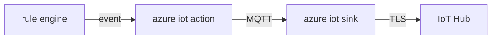

# Azure IoT connector

The Azure IoT connector sends rule results as device telemetry to an IoT Hub.

Use it for device telemetry in Azure. The hub topic is fixed by the device.



## Status

This kind is pending. The reference 6.3.0 has no schema for it, and the CEO kept it out of the MVP on 2026-11-08.
The broker refuses connector and action create and update with `400 BAD_REQUEST`.
A stored record does not start and reports `disconnected`.
The driver code stays in the tree for a later decision.

## Before you start

- Create an IoT Hub and device.
- Keep the SAS key.
- The kind is pending, so the broker answers 400 for every create.

## Settings

| Connector setting | Required | Meaning |
|---|---|---|
| `iot_hub_name` | yes | Hub host with port. |
| `device_id` | yes | Device ID. |
| `shared_access_key` | yes | SAS key. |

The action carries no target field. The device fixes the hub topic.

Example action:

```json
{
  "name": "azure-iot-events",
  "type": "azure_iot",
  "connector": "azure-iot-local",
  "parameters": {}
}
```

## Limits

- A missing hub, device or key answers 400 and names the field.
- A failed send counts one failed forward on the action.
- Live qualification is not planned while the kind is pending.

## Next steps

- Feed the connector from a rule in [Actions](../rules/actions.md).
- See every kind in [Connectors](./index.md).

## Check that it works

Create the connector. The broker answers 400 and names the pending kind. The check prints `ok`.

```toml test
[node]
id = "docs-connector-azure-iot"

[listeners.tcp]
bind = "0.0.0.0:1883"

[listeners.api]
bind = "0.0.0.0:18083"

[logging]
level = "warn"

[auth]
allow_anonymous = true
```

```sh test
python3 - <<'PY'
import json, os, urllib.request
port = os.environ.get("API_PORT", "18083")
key = os.environ["API_KEY"]
body = json.dumps({"name": "docs-azi-1", "type": "azure_iot",
                   "iot_hub_name": "127.0.0.1:8883", "device_id": "edge-1",
                   "shared_access_key": "secret"}).encode()
req = urllib.request.Request(
    f"http://127.0.0.1:{port}/api/v5/connectors", data=body, method="POST",
    headers={"Authorization": f"Bearer {key}", "Content-Type": "application/json"})
try:
    with urllib.request.urlopen(req, timeout=5) as res:
        status, created = res.status, json.load(res)
except urllib.error.HTTPError as err:
    status, created = err.code, json.load(err)
assert status == 400, (status, created)
assert "azure" in created["message"], created
print("ok")
PY
```

```output
ok
```
