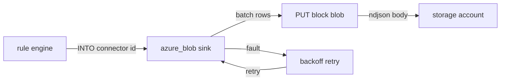

# Azure Blob connector

The Azure Blob connector writes each rule result as one JSON line in a block blob. It buffers rows as newline-delimited JSON and uploads one blob per flush. It renders the blob path from a template with date parts and a batch id.

Use it when blobs must hold broker data. You get one blob per flush with your own path template and auth scheme.



## Before you start

- Note the storage `account_name` and the `container_name`.
- Keep one auth material: a base64 account key, a SAS token, or a bearer token.
- For a full build, enable the feature: `--features azure_blob`. The default build answers 400 and names the feature.

## Settings

Set `kind` to `azure_blob`. The broker also accepts `azureblob` and `azblob`. It stores the kind as `azure_blob`.

| Setting | Required | Meaning |
|---|---|---|
| `account_name` | yes | Storage account name. It must match `[a-z0-9]` with length 3 to 24. |
| `container_name` | yes | Destination container. It must match `[a-z0-9-]` with length 3 to 63. It must start and end with a letter or digit. |
| `endpoint` | no | Custom endpoint. Default is `https://{account_name}.blob.core.windows.net`. |
| `auth` | yes | Object with `type` `sharedkey`, `sastoken`, or `bearertoken`. A `sharedkey` needs a non-empty base64 `account_key`. A `sastoken` needs a non-empty `sas_token`. A `bearertoken` needs a non-empty `token`. |
| `blob_path_template` | yes | Blob path with `${date.year}`, `${date.month}`, `${date.day}`, `${date.hour}`, and `${batch_id}`. It must not be empty. It must resolve to a relative path. |
| `compression` | no | `none` or `gzip`. Default is `none`. `gzip` sends `Content-Encoding: gzip`. |
| `max_records_per_blob` | no | Rows per blob. Default 10000. A value of 0 is refused. |
| `max_bytes_per_blob` | no | Byte limit per blob over buffered lines. Default 10485760. A value of 0 is refused. |
| `flush_interval_secs` | no | Linger before a partial batch flushes. Default 60. Values clamp to at least 1. |
| `buffer_capacity` | no | Max buffered rows. Default is none, which means no bound. |
| `timeout_ms` | no | Request deadline. Default 5000. Values clamp to at least 1. |

Example:

```json
{
  "id": "azure-blob-1",
  "kind": "azure_blob",
  "config": {
    "account_name": "mydeviceblobs",
    "container_name": "telemetry",
                              "auth": {"type": "sharedkey", "account_key": "MDEyMzQ1Njc4OWFiY2RlZjAxMjM0NTY3ODlhYmNkZWY="},
    "blob_path_template": "telemetry/year=${date.year}/month=${date.month}/day=${date.day}/hour=${date.hour}/${batch_id}.json",
    "compression": "none",
    "max_records_per_blob": 100,
    "max_bytes_per_blob": 1048576,
    "flush_interval_secs": 60,
    "timeout_ms": 5000
  }
}
```

> [!NOTE]
> The docs run creates this shape. Creation validates only; it opens no socket. The send path needs a storage account. See the failure record in [Verification failures](../_verification/failures.md).

## Check that it works

Create the connector. The broker answers 201 with the kind when the build holds the feature, else 400 naming the feature. Both answers print `ok`.

```toml test
[node]
id = "docs-connector-azure-blob"

[listeners.tcp]
bind = "0.0.0.0:1883"

[listeners.api]
bind = "0.0.0.0:18083"

[logging]
level = "warn"

[auth]
allow_anonymous = true
```

```sh test
python3 - <<'PY'
import json, os, urllib.request, urllib.error
port = os.environ.get("API_PORT", "18083")
key = os.environ["API_KEY"]
body = json.dumps({"id": "azure-blob-1", "kind": "azure_blob",
                   "config": {"account_name": "mydeviceblobs",
                              "container_name": "telemetry",
    "auth": {"type": "sharedkey", "account_key": "MDEyMzQ1Njc4OWFiY2RlZjAxMjM0NTY3ODlhYmNkZWY="},
                              "blob_path_template": "telemetry/${batch_id}.json",
                              "max_records_per_blob": 100,
                              "max_bytes_per_blob": 1048576,
                              "flush_interval_secs": 60,
                              "timeout_ms": 5000}}).encode()
req = urllib.request.Request(
    f"http://127.0.0.1:{port}/api/v1/connectors", data=body, method="POST",
    headers={"Authorization": f"Bearer {key}", "Content-Type": "application/json"})
try:
    with urllib.request.urlopen(req, timeout=5) as res:
        status, created = res.status, json.load(res)
except urllib.error.HTTPError as err:
    status, created = err.code, json.load(err)
assert status in (201, 400), (status, created)
if status == 201:
    assert created["kind"] == "azure_blob", created
else:
    assert "azure_blob" in created["error"].lower().replace("-", "_"), created
print("ok")
PY
```

```output
ok
```

## Limits

- An empty `account_name`, `container_name`, or `blob_path_template` is refused with 400. A bad account or container name is refused with 400.
- An empty `account_key`, `sas_token`, or `token` is refused with 400. A key outside base64 is refused with 400.
- An unknown or unclosed template variable is refused with 400. A path with a leading `/` is refused with 400.
- A `max_records_per_blob` of 0 is refused with 400. A `max_bytes_per_blob` of 0 is refused with 400.
- A non-UTF-8 payload fails the row with a dispatch error. An empty topic fails the row.
- The production path uses `HttpAzureBlobTransport` over the maintained HTTP client. It ensures the container with `PUT ?restype=container` and uploads with `PUT BlockBlob`. The memory transport serves offline unit tests only.
- A throttled status retries with backoff. A rejected status drops the row with a dispatch error. Backoff waits 2s, then doubles to 30s. Flushes fail fast during backoff.
- The connector runs behind the rule engine bounded queue. A slow endpoint sheds load; it never stalls publishers.
- The tier is enterprise. The kind needs the `azure_blob` feature build.

## Next steps

- Feed the connector from a rule in [Actions](../rules/actions.md).
- See every kind in [Connectors](./index.md).
