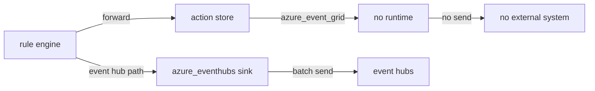

# Azure Event Grid connector

The Azure Event Grid name is an accepted action name with no send runtime in this build. Create accepts it through the action API. No rows leave the broker through it.

Use it only as a placeholder name in stored actions. You get a stored row with `connected` status and no delivery.



## Before you start

- Read the action list with `GET /api/v5/action_types`. This name stays absent from that list.
- Use `azure_event_hub_producer` for Azure event delivery.
- No feature flag applies. No build enables a send path for this name.

## Settings

This name takes no settings. The broker stores the entry and sends no rows.

| Setting | Required | Meaning |
|---|---|---|
| `type` | yes | It must be `azure_event_grid`. |
| `name` | yes | Action id. It must not be empty. |

Example:

```json
{
  "type": "azure_event_grid",
  "name": "azure-event-grid-1"
}
```

> [!NOTE]
> The docs run creates this shape. Creation stores only; it opens no socket. No rows reach a backend. See the failure record in [Verification failures](../_verification/failures.md).

## Check that it works

Create the action. The connector route refuses the name, and the action route stores it. Both answers print `ok`.

```toml test
[node]
id = "docs-connector-azure-event-grid"

[listeners.tcp]
bind = "0.0.0.0:1883"

[listeners.api]
bind = "0.0.0.0:18083"

[logging]
level = "warn"

[auth]
allow_anonymous = true
```

```sh test
python3 - <<'PY'
import json, os, urllib.request, urllib.error
port = os.environ.get("API_PORT", "18083")
key = os.environ["API_KEY"]
def call(method, path, body):
    data = json.dumps(body).encode() if body is not None else None
    req = urllib.request.Request(
        f"http://127.0.0.1:{port}{path}", data=data, method=method,
        headers={"Authorization": f"Bearer {key}", "Content-Type": "application/json"})
    try:
        with urllib.request.urlopen(req, timeout=5) as res:
            return res.status, json.load(res)
    except urllib.error.HTTPError as err:
        return err.code, json.load(err)
s1, b1 = call("POST", "/api/v1/connectors",
              {"id": "azure-eg-1", "kind": "azure_event_grid", "config": {}})
assert s1 == 400, (s1, b1)
assert "azure_event_grid" in json.dumps(b1), (s1, b1)
s2, b2 = call("POST", "/api/v5/actions",
              {"type": "azure_event_grid", "name": "azure-event-grid-1"})
assert s2 == 201, (s2, b2)
assert b2["type"] == "azure_event_grid", (s2, b2)
assert b2["status"] == "connected", (s2, b2)
print("ok")
PY
```

```output
ok
```

## Limits

- `POST /api/v1/connectors` with this kind answers 400. The message names `azure_event_grid` as an unknown kind.
- `GET /api/v5/action_types` omits this name. No runtime stands behind it in this build.
- A created action row reads `connected` when enabled. The status mirrors the enable flag. No probe runs behind it.
- The connector runs behind no queue. No rows leave the broker through this name. Use `azure_event_hub_producer` for event delivery.
- No tier applies. No feature build enables this path.

## Next steps

- Send events with [Azure Event Hubs](./index.md).
- Feed actions from a rule in [Actions](../rules/actions.md).
- See every kind in [Connectors](./index.md).
