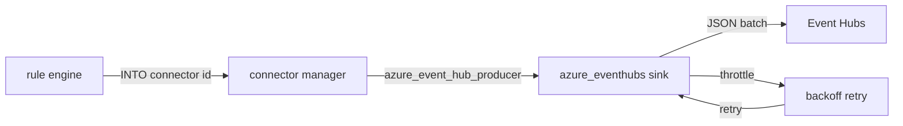

# Azure Event Hub Producer connector

`azure_event_hub_producer` is the documented name for the `azure_eventhubs` runtime. The v5 connector route accepts this name and runs the Event Hubs sink. The v1 connector route does not accept this name. Use the v5 route, or use `azure_eventhubs` on the v1 route.

Use it when a console stores a connector under the producer name. You get the Event Hubs batch send path with the stored name.



## Before you start

- Note the `namespace`, the `event_hub`, and the SAS policy name.
- Keep a non-empty SAS key. The v5 route passes it to the sink.
- For a full build, enable the feature: `--features azure_eventhubs`. The default build answers 400 and names the feature.
- Use `POST /api/v5/connectors`. The v1 route refuses this name.

## Settings

Set `type` to `azure_event_hub_producer` on the v5 API. The row keeps this type. The sink runs the `azure_eventhubs` runtime.

| Setting | Required | Meaning |
|---|---|---|
| `type` | yes | It must be `azure_event_hub_producer` on the v5 route. |
| `name` | yes | Connector id. `id` is an alias. |
| `namespace` | no | Service Bus namespace. Default is `test-namespace`. It must be 1 to 63 chars of `[a-z0-9-]`, with no leading or trailing `-`. |
| `event_hub` | no | Event Hub name. The `hub` key is an alias. Default is `test-hub`. It must be 1 to 256 chars of `[A-Za-z0-9-_.~]`. |
| `endpoint` | no | Host override. The `url` key is an alias. It must start with `http://` or `https://`. Default is `https://{namespace}.servicebus.windows.net`. |
| `shared_access_key_name` | no | SAS policy name. The `key_name` key is an alias. Default is `SendPolicy`. It must not be empty. |
| `shared_access_key` | no | SAS secret. The `key` key is an alias. A portal base64 key is decoded before signing. |
| `timeout_ms` | no | Request deadline. The `timeout` key is an alias. Default is 5000. Values clamp to at least 1. |

The v5 route stores these keys but does not use the value:

| Stored key | v5 fixed value |
|---|---|
| `partition_key_template` | none |
| `user_properties` | empty |
| `token_ttl_secs` | 3600 |
| `batch_size` | 1 |
| `batch_bytes` | 1048576 |
| `linger_ms` | 10 |
| `max_retries` | 3 |
| `initial_backoff_ms` | 100 |
| `max_backoff_ms` | 2000 |

Example:

```json
{
  "name": "azure-eh-producer-1",
  "type": "azure_event_hub_producer",
  "namespace": "my-eventhub-ns",
  "event_hub": "telemetry-hub",
  "shared_access_key_name": "SendPolicy",
  "shared_access_key": "dGVzdC1rZXktbWF0ZXJpYWwtMzItYnl0ZXMhIU9L",
  "timeout_ms": 5000
}
```

> [!NOTE]
> The docs run creates this shape. Creation validates only; it opens no socket. The send path needs an Event Hubs namespace. See the failure record in [Verification failures](../_verification/failures.md).

## Check that it works

The v1 route refuses the name. The v5 route answers 201 with the stored type when the build holds the feature, else 400 naming the feature. Both answers print `ok`.

```toml test
[node]
id = "docs-connector-azure-event-hub-producer"

[listeners.tcp]
bind = "0.0.0.0:1883"

[listeners.api]
bind = "0.0.0.0:18083"

[logging]
level = "warn"

[auth]
allow_anonymous = true
```

```sh test
python3 - <<'PY'
import json, os, urllib.request, urllib.error
port = os.environ.get("API_PORT", "18083")
key = os.environ["API_KEY"]
def call(method, path, body):
    data = json.dumps(body).encode()
    req = urllib.request.Request(
        f"http://127.0.0.1:{port}{path}", data=data, method=method,
        headers={"Authorization": f"Bearer {key}", "Content-Type": "application/json"})
    try:
        with urllib.request.urlopen(req, timeout=5) as res:
            return res.status, json.load(res)
    except urllib.error.HTTPError as err:
        return err.code, json.load(err)
s1, b1 = call("POST", "/api/v1/connectors",
              {"id": "azure-eh-producer-v1", "kind": "azure_event_hub_producer",
               "config": {}})
assert s1 == 400, (s1, b1)
assert "azure_event_hub_producer" in json.dumps(b1).lower().replace("-", "_"), (s1, b1)
s2, b2 = call("POST", "/api/v5/connectors",
              {"name": "azure-eh-producer-1", "type": "azure_event_hub_producer",
               "namespace": "my-eventhub-ns", "event_hub": "telemetry-hub",
               "shared_access_key_name": "SendPolicy",
               "shared_access_key": "dGVzdC1rZXktbWF0ZXJpYWwtMzItYnl0ZXMhIU9L",
               "timeout_ms": 5000})
assert s2 in (201, 400), (s2, b2)
if s2 == 201:
    assert b2["type"] == "azure_event_hub_producer", (s2, b2)
else:
    assert "azure_eventhubs" in json.dumps(b2).lower().replace("-", "_"), (s2, b2)
s3, b3 = call("POST", "/api/v5/connectors",
              {"name": "azure-eh-producer-no-key",
               "type": "azure_event_hub_producer",
               "namespace": "my-eventhub-ns", "event_hub": "telemetry-hub"})
assert s3 in (201, 400), (s3, b3)
if s3 == 201:
    assert b3["status"] == "disconnected", (s3, b3)
else:
    assert "azure_eventhubs" in json.dumps(b3).lower().replace("-", "_"), (s3, b3)
print("ok")
PY
```

```output
ok
```

## Limits

- An empty `shared_access_key_name` is refused with 400. An empty `shared_access_key` gives 400 when the feature is absent. When the feature is built, the row stores as `disconnected` and sends no rows.
- A `namespace` outside `[a-z0-9-]` or a bad length is refused with 400. An `event_hub` outside `[A-Za-z0-9-_.~]` or a bad length is refused with 400.
- An `endpoint` outside `http://` and `https://` is refused with 400.
- The v5 route stores `partition_key_template` and `user_properties`, but it does not use them. The sink sends no partition key and only the fixed `mqtt_topic` and `mqtt_qos` properties.
- The v5 route stores `batch_size`, `batch_bytes`, `linger_ms`, `max_retries`, `initial_backoff_ms`, `max_backoff_ms`, and `token_ttl_secs`, but it does not use them. It fixes them to 1, 1048576, 10, 3, 100, 2000, and 3600.
- The production path uses `HttpAzureEventHubsTransport` over the maintained HTTP client. It sends one signed `POST {resource}/messages` per batch. The memory transport serves offline unit tests only.
- A 429 or 503 status retries with backoff. A rejected status restores the rows and returns a dispatch error. A transport error restores the rows and backs off.
- The connector runs behind the rule engine bounded queue. A slow endpoint sheds load; it never stalls publishers.
- The tier is enterprise. The kind needs the `azure_eventhubs` feature build.

## Next steps

- Use the full settings on [Azure Event Hubs](./azure_eventhubs.md).
- Feed the connector from a rule in [Actions](../rules/actions.md).
- See every kind in [Connectors](./index.md).
