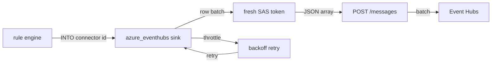

# Azure Event Hubs connector

The Azure Event Hubs connector sends each rule result to an Event Hub. It builds a JSON batch array with a base64 body and a partition key. It signs every batch with a fresh shared access signature.

Use it when event streams must receive broker data. You get one batch send per flush with your own namespace, hub, partition key, and properties.



## Before you start

- Note the Service Bus `namespace`, the `event_hub`, and the SAS policy name.
- Keep a non-empty SAS key. A portal base64 key is decoded before it signs.
- For a full build, enable the feature: `--features azure_eventhubs`. The default build answers 400 and names the feature.
- Use `POST /api/v1/connectors` for the full config, or `POST /api/v5/connectors` for the fixed v5 shape.

## Settings

Set `kind` to `azure_eventhubs` on the v1 API. The v1 route also accepts `azure` and `eventhubs`. It stores the kind as `azure_eventhubs`.

| Setting | Required | Meaning |
|---|---|---|
| `namespace` | yes | Service Bus namespace. It must be 1 to 63 chars of `[a-z0-9-]`, with no leading or trailing `-`. |
| `event_hub` | yes | Event Hub name. It must be 1 to 256 chars of `[A-Za-z0-9-_.~]`. |
| `endpoint` | no | Host override. It must start with `http://` or `https://`. Default is `https://{namespace}.servicebus.windows.net`. |
| `shared_access_key_name` | yes | SAS policy name. It must not be empty. |
| `shared_access_key` | yes | SAS secret. A portal base64 key is decoded before it signs. A raw secret signs in place. |
| `partition_key_template` | no | Partition key template. It reads `${topic}`, `${client_id}`, `${qos}`, and `${timestamp}`. Default is none. |
| `user_properties` | no | Extra application properties. Each value is a template with the same variables. Default is empty. |
| `token_ttl_secs` | no | SAS token lifetime. Default 3600. Values clamp to at least 1. |
| `batch_size` | no | Events per batch. Default 100. A value of 0 is refused. `null` means no row bound. |
| `batch_bytes` | no | Batch byte limit. Default 1048576. A value of 0 is refused. `null` means no byte bound. |
| `linger_ms` | no | Linger before a partial batch flushes. Default 20. `null` means no time bound. |
| `max_retries` | no | Retries on 429 and 503. Default 4. `null` means no limit. A value of 0 means no retry. |
| `initial_backoff_ms` | no | First retry delay. Default 100. Values clamp to at least 1. |
| `max_backoff_ms` | no | Retry delay ceiling. Default 2500. Values clamp to at least 1. |
| `timeout_ms` | no | Request deadline. Default 5000. Values clamp to at least 1. |

The v5 route accepts a smaller shape. It reads `namespace`, `event_hub` or `hub`, `endpoint` or `url`, `shared_access_key_name` or `key_name`, `shared_access_key` or `key`, and `timeout_ms` or `timeout`. It defaults `namespace` to `test-namespace`, `event_hub` to `test-hub`, `shared_access_key_name` to `SendPolicy`, and `timeout_ms` to 5000. It requires `shared_access_key`.

The v5 route stores these keys but does not use the value:

| Stored key | v5 fixed value |
|---|---|
| `partition_key_template` | none |
| `user_properties` | empty |
| `token_ttl_secs` | 3600 |
| `batch_size` | 1 |
| `batch_bytes` | 1048576 |
| `linger_ms` | 10 |
| `max_retries` | 3 |
| `initial_backoff_ms` | 100 |
| `max_backoff_ms` | 2000 |

Example:

```json
{
  "id": "azure-eh-1",
  "kind": "azure_eventhubs",
  "config": {
    "namespace": "my-eventhub-ns",
    "event_hub": "telemetry-hub",
    "shared_access_key_name": "SendPolicy",
    "shared_access_key": "dGVzdC1rZXktbWF0ZXJpYWwtMzItYnl0ZXMhIU9L",
    "partition_key_template": "${client_id}",
    "user_properties": {"source": "indramqtt"},
    "token_ttl_secs": 3600,
    "batch_size": 100,
    "batch_bytes": 1048576,
    "linger_ms": 20,
    "max_retries": 4,
    "initial_backoff_ms": 100,
    "max_backoff_ms": 2500,
    "timeout_ms": 5000
  }
}
```

> [!NOTE]
> The docs run creates this shape. Creation validates only; it opens no socket. The send path needs an Event Hubs namespace. See the failure record in [Verification failures](../_verification/failures.md).

## Check that it works

The v5 route refuses a body without the key and names the field. The v1 route answers 201 with the kind when the build holds the feature, else 400 naming the feature. Both answers print `ok`.

```toml test
[node]
id = "docs-connector-azure-eventhubs"

[listeners.tcp]
bind = "0.0.0.0:1883"

[listeners.api]
bind = "0.0.0.0:18083"

[logging]
level = "warn"

[auth]
allow_anonymous = true
```

```sh test
python3 - <<'PY'
import json, os, urllib.request, urllib.error
port = os.environ.get("API_PORT", "18083")
key = os.environ["API_KEY"]
def call(method, path, body):
    data = json.dumps(body).encode()
    req = urllib.request.Request(
        f"http://127.0.0.1:{port}{path}", data=data, method=method,
        headers={"Authorization": f"Bearer {key}", "Content-Type": "application/json"})
    try:
        with urllib.request.urlopen(req, timeout=5) as res:
            return res.status, json.load(res)
    except urllib.error.HTTPError as err:
        return err.code, json.load(err)
s0, b0 = call("POST", "/api/v5/connectors",
              {"name": "azure-eh-no-key", "type": "azure_eventhubs",
               "namespace": "my-eventhub-ns", "event_hub": "telemetry-hub"})
assert s0 == 400, (s0, b0)
assert "shared_access_key" in json.dumps(b0), (s0, b0)
s1, b1 = call("POST", "/api/v1/connectors",
              {"id": "azure-eh-1", "kind": "azure_eventhubs",
               "config": {"namespace": "my-eventhub-ns",
                          "event_hub": "telemetry-hub",
                          "shared_access_key_name": "SendPolicy",
                          "shared_access_key": "dGVzdC1rZXktbWF0ZXJpYWwtMzItYnl0ZXMhIU9L",
                          "partition_key_template": "${client_id}",
                          "user_properties": {"source": "indramqtt"},
                          "token_ttl_secs": 3600,
                          "batch_size": 100,
                          "batch_bytes": 1048576,
                          "linger_ms": 20,
                          "max_retries": 4,
                          "initial_backoff_ms": 100,
                          "max_backoff_ms": 2500,
                          "timeout_ms": 5000}})
assert s1 in (201, 400), (s1, b1)
if s1 == 201:
    assert b1["kind"] == "azure_eventhubs", (s1, b1)
else:
    assert "azure_eventhubs" in b1["error"].lower(), (s1, b1)
print("ok")
PY
```

```output
ok
```

## Limits

- An empty `shared_access_key_name` or `shared_access_key` is refused with 400. A `namespace` outside `[a-z0-9-]` or a bad length is refused with 400. An `event_hub` outside `[A-Za-z0-9-_.~]` or a bad length is refused with 400.
- An `endpoint` outside `http://` and `https://` is refused with 400.
- A template with an unknown or unclosed variable is refused with 400. An empty user property name is refused with 400.
- A `batch_size` of 0 is refused with 400. A `batch_bytes` of 0 is refused with 400.
- The production path uses `HttpAzureEventHubsTransport` over the maintained HTTP client. It sends one signed `POST {resource}/messages` per batch. The memory transport serves offline unit tests only.
- The batch is a JSON array. Each item holds a base64 `Body`, the `UserProperties`, and a `BrokerProperties` partition key. The sink adds `mqtt_topic` and `mqtt_qos` to the properties.
- A 429 or 503 status retries with backoff. A rejected status restores the rows and returns a dispatch error. A transport error restores the rows and backs off.
- Backoff starts at `initial_backoff_ms` and doubles to `max_backoff_ms`. A fresh SAS token covers each attempt and uses `token_ttl_secs`.
- The connector runs behind the rule engine bounded queue. A slow endpoint sheds load; it never stalls publishers.
- The tier is enterprise. The kind needs the `azure_eventhubs` feature build.

## Other names

This connector is also known as `azure-event-hubs`, `azure_event_hub_producer`, `azure`, and `eventhubs`. Old links to `/connectors/azure-event-hubs/` and `/connectors/azure_event_hub_producer/` redirect here.

The producer name `azure_event_hub_producer` is accepted on the v5 route. The v5 route maps `azure_event_hub_producer` to this runtime. The v5 route accepts standard producer settings and applies fixed defaults for batch size and backoff.

## Next steps

- Use the producer name on the v5 route in [Azure Event Hub Producer](#other-names).
- Feed the connector from a rule in [Actions](../rules/actions.md).
- See every kind in [Connectors](./index.md).

## Known limits in this release

The broker accepts the fields in this list. The broker does not apply them in this release.

- `batch_bytes` (the batch size in bytes)
- `batch_size` (the batch size)
- `initial_backoff_ms` (the first retry wait time)
- `linger_ms` (the batch wait time)
- `max_backoff_ms` (the longest retry wait time)
- `max_retries` (the retry count)

To set batching, use `resource_opts` in the action. The broker applies `resource_opts`.

A later release applies these fields.
