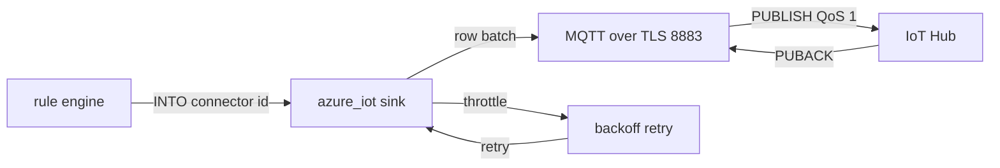

# Azure IoT connector

The Azure IoT connector bridges rule results to Azure IoT Hub over MQTT TLS. It sends device-to-cloud telemetry, twin reported patches, and direct-method responses. It mints and renews a shared access signature for shared key auth.

Use it when an IoT Hub must receive broker data. You get one publish per result row with SAS renewal, backoff, and a configurable buffer.



## Before you start

- Note the `iot_hub_name` and the `device_id`.
- Keep one auth material: a shared access key, a pre-minted SAS token, or an X.509 certificate and key.
- For a full build, enable the feature: `--features azure_iot`. The default build answers 400 and names the feature.
- Use `POST /api/v1/connectors` for every auth mode. The v5 route uses a shared access key only.

## Settings

Set `kind` to `azure_iot` on the v1 API. The v1 route also accepts `azure_iothub` and `iothub`. It stores the kind as `azure_iot`.

| Setting | Required | Meaning |
|---|---|---|
| `iot_hub_name` | yes | Hub host, with an optional `:port`. Default port is 8883. An empty value is refused. The v5 route defaults to `127.0.0.1:8883`. |
| `device_id` | yes | Device id. It must not contain `/`, `#`, or `+`. The v5 route defaults to `device-01`. |
| `module_id` | no | Module id. It must not contain `/`, `#`, or `+`. The `module` key is a v5 alias. |
| `auth` | no | Object with `type` `sharedaccesskey`, `sastoken`, or `x509`. Default is an empty shared key, which validation refuses. A shared key needs a non-empty `key`; a SAS token must start with `SharedAccessSignature `; X.509 needs PEM `cert_pem` and `key_pem`. The v5 route ignores this object. |
| `shared_access_key` | yes | v5 secret. The `key` key is an alias. The v5 route sets auth to a shared access key. |
| `key_name` | no | SAS key name. The `shared_access_key_name` key is a v5 alias. v5 default is `device`. |
| `api_version` | no | MQTT API version. Default `2021-04-12`. An empty value is refused. |
| `direct_methods_enabled` | no | Default true. The `direct_methods` key is a v5 alias. The TLS transport subscribes `$iothub/methods/POST/#` on connect when true. |
| `twin_sync_enabled` | no | Default true. The `twin_sync` key is a v5 alias. The TLS transport subscribes `$iothub/twin/PATCH/properties/desired/#` on connect when true. |
| `batch_size` | no | Rows per flush. Default 500 on v1. The v5 route defaults to 1. A value of 0 is refused. |
| `buffer_capacity` | no | Max buffered rows. Default is none, which means no bound. A full buffer returns a connection error. |
| `linger_ms` | no | Linger before a partial batch flushes. Default 50 on v1. The v5 route defaults to 10. |
| `max_retries` | no | Retries on throttles and connection errors. Default 5 on v1. The v5 route defaults to 3. `null` means no limit. A value of 0 means no retry. |
| `timeout_ms` | no | Request deadline. Default 5000. Values clamp to at least 1. |
| `connect_timeout_ms` | no | TCP connect deadline. Default 5000. Values clamp to at least 1. |
| `handshake_timeout_ms` | no | TLS handshake deadline. Default 5000. Values clamp to at least 1. |
| `ca_bundle_pem` | no | Extra CA bundle in PEM form. It must hold `BEGIN CERTIFICATE` when set. The `ca_bundle` key is a v5 alias. |
| `sas_ttl_secs` | no | SAS token lifetime. Default 3600. Minimum 60. The `sas_ttl` and `token_ttl_secs` keys are v5 aliases. |

The v5 route reads these identity keys: `iot_hub_name`, `device_id`, `module_id` or `module`, `shared_access_key` or `key`, and `key_name` or `shared_access_key_name`. It also reads `api_version`, `direct_methods_enabled` or `direct_methods`, and `twin_sync_enabled` or `twin_sync`. The batch keys are `batch_size`, `buffer_capacity`, `linger_ms`, and `max_retries`. The timing keys are `timeout_ms`, `connect_timeout_ms`, and `handshake_timeout_ms`. The TLS key is `ca_bundle_pem` or `ca_bundle`. The token key is `sas_ttl_secs`, `sas_ttl`, or `token_ttl_secs`. It requires `shared_access_key`. It ignores the v1 `auth` object and always uses a shared access key.

Example:

```json
{
  "id": "azure-iot-1",
  "kind": "azure_iot",
  "config": {
    "iot_hub_name": "my-hub.azure-devices.net",
    "device_id": "device-01",
    "module_id": null,
    "auth": {"type": "sharedaccesskey",
              "key": "dGVzdC1rZXktbWF0ZXJpYWwtMzItYnl0ZXMhIU9L",
              "key_name": "device"},
    "api_version": "2021-04-12",
    "direct_methods_enabled": true,
    "twin_sync_enabled": true,
    "batch_size": 500,
    "buffer_capacity": 1000,
    "linger_ms": 50,
    "max_retries": 5,
    "timeout_ms": 5000,
    "connect_timeout_ms": 5000,
    "handshake_timeout_ms": 5000,
    "sas_ttl_secs": 3600
  }
}
```

> [!NOTE]
> The docs run creates this shape. Creation validates only; it opens no socket. The send path needs an IoT Hub. See the failure record in [Verification failures](../_verification/failures.md).

## Check that it works

The v5 route refuses a body without the key and names the field. The v1 route answers 201 with the kind when the build holds the feature, else 400 naming the feature. Both answers print `ok`.

```toml test
[node]
id = "docs-connector-azure-iot"

[listeners.tcp]
bind = "0.0.0.0:1883"

[listeners.api]
bind = "0.0.0.0:18083"

[logging]
level = "warn"

[auth]
allow_anonymous = true
```

```sh test
python3 - <<'PY'
import json, os, urllib.request, urllib.error
port = os.environ.get("API_PORT", "18083")
key = os.environ["API_KEY"]
def call(method, path, body):
    data = json.dumps(body).encode()
    req = urllib.request.Request(
        f"http://127.0.0.1:{port}{path}", data=data, method=method,
        headers={"Authorization": f"Bearer {key}", "Content-Type": "application/json"})
    try:
        with urllib.request.urlopen(req, timeout=5) as res:
            return res.status, json.load(res)
    except urllib.error.HTTPError as err:
        return err.code, json.load(err)
s0, b0 = call("POST", "/api/v5/connectors",
              {"name": "azure-iot-no-key", "type": "azure_iot",
               "iot_hub_name": "127.0.0.1:8883", "device_id": "device-01"})
assert s0 == 400, (s0, b0)
assert "shared_access_key" in json.dumps(b0), (s0, b0)
s1, b1 = call("POST", "/api/v1/connectors",
              {"id": "azure-iot-1", "kind": "azure_iot",
               "config": {"iot_hub_name": "my-hub.azure-devices.net",
                          "device_id": "device-01",
                          "module_id": None,
                          "auth": {"type": "sharedaccesskey",
                                    "key": "dGVzdC1rZXktbWF0ZXJpYWwtMzItYnl0ZXMhIU9L",
                                    "key_name": "device"},
                          "api_version": "2021-04-12",
                          "direct_methods_enabled": True,
                          "twin_sync_enabled": True,
                          "batch_size": 500,
                          "buffer_capacity": 1000,
                          "linger_ms": 50,
                          "max_retries": 5,
                          "timeout_ms": 5000,
                          "connect_timeout_ms": 5000,
                          "handshake_timeout_ms": 5000,
                          "sas_ttl_secs": 3600}})
assert s1 in (201, 400), (s1, b1)
if s1 == 201:
    assert b1["kind"] == "azure_iot", (s1, b1)
else:
    assert "azure_iot" in b1["error"].lower(), (s1, b1)
print("ok")
PY
```

```output
ok
```

## Limits

- An empty `iot_hub_name` is refused with 400. A hub name that does not parse to a host and port is refused with 400.
- An empty `device_id`, or one with `/`, `#`, or `+`, is refused with 400. A bad `module_id` is refused with 400.
- An empty shared key is refused with 400. A SAS token without the `SharedAccessSignature ` prefix is refused with 400. X.509 material without PEM markers is refused with 400.
- An empty `api_version` is refused with 400. A `ca_bundle_pem` without `BEGIN CERTIFICATE` is refused with 400. A `batch_size` of 0 is refused with 400.
- The production path uses `TlsAzureIotTransport` over the maintained TLS stack. It dials port 8883 with server certificate checks against the CA bundle and the system trust store.
- A shared access key rides as the MQTT password. An X.509 device sends a client certificate instead. The transport sends CONNECT once, then PUBLISH at QoS 1 and waits for the PUBACK.
- The SAS cache renews a token inside a 60 second skew. A shared access key mints tokens with `sas_ttl_secs`.
- A connection error retries to `max_retries`. Backoff starts at 100ms and doubles to 2000ms. A failed flush restores the rows in order and engages backoff.
- The buffer holds at most `buffer_capacity` rows. A full buffer returns a connection error. The connector runs behind the rule engine bounded queue, so a slow hub never stalls publishers.
- The tier is enterprise. The kind needs the `azure_iot` feature build.

## Next steps

- Feed the connector from a rule in [Actions](../rules/actions.md).
- See every kind in [Connectors](./index.md).
