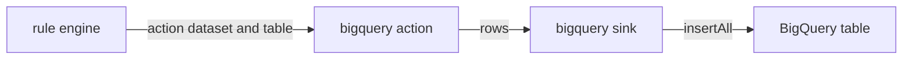

# BigQuery connector

The BigQuery connector streams rule results into one table with the BigQuery `insertAll` API.

Use it for analytics rows in Google Cloud. The action names the dataset and table, so one connector can feed several tables.



## Before you start

- Create a service account with BigQuery write access.
- Note the project, dataset and table.
- For a full build, enable `--features bigquery`. The default build answers 400 and names the feature.

## Settings

| Connector setting | Required | Meaning |
|---|---|---|
| `authentication` | yes | `service_account_json` or `attached_service_account`. |
| `authentication.gcp_project_id` | yes | Project for the attached account form. |
| `authentication.access_token` | yes | Access token for the attached account form. |
| `authentication.service_account_json` | yes | Service account key JSON for the key form. |

| Action setting | Required | Meaning |
|---|---|---|
| `dataset` | yes | Target dataset. |
| `table` | yes | Target table template. |
| `project_id` | no | Overrides the project in the authentication block. |

Example action:

```json
{
  "name": "bq-events",
  "type": "bigquery",
  "connector": "bq-project",
  "parameters": {"dataset": "telemetry", "table": "events"}
}
```

## Limits

- A missing authentication block, dataset or table answers 400 and names the field.
- Workload identity federation is refused with a clear error. Use a service account key or the attached account.
- A failed insert counts one failed forward on the action.

## Next steps

- Feed the connector from a rule in [Actions](../rules/actions.md).
- See every kind in [Connectors](./index.md).

## Check that it works

Create the connector. The broker answers 201 with the kind when the build holds the feature, else 400 names it. Both answers print `ok`.

```toml test
[node]
id = "docs-connector-bigquery"

[listeners.tcp]
bind = "0.0.0.0:1883"

[listeners.api]
bind = "0.0.0.0:18083"

[logging]
level = "warn"

[auth]
allow_anonymous = true
```

```sh test
python3 - <<'PY'
import json, os, urllib.request
port = os.environ.get("API_PORT", "18083")
key = os.environ["API_KEY"]
body = json.dumps({"name": "docs-bq-1", "type": "bigquery",
                   "authentication": {"type": "attached_service_account",
                                      "gcp_project_id": "p",
                                      "access_token": "test-attached-token"}}).encode()
req = urllib.request.Request(
    f"http://127.0.0.1:{port}/api/v5/connectors", data=body, method="POST",
    headers={"Authorization": f"Bearer {key}", "Content-Type": "application/json"})
try:
    with urllib.request.urlopen(req, timeout=5) as res:
        status, created = res.status, json.load(res)
except urllib.error.HTTPError as err:
    status, created = err.code, json.load(err)
assert status in (201, 400), (status, created)
if status == 201:
    assert created["type"] == "bigquery", created
else:
    assert "bigquery" in created["message"], created
print("ok")
PY
```

```output
ok
```
