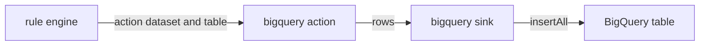
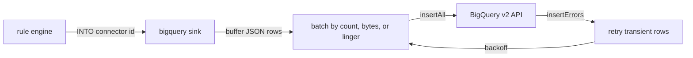

# BigQuery connector

The BigQuery connector streams rule results into one table with the BigQuery `insertAll` API.

Use it for analytics rows in Google Cloud. The action names the dataset and table, so one connector can feed several tables.



## Before you start

- Create a service account with BigQuery write access.
- Note the project, dataset and table.
- For a full build, enable `--features bigquery`. The default build answers 400 and names the feature.

## Settings

| Connector setting | Required | Meaning |
|---|---|---|
| `authentication` | yes | `service_account_json` or `attached_service_account`. |
| `authentication.gcp_project_id` | yes | Project for the attached account form. |
| `authentication.access_token` | yes | Access token for the attached account form. |
| `authentication.service_account_json` | yes | Service account key JSON for the key form. |

| Action setting | Required | Meaning |
|---|---|---|
| `dataset` | yes | Target dataset. |
| `table` | yes | Target table template. |
| `project_id` | no | Overrides the project in the authentication block. |

Example action:

```json
{
  "name": "bq-events",
  "type": "bigquery",
  "connector": "bq-project",
  "parameters": {"dataset": "telemetry", "table": "events"}
}
```

## Limits

- A missing authentication block, dataset or table answers 400 and names the field.
- Workload identity federation is refused with a clear error. Use a service account key or the attached account.
- A failed insert counts one failed forward on the action.

## Next steps

- Feed the connector from a rule in [Actions](../rules/actions.md).
- See every kind in [Connectors](./index.md).

## Check that it works

Create the connector. The broker answers 201 with the kind when the build holds the feature, else 400 names it. Both answers print `ok`.

```toml test
[node]
id = "docs-connector-bigquery"

[listeners.tcp]
bind = "0.0.0.0:1883"

[listeners.api]
bind = "0.0.0.0:18083"

[logging]
level = "warn"

[auth]
allow_anonymous = true
```

```sh test
python3 - <<'PY'
import json, os, urllib.request
port = os.environ.get("API_PORT", "18083")
key = os.environ["API_KEY"]
body = json.dumps({"name": "docs-bq-1", "type": "bigquery",
                   "authentication": {"type": "attached_service_account",
                                      "gcp_project_id": "p",
                                      "access_token": "test-attached-token"}}).encode()
req = urllib.request.Request(
    f"http://127.0.0.1:{port}/api/v5/connectors", data=body, method="POST",
    headers={"Authorization": f"Bearer {key}", "Content-Type": "application/json"})
try:
    with urllib.request.urlopen(req, timeout=5) as res:
        status, created = res.status, json.load(res)
except urllib.error.HTTPError as err:
    status, created = err.code, json.load(err)
assert status in (201, 400), (status, created)
if status == 201:
    assert created["type"] == "bigquery", created
else:
    assert "bigquery" in created["message"], created
print("ok")
PY
```

```output
ok
```

## Reference form (v1 API)

The reference form uses the v1 connector API. The v5 form above uses connector and action documents. This section keeps the reference page.

The BigQuery connector streams each rule result into a BigQuery table. It buffers JSON rows and sends them with `tabledata.insertAll`. It authenticates with a service-account key, an access token, or no token for an emulator.

Use it when broker data must land in BigQuery for SQL analytics. You get one insert per batch, a table name from a template, and selective retry of failed rows.



### Before you start

- Create the BigQuery project, dataset, and target table.
- Keep one auth material: a service-account key, an access token, or no token for an emulator.
- For a full build, enable the feature: `--features bigquery`. The default build answers 400 and names the feature.

### Settings

Set `kind` to `bigquery` on the v1 API. The v1 route also accepts `bq` and `gbq`. It stores the kind as `bigquery`.

| Setting | Required | Meaning |
|---|---|---|
| `project_id` | yes | GCP project id. It must hold 1 to 1024 characters from `A-Z`, `a-z`, `0-9`, `_`, and `-`. A bad value is refused. |
| `dataset_id` | yes | BigQuery dataset id. It uses the same character rule as `project_id`. A bad value is refused. |
| `table_template` | yes | Table name template. It accepts `${topic}`, `${client_id}`, `${qos}`, `${timestamp}`, and `${YYYYMMDD}`. Other characters become `_`. The result must not be empty or start with a digit. An unknown variable is refused. |
| `endpoint` | no | API base URL. Default is `https://bigquery.googleapis.com/bigquery/v2`. The value must start with `http://` or `https://`. |
| `auth` | no | Auth object. `{"type":"none"}` sends no token. `{"type":"accesstoken","token":"..."}` sends a bearer token. `{"type":"serviceaccountkey","client_email":"...","private_key_pem":"..."}` mints tokens. Default is `none`. An empty token, email, or key is refused. |
| `ignore_unknown_values` | no | The `ignoreUnknownValues` flag. Default true. |
| `skip_invalid_rows` | no | The `skipInvalidRows` flag. Default false. |
| `template_suffix` | no | Partition decorator. It accepts the table variables plus `${payload.<field>}`. The broker appends `$` and the rendered value to the table. The rendered value must use only `A-Z`, `a-z`, `0-9`, and `_`. |
| `batch_size` | no | Rows per insert. Default 500. A value of 0 is refused. `null` means no row bound. |
| `batch_bytes` | no | Buffered byte limit. Default 1048576. A value of 0 is refused. `null` means no byte bound. |
| `linger_ms` | no | Linger before a partial batch flushes. Default 20. `null` means no linger bound. |
| `max_retries` | no | Retries on transient faults. Default 4. `null` means no limit. A value of 0 means no retry. |
| `initial_backoff_ms` | no | First retry delay. Default 100. Values below 1 become 1. |
| `max_backoff_ms` | no | Retry delay ceiling. Default 2500. Values below 1 become 1. |
| `timeout_ms` | no | Request deadline. Default 5000. Values below 1 become 1. |

The v5 route reads `project_id` or `project`, `dataset_id` or `dataset`, and `table` or `table_template`. Defaults are `test-project`, `test-dataset`, and `telemetry`. It also reads `endpoint` or `url`, `timeout_ms` or `timeout`, `ignore_unknown_values`, `skip_invalid_rows`, and `template_suffix`. The batch keys are `batch_size`, `batch_bytes`, `linger_ms`, `max_retries`, `initial_backoff_ms`, and `max_backoff_ms`. The v5 defaults are 1 row, 1048576 bytes, 10 ms linger, 3 retries, 100 ms initial backoff, and 2000 ms maximum backoff. The v5 route ignores the v1 `auth` object and sends no token.

Example:

```json
{
  "id": "bigquery-1",
  "kind": "bigquery",
  "config": {
    "project_id": "my-iot-project",
    "dataset_id": "telemetry",
    "table_template": "telemetry_${topic}",
    "endpoint": null,
    "auth": {"type": "none"},
    "ignore_unknown_values": true,
    "skip_invalid_rows": false,
    "template_suffix": "${YYYYMMDD}",
    "batch_size": 500,
    "batch_bytes": 1048576,
    "linger_ms": 20,
    "max_retries": 4,
    "initial_backoff_ms": 100,
    "max_backoff_ms": 2500,
    "timeout_ms": 5000
  }
}
```

> [!NOTE]
> The docs run creates this shape. Creation validates only; it opens no socket. The send path needs a BigQuery dataset. See the failure record in [Verification failures](../_verification/failures.md).

### Check that it works

Create the connector. The broker answers 201 with the kind when the build holds the feature, else 400 naming the feature. Both answers print `ok`.

```toml test
# Reference form run.
[node]
id = "docs-connector-bigquery"

[listeners.tcp]
bind = "0.0.0.0:1883"

[listeners.api]
bind = "0.0.0.0:18083"

[logging]
level = "warn"

[auth]
allow_anonymous = true
```

```sh test
python3 - <<'PY'
import json, os, urllib.request, urllib.error
port = os.environ.get("API_PORT", "18083")
key = os.environ["API_KEY"]
body = json.dumps({"id": "bigquery-1", "kind": "bigquery",
                   "config": {"project_id": "my-iot-project",
                              "dataset_id": "telemetry",
                              "table_template": "telemetry_${topic}",
                              "endpoint": None,
                              "auth": {"type": "none"},
                              "ignore_unknown_values": True,
                              "skip_invalid_rows": False,
                              "template_suffix": "${YYYYMMDD}",
                              "batch_size": 500,
                              "batch_bytes": 1048576,
                              "linger_ms": 20,
                              "max_retries": 4,
                              "initial_backoff_ms": 100,
                              "max_backoff_ms": 2500,
                              "timeout_ms": 5000}}).encode()
req = urllib.request.Request(
    f"http://127.0.0.1:{port}/api/v1/connectors", data=body, method="POST",
    headers={"Authorization": f"Bearer {key}", "Content-Type": "application/json"})
try:
    with urllib.request.urlopen(req, timeout=5) as res:
        status, created = res.status, json.load(res)
except urllib.error.HTTPError as err:
    status, created = err.code, json.load(err)
assert status in (201, 400), (status, created)
if status == 201:
    assert created["kind"] == "bigquery", created
else:
    assert "bigquery" in created["error"].lower(), created
print("ok")
PY
```

```output
ok
```

### Limits

- An empty `project_id`, `dataset_id`, or `table_template` is refused with 400. A bad project or dataset id is refused with 400.
- An endpoint outside `http://` and `https://` is refused with 400. An empty access token is refused with 400. A service-account key without an email or key is refused with 400.
- A table template that renders empty or starts with a digit is refused with 400. An unknown template variable is refused with 400. A suffix outside `A-Z`, `a-z`, `0-9`, and `_` is refused with 400.
- A `batch_size` or `batch_bytes` of 0 is refused with 400.
- The connector needs a non-empty topic, a UTF-8 payload, and a JSON payload. A bad row gives a dispatch error.
- The production path uses `SdkBigQueryTransport` on the maintained BigQuery driver. It calls `tabledata.insertAll` with one UUID `insertId` per row and a bearer token. The endpoint override adds `/bigquery/v2` to the base URL.
- Transient row reasons `backendError` and `rateLimitExceeded` retry only the failed rows. Other row errors are terminal. HTTP 429, HTTP 5xx, and transport faults retry the batch.
- Retries use `initial_backoff_ms`, double each attempt, add jitter, and stop at `max_backoff_ms`. After the last attempt the broker restores the rows in order and backs off. The restore backoff waits 2 seconds, doubles, and stops at 30 seconds.
- The connector runs behind the rule engine bounded queue. A slow dataset never stalls publishers.
- The tier is enterprise. The kind needs the `bigquery` feature build.

### Next steps

- Feed the connector from a rule in [Actions](../rules/actions.md).
- See every kind in [Connectors](./index.md).
