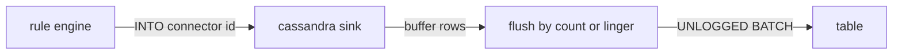

# Cassandra connector

The Cassandra connector writes rule results as bound CQL rows. It runs the maintained Scylla driver with `UNLOGGED` batches. It buffers rows and flushes by count or by linger.

Use it when wide rows must land in Cassandra or ScyllaDB. You get one batch per flush.



## Before you start

- Run Cassandra or ScyllaDB. Note the seed nodes, keyspace, and table.
- Create the keyspace and the target table. Match the columns to the row shape.
- For a full build, enable the feature: `--features cassandra`. The default build answers 400 and names the feature.

## Settings

Set `kind` to `cassandra`. The aliases `scylla`, `scylladb` and `cql` select the same runtime.

| Setting | Required | Meaning |
|---|---|---|
| `servers` | yes | Seed nodes, `host` or `host:port`. Default port 9042. |
| `keyspace` | yes | Keyspace of the table. |
| `table` | yes | Target table. Matches `[A-Za-z0-9_]+`. |
| `username` | no | SASL user. Needs `password` too. |
| `password` | no | SASL password. Needs `username` too. |
| `partition_key` | no | Token routing template. Default `${client_id}`. |

The action may override `table` and `partition_key` per target. Each row binds device id, bucket hour, event time and payload with `LOCAL_QUORUM`.

### `servers`

Seed nodes of the cluster. Type: string. Required: yes. Absent or blank: 400 naming `servers`.

```sh test
python3 - <<'PY'
import json, os, urllib.request
port = os.environ.get("API_PORT", "18083")
key = os.environ["API_KEY"]
def post(body):
    req = urllib.request.Request(
        f"http://127.0.0.1:{port}/api/v5/connectors", data=json.dumps(body).encode(), method="POST",
        headers={"Authorization": f"Bearer {key}", "Content-Type": "application/json"})
    try:
        with urllib.request.urlopen(req, timeout=5) as res:
            return res.status, json.load(res)
    except urllib.error.HTTPError as err:
            return err.code, json.load(err)
status, created = post({"name": "cass-servers-ok", "type": "cassandra",
                        "servers": "127.0.0.1:9042", "keyspace": "telemetry", "table": "t"})
assert status in (201, 400), (status, created)
status, body = post({"name": "cass-servers-bad", "type": "cassandra",
                     "keyspace": "telemetry", "table": "t"})
assert status == 400 and ("servers" in body["message"] or "cassandra" in body["message"]), body
print("ok")
PY
```

```output
ok
```

### `keyspace`

Keyspace of the table. Type: string. Required: yes. Absent or blank: 400 naming `keyspace`.

```sh test
python3 - <<'PY'
import json, os, urllib.request
port = os.environ.get("API_PORT", "18083")
key = os.environ["API_KEY"]
def post(body):
    req = urllib.request.Request(
        f"http://127.0.0.1:{port}/api/v5/connectors", data=json.dumps(body).encode(), method="POST",
        headers={"Authorization": f"Bearer {key}", "Content-Type": "application/json"})
    try:
        with urllib.request.urlopen(req, timeout=5) as res:
            return res.status, json.load(res)
    except urllib.error.HTTPError as err:
            return err.code, json.load(err)
status, body = post({"name": "cass-ks-bad", "type": "cassandra",
                     "servers": "127.0.0.1:9042", "table": "t"})
assert status == 400 and ("keyspace" in body["message"] or "cassandra" in body["message"]), body
print("ok")
PY
```

```output
ok
```

### `table`

Target table. Type: string. Required: yes. Must match `[A-Za-z0-9_]+`. Absent: 400 naming `table`.

```sh test
python3 - <<'PY'
import json, os, urllib.request
port = os.environ.get("API_PORT", "18083")
key = os.environ["API_KEY"]
def post(body):
    req = urllib.request.Request(
        f"http://127.0.0.1:{port}/api/v5/connectors", data=json.dumps(body).encode(), method="POST",
        headers={"Authorization": f"Bearer {key}", "Content-Type": "application/json"})
    try:
        with urllib.request.urlopen(req, timeout=5) as res:
            return res.status, json.load(res)
    except urllib.error.HTTPError as err:
            return err.code, json.load(err)
status, body = post({"name": "cass-table-bad", "type": "cassandra",
                     "servers": "127.0.0.1:9042", "keyspace": "telemetry", "table": "no-such-table!"})
assert status == 400 and ("table" in body["message"] or "cassandra" in body["message"]), body
print("ok")
PY
```

```output
ok
```

### `username`

SASL user. Type: string. Required: no. Needs `password` too. A half pair is 400.

```sh test
python3 - <<'PY'
import json, os, urllib.request
port = os.environ.get("API_PORT", "18083")
key = os.environ["API_KEY"]
def post(body):
    req = urllib.request.Request(
        f"http://127.0.0.1:{port}/api/v5/connectors", data=json.dumps(body).encode(), method="POST",
        headers={"Authorization": f"Bearer {key}", "Content-Type": "application/json"})
    try:
        with urllib.request.urlopen(req, timeout=5) as res:
            return res.status, json.load(res)
    except urllib.error.HTTPError as err:
            return err.code, json.load(err)
status, body = post({"name": "cass-user-bad", "type": "cassandra",
                     "servers": "127.0.0.1:9042", "keyspace": "telemetry", "table": "t",
                     "username": "u"})
assert status == 400 and ("together" in body["message"] or "cassandra" in body["message"]), body
print("ok")
PY
```

```output
ok
```

### `password`

SASL password. Type: string. Required: no. Needs `username` too. A half pair is 400.

```sh test
python3 - <<'PY'
import json, os, urllib.request
port = os.environ.get("API_PORT", "18083")
key = os.environ["API_KEY"]
def post(body):
    req = urllib.request.Request(
        f"http://127.0.0.1:{port}/api/v5/connectors", data=json.dumps(body).encode(), method="POST",
        headers={"Authorization": f"Bearer {key}", "Content-Type": "application/json"})
    try:
        with urllib.request.urlopen(req, timeout=5) as res:
            return res.status, json.load(res)
    except urllib.error.HTTPError as err:
            return err.code, json.load(err)
status, created = post({"name": "cass-pw-ok", "type": "cassandra",
                        "servers": "127.0.0.1:9042", "keyspace": "telemetry", "table": "t",
                        "username": "u", "password": "p"})
assert status in (201, 400), (status, created)
print("ok")
PY
```

```output
ok
```

### `partition_key`

Token routing template. Type: string. Required: no. Default `${client_id}`.

```sh test
python3 - <<'PY'
import json, os, urllib.request
port = os.environ.get("API_PORT", "18083")
key = os.environ["API_KEY"]
def post(body):
    req = urllib.request.Request(
        f"http://127.0.0.1:{port}/api/v5/connectors", data=json.dumps(body).encode(), method="POST",
        headers={"Authorization": f"Bearer {key}", "Content-Type": "application/json"})
    try:
        with urllib.request.urlopen(req, timeout=5) as res:
            return res.status, json.load(res)
    except urllib.error.HTTPError as err:
            return err.code, json.load(err)
status, created = post({"name": "cass-pk-ok", "type": "cassandra",
                        "servers": "127.0.0.1:9042", "keyspace": "telemetry", "table": "t",
                        "partition_key": "${payload.device}"})
assert status in (201, 400), (status, created)
print("ok")
PY
```

```output
ok
```

Example:

```json
{
  "name": "cass-sink-1",
  "type": "cassandra",
  "servers": "127.0.0.1:9042",
  "keyspace": "telemetry",
  "table": "mqtt_events"
}
```

> [!NOTE]
> The docs run creates this shape. Creation validates only; it inserts nothing. The send path needs a Cassandra server. See the failure record in [Verification failures](../_verification/failures.md).

## Check that it works

Create the connector. The broker answers 201 with the kind when the build holds Cassandra, else 400 naming the feature. Both answers print `ok`.

```toml test
[node]
id = "docs-connector-cassandra"

[listeners.tcp]
bind = "0.0.0.0:1883"

[listeners.api]
bind = "0.0.0.0:18083"

[logging]
level = "warn"

[auth]
allow_anonymous = true
```

```sh test
python3 - <<'PY'
import json, os, urllib.request
port = os.environ.get("API_PORT", "18083")
key = os.environ["API_KEY"]
body = json.dumps({"name": "cass-sink-1", "type": "cassandra",
                   "servers": "127.0.0.1:9042",
                   "keyspace": "telemetry",
                   "table": "mqtt_events"}).encode()
req = urllib.request.Request(
    f"http://127.0.0.1:{port}/api/v5/connectors", data=body, method="POST",
    headers={"Authorization": f"Bearer {key}", "Content-Type": "application/json"})
try:
    with urllib.request.urlopen(req, timeout=5) as res:
        status, created = res.status, json.load(res)
except urllib.error.HTTPError as err:
    status, created = err.code, json.load(err)
assert status in (201, 400), (status, created)
if status == 201:
    assert created["type"] == "cassandra", created
else:
    assert "cassandra" in created["message"], created
print("ok")
PY
```

```output
ok
```

## Limits

- `table` fits one fixed CQL shape per action. A template table is not supported.
- A dead server backs off and retries. The bounded queue sheds past its bound.
- Token-aware routing needs the `partition_key` template.

## Next steps

- Feed the connector from a rule in [Actions](../rules/actions.md).
- See every kind in [Connectors](./index.md).
