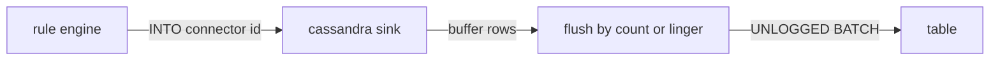
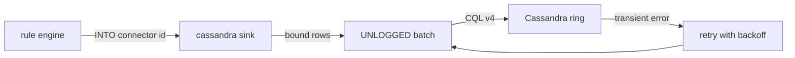

# Cassandra connector

The Cassandra connector writes rule results as bound CQL rows. It runs the maintained Scylla driver with `UNLOGGED` batches. It buffers rows and flushes by count or by linger.

Use it when wide rows must land in Cassandra or ScyllaDB. You get one batch per flush.



## Before you start

- Run Cassandra or ScyllaDB. Note the seed nodes, keyspace, and table.
- Create the keyspace and the target table. Match the columns to the row shape.
- For a full build, enable the feature: `--features cassandra`. The default build answers 400 and names the feature.

## Settings

Set `kind` to `cassandra`. The aliases `scylla`, `scylladb` and `cql` select the same runtime.

| Setting | Required | Meaning |
|---|---|---|
| `servers` | yes | Seed nodes, `host` or `host:port`. Default port 9042. |
| `keyspace` | yes | Keyspace of the table. |
| `table` | yes | Target table. Matches `[A-Za-z0-9_]+`. |
| `username` | no | SASL user. Needs `password` too. |
| `password` | no | SASL password. Needs `username` too. |
| `partition_key` | no | Token routing template. Default `${client_id}`. |

The action may override `table` and `partition_key` per target. Each row binds device id, bucket hour, event time and payload with `LOCAL_QUORUM`.

### `servers`

Seed nodes of the cluster. Type: string. Required: yes. Absent or blank: 400 naming `servers`.

```sh test
python3 - <<'PY'
import json, os, urllib.request
port = os.environ.get("API_PORT", "18083")
key = os.environ["API_KEY"]
def post(body):
    req = urllib.request.Request(
        f"http://127.0.0.1:{port}/api/v5/connectors", data=json.dumps(body).encode(), method="POST",
        headers={"Authorization": f"Bearer {key}", "Content-Type": "application/json"})
    try:
        with urllib.request.urlopen(req, timeout=5) as res:
            return res.status, json.load(res)
    except urllib.error.HTTPError as err:
            return err.code, json.load(err)
status, created = post({"name": "cass-servers-ok", "type": "cassandra",
                        "servers": "127.0.0.1:9042", "keyspace": "telemetry", "table": "t"})
assert status in (201, 400), (status, created)
status, body = post({"name": "cass-servers-bad", "type": "cassandra",
                     "keyspace": "telemetry", "table": "t"})
assert status == 400 and ("servers" in body["message"] or "cassandra" in body["message"]), body
print("ok")
PY
```

```output
ok
```

### `keyspace`

Keyspace of the table. Type: string. Required: yes. Absent or blank: 400 naming `keyspace`.

```sh test
python3 - <<'PY'
import json, os, urllib.request
port = os.environ.get("API_PORT", "18083")
key = os.environ["API_KEY"]
def post(body):
    req = urllib.request.Request(
        f"http://127.0.0.1:{port}/api/v5/connectors", data=json.dumps(body).encode(), method="POST",
        headers={"Authorization": f"Bearer {key}", "Content-Type": "application/json"})
    try:
        with urllib.request.urlopen(req, timeout=5) as res:
            return res.status, json.load(res)
    except urllib.error.HTTPError as err:
            return err.code, json.load(err)
status, body = post({"name": "cass-ks-bad", "type": "cassandra",
                     "servers": "127.0.0.1:9042", "table": "t"})
assert status == 400 and ("keyspace" in body["message"] or "cassandra" in body["message"]), body
print("ok")
PY
```

```output
ok
```

### `table`

Target table. Type: string. Required: yes. Must match `[A-Za-z0-9_]+`. Absent: 400 naming `table`.

```sh test
python3 - <<'PY'
import json, os, urllib.request
port = os.environ.get("API_PORT", "18083")
key = os.environ["API_KEY"]
def post(body):
    req = urllib.request.Request(
        f"http://127.0.0.1:{port}/api/v5/connectors", data=json.dumps(body).encode(), method="POST",
        headers={"Authorization": f"Bearer {key}", "Content-Type": "application/json"})
    try:
        with urllib.request.urlopen(req, timeout=5) as res:
            return res.status, json.load(res)
    except urllib.error.HTTPError as err:
            return err.code, json.load(err)
status, body = post({"name": "cass-table-bad", "type": "cassandra",
                     "servers": "127.0.0.1:9042", "keyspace": "telemetry", "table": "no-such-table!"})
assert status == 400 and ("table" in body["message"] or "cassandra" in body["message"]), body
print("ok")
PY
```

```output
ok
```

### `username`

SASL user. Type: string. Required: no. Needs `password` too. A half pair is 400.

```sh test
python3 - <<'PY'
import json, os, urllib.request
port = os.environ.get("API_PORT", "18083")
key = os.environ["API_KEY"]
def post(body):
    req = urllib.request.Request(
        f"http://127.0.0.1:{port}/api/v5/connectors", data=json.dumps(body).encode(), method="POST",
        headers={"Authorization": f"Bearer {key}", "Content-Type": "application/json"})
    try:
        with urllib.request.urlopen(req, timeout=5) as res:
            return res.status, json.load(res)
    except urllib.error.HTTPError as err:
            return err.code, json.load(err)
status, body = post({"name": "cass-user-bad", "type": "cassandra",
                     "servers": "127.0.0.1:9042", "keyspace": "telemetry", "table": "t",
                     "username": "u"})
assert status == 400 and ("together" in body["message"] or "cassandra" in body["message"]), body
print("ok")
PY
```

```output
ok
```

### `password`

SASL password. Type: string. Required: no. Needs `username` too. A half pair is 400.

```sh test
python3 - <<'PY'
import json, os, urllib.request
port = os.environ.get("API_PORT", "18083")
key = os.environ["API_KEY"]
def post(body):
    req = urllib.request.Request(
        f"http://127.0.0.1:{port}/api/v5/connectors", data=json.dumps(body).encode(), method="POST",
        headers={"Authorization": f"Bearer {key}", "Content-Type": "application/json"})
    try:
        with urllib.request.urlopen(req, timeout=5) as res:
            return res.status, json.load(res)
    except urllib.error.HTTPError as err:
            return err.code, json.load(err)
status, created = post({"name": "cass-pw-ok", "type": "cassandra",
                        "servers": "127.0.0.1:9042", "keyspace": "telemetry", "table": "t",
                        "username": "u", "password": "p"})
assert status in (201, 400), (status, created)
print("ok")
PY
```

```output
ok
```

### `partition_key`

Token routing template. Type: string. Required: no. Default `${client_id}`.

```sh test
python3 - <<'PY'
import json, os, urllib.request
port = os.environ.get("API_PORT", "18083")
key = os.environ["API_KEY"]
def post(body):
    req = urllib.request.Request(
        f"http://127.0.0.1:{port}/api/v5/connectors", data=json.dumps(body).encode(), method="POST",
        headers={"Authorization": f"Bearer {key}", "Content-Type": "application/json"})
    try:
        with urllib.request.urlopen(req, timeout=5) as res:
            return res.status, json.load(res)
    except urllib.error.HTTPError as err:
            return err.code, json.load(err)
status, created = post({"name": "cass-pk-ok", "type": "cassandra",
                        "servers": "127.0.0.1:9042", "keyspace": "telemetry", "table": "t",
                        "partition_key": "${payload.device}"})
assert status in (201, 400), (status, created)
print("ok")
PY
```

```output
ok
```

Example:

```json
{
  "name": "cass-sink-1",
  "type": "cassandra",
  "servers": "127.0.0.1:9042",
  "keyspace": "telemetry",
  "table": "mqtt_events"
}
```

> [!NOTE]
> The docs run creates this shape. Creation validates only; it inserts nothing. The send path needs a Cassandra server. See the failure record in [Verification failures](../_verification/failures.md).

## Check that it works

Create the connector. The broker answers 201 with the kind when the build holds Cassandra, else 400 naming the feature. Both answers print `ok`.

```toml test
[node]
id = "docs-connector-cassandra"

[listeners.tcp]
bind = "0.0.0.0:1883"

[listeners.api]
bind = "0.0.0.0:18083"

[logging]
level = "warn"

[auth]
allow_anonymous = true
```

```sh test
python3 - <<'PY'
import json, os, urllib.request
port = os.environ.get("API_PORT", "18083")
key = os.environ["API_KEY"]
body = json.dumps({"name": "cass-sink-1", "type": "cassandra",
                   "servers": "127.0.0.1:9042",
                   "keyspace": "telemetry",
                   "table": "mqtt_events"}).encode()
req = urllib.request.Request(
    f"http://127.0.0.1:{port}/api/v5/connectors", data=body, method="POST",
    headers={"Authorization": f"Bearer {key}", "Content-Type": "application/json"})
try:
    with urllib.request.urlopen(req, timeout=5) as res:
        status, created = res.status, json.load(res)
except urllib.error.HTTPError as err:
    status, created = err.code, json.load(err)
assert status in (201, 400), (status, created)
if status == 201:
    assert created["type"] == "cassandra", created
else:
    assert "cassandra" in created["message"], created
print("ok")
PY
```

```output
ok
```

## Limits

- `table` fits one fixed CQL shape per action. A template table is not supported.
- A dead server backs off and retries. The bounded queue sheds past its bound.
- Token-aware routing needs the `partition_key` template.

## Next steps

- Feed the connector from a rule in [Actions](../rules/actions.md).
- See every kind in [Connectors](./index.md).

## Reference form (v1 API)

The reference form uses the v1 connector API. The v5 form above uses connector and action documents. This section keeps the reference page.

The Cassandra connector writes each rule result as a bound CQL row. It batches rows as `UNLOGGED` statements over the CQL binary protocol. It uses the Murmur3 partitioner for token-aware routing and retries transient faults.

Use it when broker data must land in Cassandra or ScyllaDB tables. You get one batch per flush, your own CQL statement, and password auth or no auth.



### Before you start

- Run a Cassandra or ScyllaDB cluster. Note the seed hosts and the keyspace.
- Create the keyspace and the target table. Match the table to your CQL statement.
- For a full build, enable the feature: `--features cassandra`. The default build answers 400 and names the feature.

### Settings

Set `kind` to `cassandra` on the v1 API. The v1 route also accepts `scylla` and `cql`. It stores the kind as `cassandra`.

| Setting | Required | Meaning |
|---|---|---|
| `contact_points` | yes | Seed hosts. Give at least one `host` or `host:port`. The default port is 9042. An empty host or a port outside 1 to 65535 is refused. |
| `keyspace` | yes | CQL keyspace. It must match `[A-Za-z0-9_]+`. |
| `table_template` | yes | Table name template. It accepts `${topic}`, `${qos}`, and `${timestamp}`. Other characters become `_`. The result must not be empty. An unknown variable is refused. |
| `auth` | no | Auth object. `{"type":"none"}` sends no auth. `{"type":"password","username":"...","password":"..."}` uses SASL PLAIN. Default is `none`. A password login needs a non-empty user name. |
| `consistency` | no | Consistency level: `one`, `quorum`, `localquorum`, or `all`. Default `localquorum`. |
| `partition_key_template` | yes | Partition key template. It accepts `${topic}`, `${client_id}`, `${device_id}`, `${qos}`, and `${timestamp}`. The broker hashes the rendered key with Murmur3. An unknown variable is refused. |
| `cql_statement_template` | yes | The insert statement. It must hold 4 `?` markers for device id, bucket hour, event time, and payload. With `ttl_secs` it must hold 5 markers. Markers inside strings and comments do not count. A wrong count is refused. |
| `ttl_secs` | no | Row TTL in seconds. It needs a fifth `?` marker for `USING TTL ?`. Default is none. |
| `batch_size` | no | Rows per batch. Default 100. A value of 0 is refused. `null` means no row bound. |
| `batch_bytes` | no | Buffered byte limit. Default 1048576. A value of 0 is refused. `null` means no byte bound. |
| `linger_ms` | no | Linger before a partial batch flushes. Default 10. `null` means no linger bound. |
| `max_retries` | no | Retries on transient faults. Default 4. `null` means no limit. A value of 0 means no retry. |
| `initial_backoff_ms` | no | First retry delay. Default 100. Values below 1 become 1. |
| `max_backoff_ms` | no | Retry delay ceiling. Default 2000. Values below 1 become 1. |
| `timeout_ms` | no | Connect and request deadline. Default 5000. Values below 1 become 1. |

The v5 route reads `server`, `servers`, or `contact_points` and splits the value on commas. The default is `127.0.0.1:9042`. It reads `keyspace` (default `idacs`) and `table` or `table_template` (default `sensor_events`). It reads `username` and `password`; a password login needs both, else it uses no auth. It reads `timeout_ms`, `timeout`, or `request_timeout_ms`. The v5 route fixes `consistency` to `one`, `partition_key_template` to `${client_id}`, `ttl_secs` to none, and the CQL to an insert of `device_id`, `bucket_hour`, `event_time`, and `payload`. It fixes the batch to 1 row, 1048576 bytes, 10 ms linger, 4 retries, 100 ms initial backoff, and 2000 ms maximum backoff.

Example:

```json
{
  "id": "cassandra-1",
  "kind": "cassandra",
  "config": {
    "contact_points": ["10.0.0.1:9042", "10.0.0.2:9042"],
    "keyspace": "telemetry",
    "table_template": "events_${topic}",
    "auth": {"type": "password", "username": "cassandra", "password": "secret"},
    "consistency": "localquorum",
    "partition_key_template": "${client_id}",
    "cql_statement_template": "INSERT INTO telemetry.events (device_id, bucket_hour, event_time, payload) VALUES (?, ?, ?, ?)",
    "ttl_secs": null,
    "batch_size": 100,
    "batch_bytes": 1048576,
    "linger_ms": 10,
    "max_retries": 4,
    "initial_backoff_ms": 100,
    "max_backoff_ms": 2000,
    "timeout_ms": 5000
  }
}
```

> [!NOTE]
> The docs run creates this shape. Creation validates only; it opens no socket. The send path needs a Cassandra cluster. See the failure record in [Verification failures](../_verification/failures.md).

### Check that it works

Create the connector. The broker answers 201 with the kind when the build holds the feature, else 400 naming the feature. Both answers print `ok`.

```toml test
# Reference form run.
[node]
id = "docs-connector-cassandra"

[listeners.tcp]
bind = "0.0.0.0:1883"

[listeners.api]
bind = "0.0.0.0:18083"

[logging]
level = "warn"

[auth]
allow_anonymous = true
```

```sh test
python3 - <<'PY'
import json, os, urllib.request, urllib.error
port = os.environ.get("API_PORT", "18083")
key = os.environ["API_KEY"]
body = json.dumps({"id": "cassandra-1", "kind": "cassandra",
                   "config": {"contact_points": ["10.0.0.1:9042",
                                                 "10.0.0.2:9042"],
                              "keyspace": "telemetry",
                              "table_template": "events_${topic}",
                              "auth": {"type": "password",
                                       "username": "cassandra",
                                       "password": "secret"},
                              "consistency": "localquorum",
                              "partition_key_template": "${client_id}",
                              "cql_statement_template": "INSERT INTO telemetry.events (device_id, bucket_hour, event_time, payload) VALUES (?, ?, ?, ?)",
                              "ttl_secs": None,
                              "batch_size": 100,
                              "batch_bytes": 1048576,
                              "linger_ms": 10,
                              "max_retries": 4,
                              "initial_backoff_ms": 100,
                              "max_backoff_ms": 2000,
                              "timeout_ms": 5000}}).encode()
req = urllib.request.Request(
    f"http://127.0.0.1:{port}/api/v1/connectors", data=body, method="POST",
    headers={"Authorization": f"Bearer {key}", "Content-Type": "application/json"})
try:
    with urllib.request.urlopen(req, timeout=5) as res:
        status, created = res.status, json.load(res)
except urllib.error.HTTPError as err:
    status, created = err.code, json.load(err)
assert status in (201, 400), (status, created)
if status == 201:
    assert created["kind"] == "cassandra", created
else:
    assert "cassandra" in created["error"].lower(), created
print("ok")
PY
```

```output
ok
```

### Limits

- An empty `contact_points` list is refused with 400. A bad host or port is refused with 400. An empty contact point is refused with 400.
- An empty `keyspace`, `table_template`, or `partition_key_template` is refused with 400. A bad keyspace is refused with 400. An unknown template variable is refused with 400.
- A password login with an empty user name is refused with 400. A `ttl_secs` value without a fifth marker is refused with 400. A CQL statement with the wrong marker count is refused with 400.
- A `batch_size` or `batch_bytes` of 0 is refused with 400.
- A row needs a non-empty topic, a UTF-8 payload, and a JSON payload. A bad row gives a dispatch error.
- The row takes `device_id` from the JSON payload when it is a string, else from the topic. It takes `bucket_hour` from the event time in UTC as `YYYY-MM-DDTHH`. It sends the event time in milliseconds and the payload text. It adds the TTL value when `ttl_secs` is set.
- The CQL text names the table. `table_template` groups rows for a flush and does not rewrite the CQL text.
- The production path uses `ScyllaCassandraTransport` on the maintained driver. It speaks CQL v4, authenticates with SASL PLAIN, prepares the insert once per CQL shape, and sends `UNLOGGED` batches with the configured consistency.
- Transient faults retry: server error, unavailable, overloaded, bootstrapping, read and write timeouts, and broken connections. Other faults are terminal.
- Retries use `initial_backoff_ms`, double each attempt, add jitter, and stop at `max_backoff_ms`. After the last attempt the broker restores the rows in order and backs off. The restore backoff waits 2 seconds, doubles, and stops at 30 seconds.
- The connector runs behind the rule engine bounded queue. A slow cluster never stalls publishers.
- The tier is enterprise. The kind needs the `cassandra` feature build.

### Next steps

- Feed the connector from a rule in [Actions](../rules/actions.md).
- See every kind in [Connectors](./index.md).
