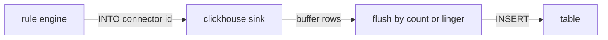

# ClickHouse connector

The ClickHouse connector inserts rule results as analytic rows. It writes with the maintained ClickHouse driver in native row encoding. It buffers rows and flushes by count or by linger.

Use it when analytics must query broker data with SQL. You get one insert per batch.



## Before you start

- Run ClickHouse. Note the HTTP endpoint, database, and table.
- Create the target table. Match its columns to the row shape.
- For a full build, enable the feature: `--features clickhouse`. The default build answers 400 and names the feature.

## Settings

Set `kind` to `clickhouse`.

| Setting | Required | Meaning |
|---|---|---|
| `endpoint` | yes | Base HTTP endpoint, for example `http://ch:8123`. |
| `database` | yes | Target database. |
| `table` | yes | Target table. |
| `format` | yes | Insert format; `JSONEachRow` is the default shape. |
| `batch_size` | yes | Rows per insert, at least 1. |
| `batch_timeout_ms` | yes | Linger before a partial batch flushes. |
| `username` | no | ClickHouse user; default `default`. |
| `password` | no | ClickHouse password; default empty. |
| `request_timeout_ms` | no | Per-request timeout in ms; default 5000. |

Example:

```json
{
  "id": "ch-sink-1",
  "kind": "clickhouse",
  "config": {
    "endpoint": "http://127.0.0.1:8123",
    "database": "indra",
    "table": "mqtt_events",
    "format": "JSONEachRow",
    "batch_size": 100,
    "batch_timeout_ms": 50
  }
}
```

> [!NOTE]
> The docs run creates this shape. Creation validates only; it inserts nothing. The send path needs a ClickHouse server. See the failure record in [Verification failures](../_verification/failures.md).

## Check that it works

Create the connector. The broker answers 201 with the kind when the build holds ClickHouse, else 400 naming the feature. Both answers print `ok`.

```toml test
[node]
id = "docs-connector-clickhouse"

[listeners.tcp]
bind = "0.0.0.0:1883"

[listeners.api]
bind = "0.0.0.0:18083"

[logging]
level = "warn"

[auth]
allow_anonymous = true
```

```sh test
python3 - <<'PY'
import json, os, urllib.request
port = os.environ.get("API_PORT", "18083")
key = os.environ["API_KEY"]
body = json.dumps({"id": "ch-sink-1", "kind": "clickhouse",
                   "config": {"endpoint": "http://127.0.0.1:8123",
                              "database": "indra", "table": "mqtt_events",
                              "format": "JSONEachRow", "batch_size": 100,
                              "batch_timeout_ms": 50}}).encode()
req = urllib.request.Request(
    f"http://127.0.0.1:{port}/api/v1/connectors", data=body, method="POST",
    headers={"Authorization": f"Bearer {key}", "Content-Type": "application/json"})
try:
    with urllib.request.urlopen(req, timeout=5) as res:
        status, created = res.status, json.load(res)
except urllib.error.HTTPError as err:
    status, created = err.code, json.load(err)
assert status in (201, 400), (status, created)
if status == 201:
    assert created["kind"] == "clickhouse", created
else:
    assert "clickhouse" in created["error"], created
print("ok")
PY
```

```output
ok
```

## Limits

- `batch_size` must be at least 1. Small batches bound per-connector memory.
- A dead server backs off and retries. The bounded queue sheds past its bound.
- The driver path writes native row encoding; the `format` field selects the fallback shape.

## Next steps

- Feed the connector from a rule in [Actions](../rules/actions.md).
- See every kind in [Connectors](./index.md).
