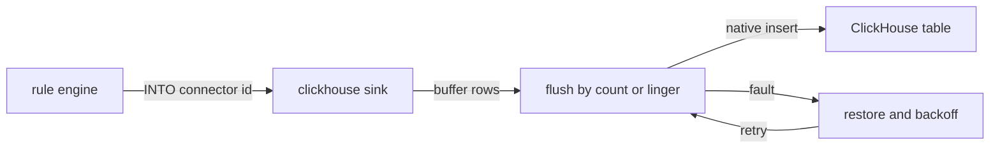

# ClickHouse connector

The ClickHouse connector inserts rule results as analytical rows. It writes with the maintained ClickHouse driver in native row encoding. It buffers rows and flushes by count or by linger.

Use it when analytics must query broker data with SQL. You get one insert per batch with the columns `topic`, `qos`, and `payload`.



## Before you start

- Run ClickHouse. Note the HTTP endpoint, database, and table.
- Create the target table with the columns `topic String`, `qos UInt8`, and `payload String`.
- For a full build, enable the feature: `--features clickhouse`. The default build answers 400 and names the feature.

## Settings

Set `kind` to `clickhouse` on the v1 API. The v1 route also accepts `ch`. It stores the kind as `clickhouse`.

| Setting | Required | Meaning |
|---|---|---|
| `endpoint` | yes | Base HTTP endpoint. It must start with `http://` or `https://`, for example `http://ch:8123`. |
| `database` | yes | Target database. It must match `[A-Za-z0-9_]+`. |
| `table` | yes | Target table. It must match `[A-Za-z0-9_]+`. |
| `format` | yes | Insert format for the HTTP fallback: `JSONEachRow`, `JSONStringsEachRow`, `JSONObjectEachRow`, `TabSeparated`, or `CSV`. Any other value is refused. The driver path validates the value and writes native `RowBinaryWithNamesAndTypes`. |
| `batch_size` | yes | Rows per insert. It must be at least 1. A value of 0 is refused. |
| `batch_timeout_ms` | yes | Linger before a partial batch flushes. |
| `username` | no | ClickHouse user. Default `default`. It must not be empty. |
| `password` | no | ClickHouse password. Default empty. |
| `request_timeout_ms` | no | Per-request deadline. Default 5000. Values below 1 become 1. |

The v5 route reads `url` or `server`. The default is `http://127.0.0.1:8123`; a value without a scheme gets `http://`. It reads `database` (default `default`) and `table` (default `test_mqtt_events`). It reads `username` or `user` (default `default`) and `password`. It reads `request_timeout_ms`, `timeout_ms`, or `timeout`. The v5 route fixes `format` to `JSONEachRow`, `batch_size` to 1, and `batch_timeout_ms` to 10.

Example:

```json
{
  "id": "ch-sink-1",
  "kind": "clickhouse",
  "config": {
    "endpoint": "http://127.0.0.1:8123",
    "database": "indra",
    "table": "mqtt_events",
    "format": "JSONEachRow",
    "batch_size": 100,
    "batch_timeout_ms": 50,
    "username": "default",
    "password": "",
    "request_timeout_ms": 5000
  }
}
```

> [!NOTE]
> The docs run creates this shape. Creation validates only; it inserts nothing. The send path needs a ClickHouse server. See the failure record in [Verification failures](../_verification/failures.md).

## Check that it works

Create the connector. The broker answers 201 with the kind when the build holds ClickHouse, else 400 naming the feature. Both answers print `ok`.

```toml test
[node]
id = "docs-connector-clickhouse"

[listeners.tcp]
bind = "0.0.0.0:1883"

[listeners.api]
bind = "0.0.0.0:18083"

[logging]
level = "warn"

[auth]
allow_anonymous = true
```

```sh test
python3 - <<'PY'
import json, os, urllib.request, urllib.error
port = os.environ.get("API_PORT", "18083")
key = os.environ["API_KEY"]
body = json.dumps({"id": "ch-sink-1", "kind": "clickhouse",
                   "config": {"endpoint": "http://127.0.0.1:8123",
                              "database": "indra", "table": "mqtt_events",
                              "format": "JSONEachRow", "batch_size": 100,
                              "batch_timeout_ms": 50,
                              "username": "default", "password": "",
                              "request_timeout_ms": 5000}}).encode()
req = urllib.request.Request(
    f"http://127.0.0.1:{port}/api/v1/connectors", data=body, method="POST",
    headers={"Authorization": f"Bearer {key}", "Content-Type": "application/json"})
try:
    with urllib.request.urlopen(req, timeout=5) as res:
        status, created = res.status, json.load(res)
except urllib.error.HTTPError as err:
    status, created = err.code, json.load(err)
assert status in (201, 400), (status, created)
if status == 201:
    assert created["kind"] == "clickhouse", created
else:
    assert "clickhouse" in created["error"].lower(), created
print("ok")
PY
```

```output
ok
```

## Limits

- An endpoint outside `http://` and `https://` is refused with 400. A bad database or table name is refused with 400. An empty user name is refused with 400.
- A `format` outside the list is refused with 400. A `batch_size` of 0 is refused with 400.
- A row needs a non-empty topic and a UTF-8 payload. The sink refuses a QoS 2 event. A bad row gives a dispatch error.
- The row maps `topic` to `String`, `qos` to `UInt8`, and `payload` to `String`. Field order matches the table columns above.
- The production path uses `DriverClickHouseTransport` on the official driver. It holds the HTTP pool, Basic auth, and database, and it inserts with `RowBinaryWithNamesAndTypes`. The driver lets the server check the column types. Create the table before you send rows.
- The HTTP fallback uses `INSERT INTO <database>.<table> FORMAT <format>`. The offline tests and deployments that pin the JSON wire format use this path.
- A dead server backs off and retries. A failed flush restores the rows in order and engages backoff. The backoff waits 2 seconds, doubles, and stops at 30 seconds. Flushes fail fast during backoff.
- The connector runs behind the rule engine bounded queue. A slow server never stalls publishers.
- The tier is community. The kind needs the `clickhouse` feature build.

## Next steps

- Feed the connector from a rule in [Actions](../rules/actions.md).
- See every kind in [Connectors](./index.md).

## Known limits in this release

The broker accepts the fields in this list. The broker does not apply them in this release.

- `batch_size` (the batch size)
- `batch_timeout_ms` (the batch wait time)

To set batching, use `resource_opts` in the action. The broker applies `resource_opts`.

A later release applies these fields.
