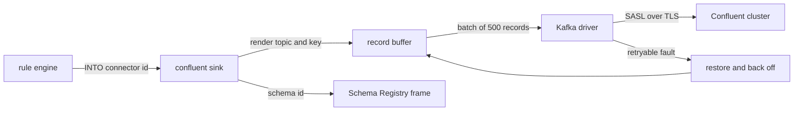

# Confluent connector

The Confluent connector publishes each rule result as one Kafka record. It renders the destination topic and the record key from templates. It places records with the Kafka murmur2 partitioner and can frame each value with a Schema Registry id.

Use it when broker data must reach Confluent Cloud or a compatible Kafka cluster with SASL. You get one record per rule result, a topic template, a key template, and optional Schema Registry framing.



## Before you start

- Run Confluent Cloud or a Kafka cluster with SASL. Note the bootstrap servers, the API key, and the API secret.
- Create the target topic. The topic template must render a name that exists.
- For a full build, enable the feature: `--features confluent`. The default build answers 400 and names the feature.
- For Schema Registry framing, note the registry endpoint, its key, its secret, and the schema id to send.

## Settings

Set `kind` to `confluent` on the v1 API. The v1 route also accepts `confluent_kafka` and `confluent_cloud`. It stores the kind as `confluent`.

| Setting | Required | Meaning |
|---|---|---|
| `bootstrap_servers` | yes | Array of `host:port` broker endpoints. An empty list or an empty element is refused. |
| `api_key` | yes | SASL user name. An empty value is refused. The v5 route also reads `username`. |
| `api_secret` | yes | SASL password. An empty value is refused. The v5 route also reads `password`. |
| `auth_mechanism` | no | `plain` (default), `scramsha256`, or `scramsha512`. |
| `security_protocol` | no | `SASL_SSL` (default) or `SASL_PLAINTEXT`. Use `SASL_PLAINTEXT` only for a trusted local endpoint without certificates. |
| `topic_template` | yes | Destination topic. It accepts `${topic}`, `${topic_segment_N}` (1-based), and `${client_id}`. An unknown or unclosed variable is refused. A rendered empty value is refused. A `${payload.<path>}` variable fails creation because validation uses an empty payload. |
| `partition_key_template` | no | Record key. It accepts `${topic}`, `${topic_segment_N}`, and `${client_id}`. Creation uses an empty payload, so a `${payload.<path>}` variable is refused. The default is none, which sends a null key. A rendered empty value sends a null key. |
| `schema_registry` | no | Object with `endpoint`, `api_key`, `api_secret`, and `schema_id`. The endpoint must start with `http://` or `https://`. The key and secret must not be empty. Each value gets the magic byte `0x00` and the big-endian schema id ahead of the payload. The sink does not register a schema at send time. |
| `partitions` | no | Partition count for murmur2 routing. The default is 12. A value of 0 is refused. A null key goes to partition 0. |
| `batch_size` | no | Records per flush. The default is 500. A value of 0 is refused. `null` means no row bound. |
| `buffer_capacity` | no | Record buffer bound. The default is none, which is no bound. When the buffer holds this many records, a send fails with a connection error. |
| `timeout_ms` | no | Driver request and socket deadline. The default is 5000. A value below 1 becomes 1. |

The v5 route reads `bootstrap_servers`, `bootstrap_hosts`, `server`, or `servers` as one string. It removes a leading `http://` or `tcp://`. The default is `127.0.0.1:9092`. It reads `topic_template` or `topic` (default `telemetry-events`) and `timeout_ms`, `timeout`, or `request_timeout_ms`. It requires `api_key` or `username` and `api_secret` or `password`. It fixes `auth_mechanism` to `plain`, `security_protocol` to `SASL_SSL`, `partition_key_template` to `${client_id}`, `schema_registry` to none, `partitions` to 1, `batch_size` to 1, and `buffer_capacity` to none. It registers the name and the alias `confluent:name`.

Example:

```json
{
  "id": "confluent-1",
  "kind": "confluent",
  "config": {
    "bootstrap_servers": ["pkc-xxxx.us-east-1.aws.confluent.cloud:9092"],
    "api_key": "EXAMPLE_KEY",
    "api_secret": "EXAMPLE_SECRET",
    "auth_mechanism": "plain",
    "security_protocol": "SASL_SSL",
    "topic_template": "telemetry-${topic_segment_1}",
    "partition_key_template": "${client_id}",
    "schema_registry": {
      "endpoint": "https://psrc-xxxx.us-east-1.aws.confluent.cloud",
      "api_key": "REGISTRY_KEY",
      "api_secret": "REGISTRY_SECRET",
      "schema_id": 1001
    },
    "partitions": 12,
    "batch_size": 500,
    "buffer_capacity": null,
    "timeout_ms": 5000
  }
}
```

> [!NOTE]
> The docs run creates this shape. Creation validates only; it opens no socket. The send path needs a Confluent cluster. See the failure record in [Verification failures](../_verification/failures.md).

## Check that it works

The broker answers 201 with the kind when the build holds the feature. The default build answers 400 and names the feature. A missing credential answers 400 and names the field. Each allowed answer prints `ok`.

```toml test
[node]
id = "docs-connector-confluent"

[listeners.tcp]
bind = "0.0.0.0:1883"

[listeners.api]
bind = "0.0.0.0:18083"

[logging]
level = "warn"

[auth]
allow_anonymous = true
```

```sh test
python3 - <<'PY'
import json, os, urllib.request, urllib.error
port = os.environ.get("API_PORT", "18083")
key = os.environ["API_KEY"]
def call(method, path, body):
    data = json.dumps(body).encode()
    req = urllib.request.Request(
        f"http://127.0.0.1:{port}{path}", data=data, method=method,
        headers={"Authorization": f"Bearer {key}", "Content-Type": "application/json"})
    try:
        with urllib.request.urlopen(req, timeout=5) as res:
            return res.status, json.load(res)
    except urllib.error.HTTPError as err:
        return err.code, json.load(err)
config = {"bootstrap_servers": ["pkc-xxxx.us-east-1.aws.confluent.cloud:9092"],
          "api_key": "EXAMPLE_KEY", "api_secret": "EXAMPLE_SECRET",
          "auth_mechanism": "plain", "security_protocol": "SASL_SSL",
          "topic_template": "telemetry-${topic_segment_1}",
          "partition_key_template": "${client_id}",
          "schema_registry": {
              "endpoint": "https://psrc-xxxx.us-east-1.aws.confluent.cloud",
              "api_key": "REGISTRY_KEY", "api_secret": "REGISTRY_SECRET",
              "schema_id": 1001},
          "partitions": 12, "batch_size": 500,
          "buffer_capacity": None, "timeout_ms": 5000}
s1, b1 = call("POST", "/api/v1/connectors",
              {"id": "confluent-1", "kind": "confluent", "config": config})
assert s1 in (201, 400), (s1, b1)
if s1 == 201:
    assert b1["kind"] == "confluent", (s1, b1)
else:
    assert "confluent" in json.dumps(b1).lower(), (s1, b1)
s2, b2 = call("POST", "/api/v5/connectors",
              {"name": "confluent-2", "type": "confluent",
               "bootstrap_servers": "pkc-xxxx.us-east-1.aws.confluent.cloud:9092",
               "api_key": "EXAMPLE_KEY", "api_secret": "EXAMPLE_SECRET",
               "topic_template": "telemetry-events", "timeout_ms": 5000})
assert s2 in (201, 400), (s2, b2)
if s2 == 201:
    assert b2["type"] == "confluent", (s2, b2)
else:
    assert "confluent" in json.dumps(b2).lower(), (s2, b2)
s3, b3 = call("POST", "/api/v5/connectors",
              {"name": "confluent-no-secret", "type": "confluent",
               "bootstrap_servers": "127.0.0.1:9092",
               "api_key": "EXAMPLE_KEY",
               "topic_template": "telemetry-events"})
assert s3 == 400, (s3, b3)
assert "api_secret" in json.dumps(b3), (s3, b3)
print("ok")
PY
```

```output
ok
```

## Limits

- An empty `bootstrap_servers`, `api_key`, `api_secret`, or `topic_template` is refused with 400.
- An unknown or unclosed template variable is refused at creation. A topic that renders empty is refused. A `${payload.<path>}` variable in `topic_template` or `partition_key_template` is refused at creation because validation uses an empty payload.
- A Schema Registry endpoint outside `http://` and `https://` is refused with 400. An empty registry key or secret is refused with 400.
- A `partitions` value of 0 and a `batch_size` value of 0 are refused with 400.
- A record carries the headers `mqtt.topic`, `mqtt.qos`, and `mqtt.timestamp`. The value is the payload bytes, with the Schema Registry frame when `schema_registry` is set.
- The sink flushes when the buffer holds `batch_size` records, or on an explicit flush. It has no time-based flush.
- The production path uses `RdkafkaConfluentTransport` on the maintained driver. It sets `request.required.acks` to `all`. It sends one delivery future at a time, so at most one flush is in flight.
- A retryable driver error restores the batch at the front and backs off. A terminal driver error drops the batch. An authentication, SASL, SSL, or oversize message error is terminal. Backoff waits 2 seconds, doubles, and stops at 30 seconds.
- The sink does not contact the registry on the send path. It frames values with the configured `schema_id`.
- The connector runs behind the rule engine bounded queue. A slow cluster never stalls publishers.
- The tier is enterprise. The kind needs the `confluent` feature build.

## Next steps

- Use the documented producer name on [Confluent Producer](./confluent_producer.md).
- Feed the connector from a rule in [Actions](../rules/actions.md).
- See every kind in [Connectors](./index.md).
