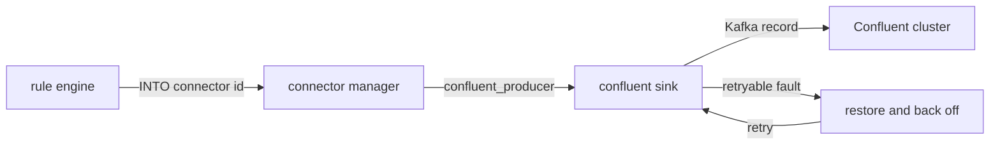

# Confluent Producer connector

`confluent_producer` is the documented name for the `confluent` runtime. The v5 connector route accepts this name and runs the Confluent sink. The v1 connector route does not accept this name. Use the v5 route, or use `confluent` on the v1 route.

Use it when a console stores a connector under the producer name. You get the Confluent record path with the stored name.



## Before you start

- Note the bootstrap servers, the API key, and the API secret.
- Create the target topic.
- For a full build, enable the feature: `--features confluent`. The default build answers 400 and names the feature.
- Use `POST /api/v5/connectors`. The v1 route refuses this name.

## Settings

Set `type` to `confluent_producer` on the v5 API. The row keeps this type. The sink runs the `confluent` runtime.

| Setting | Required | Meaning |
|---|---|---|
| `type` | yes | It must be `confluent_producer` on the v5 route. |
| `name` | yes | Connector id. `id` is an alias. |
| `bootstrap_servers` | no | Broker endpoint as one string. The `bootstrap_hosts`, `server`, and `servers` keys are aliases. The default is `127.0.0.1:9092`. A leading `http://` or `tcp://` is removed. |
| `topic_template` | no | Destination topic. The `topic` key is an alias. The default is `telemetry-events`. |
| `api_key` | no | SASL user name. The `username` key is an alias. A live sink needs a non-empty value. |
| `api_secret` | no | SASL password. The `password` key is an alias. A live sink needs a non-empty value. |
| `timeout_ms` | no | Driver request and socket deadline. The `timeout` and `request_timeout_ms` keys are aliases. The default is 5000. A value below 1 becomes 1. |

The v5 route stores these keys but does not use the value:

| Stored key | v5 fixed value |
|---|---|
| `auth_mechanism` | `plain` |
| `security_protocol` | `SASL_SSL` |
| `partition_key_template` | `${client_id}` |
| `schema_registry` | none |
| `partitions` | 1 |
| `batch_size` | 1 |
| `buffer_capacity` | none |

Example:

```json
{
  "name": "confluent-producer-1",
  "type": "confluent_producer",
  "bootstrap_servers": "pkc-xxxx.us-east-1.aws.confluent.cloud:9092",
  "topic_template": "telemetry-events",
  "api_key": "EXAMPLE_KEY",
  "api_secret": "EXAMPLE_SECRET",
  "timeout_ms": 5000
}
```

> [!NOTE]
> The docs run creates this shape. Creation validates only; it opens no socket. The send path needs a Confluent cluster. See the failure record in [Verification failures](../_verification/failures.md).

## Check that it works

The v1 route refuses the name. The v5 route answers 201 with the stored type when the build holds the feature. Without the feature it answers 400 and names the feature. Each allowed answer prints `ok`.

```toml test
[node]
id = "docs-connector-confluent-producer"

[listeners.tcp]
bind = "0.0.0.0:1883"

[listeners.api]
bind = "0.0.0.0:18083"

[logging]
level = "warn"

[auth]
allow_anonymous = true
```

```sh test
python3 - <<'PY'
import json, os, urllib.request, urllib.error
port = os.environ.get("API_PORT", "18083")
key = os.environ["API_KEY"]
def call(method, path, body):
    data = json.dumps(body).encode()
    req = urllib.request.Request(
        f"http://127.0.0.1:{port}{path}", data=data, method=method,
        headers={"Authorization": f"Bearer {key}", "Content-Type": "application/json"})
    try:
        with urllib.request.urlopen(req, timeout=5) as res:
            return res.status, json.load(res)
    except urllib.error.HTTPError as err:
        return err.code, json.load(err)
s1, b1 = call("POST", "/api/v1/connectors",
              {"id": "confluent-producer-v1", "kind": "confluent_producer",
               "config": {}})
assert s1 == 400, (s1, b1)
assert "confluent_producer" in json.dumps(b1).lower(), (s1, b1)
s2, b2 = call("POST", "/api/v5/connectors",
              {"name": "confluent-producer-1", "type": "confluent_producer",
               "bootstrap_servers": "pkc-xxxx.us-east-1.aws.confluent.cloud:9092",
               "topic_template": "telemetry-events",
               "api_key": "EXAMPLE_KEY", "api_secret": "EXAMPLE_SECRET",
               "timeout_ms": 5000})
assert s2 in (201, 400), (s2, b2)
if s2 == 201:
    assert b2["type"] == "confluent_producer", (s2, b2)
else:
    assert "confluent" in json.dumps(b2).lower(), (s2, b2)
s3, b3 = call("POST", "/api/v5/connectors",
              {"name": "confluent-producer-no-key",
               "type": "confluent_producer",
               "bootstrap_servers": "127.0.0.1:9092",
               "topic_template": "telemetry-events"})
assert s3 in (201, 400), (s3, b3)
if s3 == 201:
    assert b3["status"] == "disconnected", (s3, b3)
else:
    assert "confluent" in json.dumps(b3).lower(), (s3, b3)
print("ok")
PY
```

```output
ok
```

## Limits

- The v1 route refuses `confluent_producer` with 400 and names the unknown kind.
- The v5 route requires `type` and `name`. A missing or empty value is refused with 400.
- Without the `confluent` feature, the v5 route answers 400 and names the feature.
- With the feature and an empty `api_key` or `api_secret`, the row stores as `disconnected` and registers no sink. With both values, the row stores as `connected`.
- The v5 route stores `auth_mechanism`, `security_protocol`, `partition_key_template`, `schema_registry`, `partitions`, `batch_size`, and `buffer_capacity`, but it does not use them. It fixes them to `plain`, `SASL_SSL`, `${client_id}`, none, 1, 1, and none.
- The send path is the `confluent` runtime. See [Confluent](./confluent.md) for the record shape, the templates, the retry rules, and the backoff.
- The tier is enterprise. The kind needs the `confluent` feature build.

## Next steps

- Use the full settings on [Confluent](./confluent.md).
- Feed the connector from a rule in [Actions](../rules/actions.md).
- See every kind in [Connectors](./index.md).
