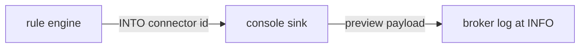

# Console connector

The console connector writes each rule result to the broker log at INFO level. It is a diagnostic sink. It opens no socket and holds no buffer.

Use it when you must see rule results in the log. You get one log line per result row with the connector name, the topic, the QoS, and a payload preview.



## Before you start

- Set `logging.level` to `info` or `debug`. The `warn` level hides the console lines.
- This kind ships in the default build. No feature flag is necessary.

## Settings

Set `kind` to `console` on the v1 API. The v1 route also accepts `logger`. The v5 route accepts `console`, `logger`, and `test`.

The connector has no settings. The broker accepts an empty `config` object and ignores extra keys.

Example:

```json
{
  "id": "console-1",
  "kind": "console",
  "config": {}
}
```

> [!NOTE]
> The docs run creates this shape and sends one message through a rule. It reads the rule counters. It does not read the broker log. The log line text stays not verified. See the failure record in [Verification failures](../_verification/failures.md).

## Check that it works

This test runs the full path through the broker. It creates the connector and a forwarding rule. It publishes one message. It waits for the rule action counter to move. Then it prints `ok`.

```toml test
[node]
id = "docs-connector-console"

[listeners.tcp]
bind = "0.0.0.0:1883"

[listeners.api]
bind = "0.0.0.0:18083"

[logging]
level = "info"

[auth]
allow_anonymous = true
```

```sh test
python3 - <<'PY'
import json, os, socket, struct, time, urllib.request
mqtt_port = int(os.environ.get("MQTT_PORT", "1883"))
api_port = os.environ.get("API_PORT", "18083")
key = os.environ["API_KEY"]

def call(method, path, body=None):
    req = urllib.request.Request(
        f"http://127.0.0.1:{api_port}{path}",
        data=None if body is None else json.dumps(body).encode(),
        method=method,
        headers={"Authorization": f"Bearer {key}", "Content-Type": "application/json"})
    with urllib.request.urlopen(req, timeout=5) as res:
        raw = res.read().decode()
        return res.status, (json.loads(raw) if raw else None)

status, created = call("POST", "/api/v1/connectors",
                       {"id": "console-1", "kind": "console", "config": {}})
assert status == 201 and created["kind"] == "console", (status, created)
status, created = call("POST", "/api/v5/connectors",
                       {"name": "console-2", "type": "console"})
assert status == 201 and created["type"] == "console", (status, created)
status, rule = call("POST", "/api/v1/rules",
                    {"name": "docs-console-rule",
                     "topic_filter": "docs/console/in",
                     "actions": [{"type": "forwardconnector",
                                  "connector_id": "console-1"}]})
assert status == 201, (status, rule)
rule_id = rule["id"]

def packet(kind, body):
    return bytes([kind, len(body)]) + body

def field(data):
    return struct.pack(">H", len(data)) + data

pub = socket.create_connection(("127.0.0.1", mqtt_port), timeout=5)
pub.sendall(packet(0x10, b"\x00\x04MQTT\x04\x02\x00\x3c" + field(b"docs-console-pub")))
assert pub.recv(4) == b"\x20\x02\x00\x00"
pub.sendall(packet(0x30, field(b"docs/console/in") + b'{"temp": 90}'))

deadline = time.time() + 12
while time.time() < deadline:
    status, metrics = call("GET", f"/api/v5/rules/{rule_id}/metrics")
    assert status == 200, (status, metrics)
    if metrics["metrics"]["actions.success"] >= 1:
        break
    time.sleep(0.1)
else:
    raise AssertionError("the console action did not run")
print("ok")
PY
```

```output
ok
```

## Limits

- The connector has no settings, no buffer, no retry, and no network connection.
- It logs at INFO with the fields `connector`, `topic`, `qos`, and `payload`. The log message is `connector event`.
- A UTF-8 payload of 256 bytes or less logs in full. A longer UTF-8 payload logs the first 256 bytes and the total byte count. A payload that is not UTF-8 logs `<N non-UTF8 bytes>`.
- `logging.level` must allow INFO. The `warn` level hides the line.
- The v5 route registers the name and an alias of the form `<type>:<name>`.
- The connector runs behind the rule engine bounded queue. A slow log sink never stalls publishers.
- The tier is community. The kind ships in the default build.

## Next steps

- Feed the connector from a rule in [Actions](../rules/actions.md).
- See every kind in [Connectors](./index.md).
