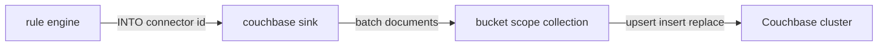

# Couchbase connector

The Couchbase connector writes each rule result as one JSON document. It targets a bucket, a scope, and a collection. It builds the document id from a template.

Use it when telemetry must land as documents with per-device keys. You get one document per result row with your own id mapping.



## Before you start

- Run a Couchbase cluster. Note the connection string.
- Create the bucket. Note the scope and the collection.
- For a full build, enable the feature: `--features couchbase`. The default build answers 400 and names the feature.

## Settings

Set `kind` to `couchbase`.

| Setting | Required | Meaning |
|---|---|---|
| `connection_string` | yes | Bootstrap URI, `couchbase://` or `couchbases://`. Default port is 11210. |
| `bucket` | yes | Target bucket name. |
| `auth` | yes | Object with `username` and `password`. |
| `doc_id_template` | yes | Document id with `${client_id}`, `${topic}`, `${qos}`, `${timestamp}`, `${seq}`, `${payload.<field>}`. |
| `scope` | no | Scope name; default `_default`. |
| `collection` | no | Collection name; default `_default`. |
| `operation` | no | `upsert`, `insert`, or `replace`; default `upsert`. |
| `expiry_secs` | no | Document TTL in seconds; default 0 means no expiry. |
| `batch_size` | no | Documents per batch; default 100. |
| `batch_bytes` | no | Batch byte limit; default 2097152. |
| `linger_ms` | no | Linger before a partial batch flushes; default 10. |
| `max_retries` | no | Retries on transient faults; default 3. |
| `initial_backoff_ms` | no | First retry delay; default 100. |
| `max_backoff_ms` | no | Retry delay ceiling; default 2000. |
| `timeout_ms` | no | Connect and write deadline; default 5000. |

Example:

```json
{
  "id": "couchbase-1",
  "kind": "couchbase",
  "config": {
    "connection_string": "couchbase://127.0.0.1",
    "bucket": "telemetry",
    "scope": "edge",
    "collection": "events",
    "auth": {"username": "Administrator", "password": "secret"},
    "doc_id_template": "${client_id}::${timestamp}",
    "operation": "upsert",
    "expiry_secs": 3600,
    "batch_size": 50,
    "batch_bytes": 65536,
    "linger_ms": 10,
    "max_retries": 2,
    "initial_backoff_ms": 10,
    "max_backoff_ms": 100,
    "timeout_ms": 5000
  }
}
```

> [!NOTE]
> The docs run creates this shape. Creation validates only; it opens no socket. The send path needs a Couchbase cluster. See the failure record in [Verification failures](../_verification/failures.md).

## Check that it works

Create the connector. The broker answers 201 with the kind when the build holds Couchbase, else 400 naming the feature. Both answers print `ok`.

```toml test
[node]
id = "docs-connector-couchbase"

[listeners.tcp]
bind = "0.0.0.0:1883"

[listeners.api]
bind = "0.0.0.0:18083"

[logging]
level = "warn"

[auth]
allow_anonymous = true
```

```sh test
python3 - <<'PY'
import json, os, urllib.request, urllib.error
port = os.environ.get("API_PORT", "18083")
key = os.environ["API_KEY"]
body = json.dumps({"id": "couchbase-1", "kind": "couchbase",
                   "config": {"connection_string": "couchbase://127.0.0.1",
                              "bucket": "telemetry",
                              "auth": {"username": "Administrator", "password": "secret"},
                              "doc_id_template": "${client_id}::${timestamp}",
                              "operation": "upsert",
                              "batch_size": 50, "batch_bytes": 65536,
                              "linger_ms": 10, "max_retries": 2,
                              "initial_backoff_ms": 10,
                              "max_backoff_ms": 100}}).encode()
req = urllib.request.Request(
    f"http://127.0.0.1:{port}/api/v1/connectors", data=body, method="POST",
    headers={"Authorization": f"Bearer {key}", "Content-Type": "application/json"})
try:
    with urllib.request.urlopen(req, timeout=5) as res:
        status, created = res.status, json.load(res)
except urllib.error.HTTPError as err:
    status, created = err.code, json.load(err)
assert status in (201, 400), (status, created)
if status == 201:
    assert created["kind"] == "couchbase", created
else:
    assert "couchbase" in created["error"], created
print("ok")
PY
```

```output
ok
```

## Limits

- An empty `connection_string`, `bucket`, `username`, or `doc_id_template` is refused with 400.
- The id template must resolve to a non-empty key. A missing `${client_id}` or `${payload.<field>}` fails the row.
- `insert` fails a present key. `replace` fails a missing key. Both keep the row for retry accounting.
- The bounded queue sheds past its bound. A slow cluster never stalls publishers.

## Next steps

- Feed the connector from a rule in [Actions](../rules/actions.md).
- See every kind in [Connectors](./index.md).
