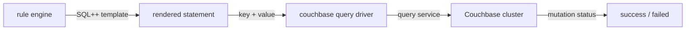

# Couchbase connector

The Couchbase connector runs one SQL++ statement for each rule result. The
statement names the keyspace, key and value, so the action owns the target.
The maintained driver carries the query connection and authentication.

Use it when a rule result must upsert or insert a Couchbase document. You
get one statement per send and a retry count per action.



## Before you start

- Run Couchbase. Create the bucket, scope and collection.
- Create a user that can write to the collection.
- For a full build, enable the feature: `--features couchbase`. The
  default build answers 400 and names the feature.

## Connector settings

Set the connector type to `couchbase`. The aliases `couch` and `cb` select
the same runtime.

| Setting | Required | Meaning |
|---|---|---|
| `server` | yes | Host and port, for example `127.0.0.1:11210`. |
| `username` | yes | Cluster user. |
| `password` | no | Cluster password. Default empty. |
| `connect_timeout` | no | Connection timeout. Default `15s`. |

## Action settings

Set the action type to `couchbase`.

| Setting | Required | Meaning |
|---|---|---|
| `connector` | yes | Connector name. |
| `sql` | yes | SQL++ statement template. |
| `max_retries` | no | Retries for one statement. Default `3`. |

The template uses `key` and `value` in the statement. The reference
`${.field}` names map onto this broker's rule output fields. No fixed
bucket, scope, collection or key is added.

Example action:

```json
{
  "name": "store-event",
  "type": "couchbase",
  "connector": "couch",
  "parameters": {
    "sql": "UPSERT INTO default:mqtt.factory.events (KEY, VALUE) VALUES (\"${client_id}\", ${payload})"
  }
}
```

## Limits

- One action owns one statement template.
- A query that returns an error counts one failed forward.
- Batching belongs to the action runtime. The driver sends one statement
  per row.

## Try it

Run this example against a started broker. It creates a connector and
shows the refusal for a missing server.

```toml test
[node]
id = "docs-connector-couchbase"

[listeners.tcp]
bind = "0.0.0.0:1883"

[listeners.api]
bind = "0.0.0.0:18083"

[logging]
level = "warn"

[auth]
allow_anonymous = true
```

```sh test
python3 - <<'PY'
import json, os, urllib.request
port = os.environ.get("API_PORT", "18083")
key = os.environ["API_KEY"]
def post(body):
    req = urllib.request.Request(
        f"http://127.0.0.1:{port}/api/v5/connectors", data=json.dumps(body).encode(), method="POST",
        headers={"Authorization": f"Bearer {key}", "Content-Type": "application/json"})
    try:
        with urllib.request.urlopen(req, timeout=5) as res:
            return res.status, json.load(res)
    except urllib.error.HTTPError as err:
            return err.code, json.load(err)
status, created = post({"name": "cb-run-ok", "type": "couchbase",
                        "server": "127.0.0.1:11210", "username": "u"})
assert status in (201, 400), (status, created)
if status == 201:
    assert created.get("type") == "couchbase", created
else:
    assert "feature" in str(created).lower(), created
status, body = post({"name": "cb-run-bad", "type": "couchbase",
                     "username": "u"})
assert status == 400 and "server" in body["message"], body
print("ok")
PY
```

```output
ok
```

## Next steps

- Read [Rules](../rules/index.md) to send a rule result to this action.
- Read [Actions](../rules/actions.md) for the shared `resource_opts`.
