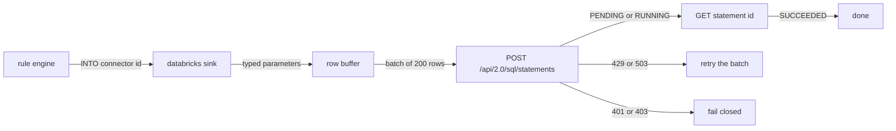

# Databricks connector

The Databricks connector writes each rule result as one table row. It sends typed statement parameters through the SQL Statements API. It polls a running statement to a terminal state and retries throttles.

Use it when rule results must land in a Databricks lakehouse table. You get one `INSERT` per row group, column mappings, and optional partition values.



## Before you start

- Run a Databricks workspace with a SQL warehouse. Note the host, the token, the warehouse HTTP path, the catalog, and the schema.
- Create the target table. Its columns must match the mapped payload fields.
- The token needs permission to run statements and to write the table.
- This kind ships in the default build. No feature flag is necessary.

## Settings

Set `kind` to `databricks` on the v1 API. The v1 route also accepts `databricks_sql` and `delta`. It stores the kind as `databricks`.

| Setting | Required | Meaning |
|---|---|---|
| `host` | yes | Workspace host, for example `dbc-a1b2c3d4-e5f6.cloud.databricks.com`. An `http://` or `https://` prefix is allowed. A value with a path or a space is refused. |
| `token` | yes | Personal access token or OAuth Bearer token. An empty value is refused. |
| `catalog` | no | Unity Catalog name. Default `main`. It must match `[A-Za-z0-9_]+`. |
| `schema` | no | Schema name. Default `default`. It must match `[A-Za-z0-9_]+`. |
| `table_template` | yes | Table name. A fixed name is the simplest form. It accepts `${client_id}`, `${qos}`, and `${timestamp}`. Validation renders it with the test topic `dummy/topic`, so a `${topic}` variable is refused. The rendered name must match `[A-Za-z0-9_]+`. |
| `http_path` | no | Warehouse HTTP path, for example `/sql/1.0/warehouses/a1b2c3d4e5f6`. It must contain `/warehouses/` and a non-empty warehouse id. The last segment is the warehouse id that each statement carries. The default is none. |
| `partition_key_template` | no | Partition value template. It accepts `${topic}`, `${client_id}`, `${qos}`, `${timestamp}`, and `${payload.<field>}`. The sink adds the value as a `_PARTITION` STRING column. An empty rendered value is refused. The default is none. |
| `column_mappings` | no | Object of column name to value template. Each key must match `[A-Za-z0-9_]+`. Each value accepts `${topic}`, `${client_id}`, `${qos}`, `${timestamp}`, and `${payload.<field>}`. The default is empty, which uses the payload object keys as columns. |
| `batch_size` | no | Rows per flush. Default 200. A value of 0 is refused. `null` means no row limit. |
| `batch_bytes` | no | Byte limit for one buffer. Default 2097152 (2 MiB). A value of 0 is refused. `null` means no byte limit. |
| `linger_ms` | no | Age in ms that makes a buffered row stale. Default 10. The sink checks the age when it buffers the next row. `null` means a row never becomes stale. |
| `max_retries` | no | Retries of one failed batch on a retryable fault. Default 3. `null` means no retry limit. |
| `initial_backoff_ms` | no | First retry delay in ms. Default 100. A value below 1 becomes 1. |
| `max_backoff_ms` | no | Retry delay ceiling in ms. Default 2000. A value below 1 becomes 1. |
| `timeout_ms` | no | Request deadline in ms. Default 5000. A value below 1 becomes 1. |

The v5 route reads `host`, `server`, or `endpoint`; `token` or `api_key`; `catalog`; `schema`; and `table` or `table_template`. It reads `timeout_ms` or `timeout`. It fixes `http_path` to none, `partition_key_template` to none, `column_mappings` to an empty map, `batch_size` to 1, `batch_bytes` to 2097152, `linger_ms` to 10, `max_retries` to 3, `initial_backoff_ms` to 100, and `max_backoff_ms` to 2000. It accepts the type name `delta_lake` as an alias. It registers the name and the aliases `databricks:name` and `delta_lake:name`.

Example:

```json
{
  "id": "databricks-1",
  "kind": "databricks",
  "config": {
    "host": "dbc-a1b2c3d4-e5f6.cloud.databricks.com",
    "token": "dapi-example-token",
    "catalog": "main",
    "schema": "default",
    "table_template": "sensor_readings",
    "http_path": "/sql/1.0/warehouses/a1b2c3d4e5f6",
    "partition_key_template": "edge-${client_id}",
    "column_mappings": {
      "device_id": "${client_id}",
      "temperature": "${payload.temperature}"
    },
    "batch_size": 50,
    "batch_bytes": 65536,
    "linger_ms": 10,
    "max_retries": 2,
    "initial_backoff_ms": 10,
    "max_backoff_ms": 100,
    "timeout_ms": 5000
  }
}
```

> [!NOTE]
> The docs run creates this shape. Creation validates only; it opens no socket. The send path needs a Databricks workspace. See the failure record in [Verification failures](../_verification/failures.md).

## Check that it works

Create the connector on the v1 and v5 routes. The broker answers 201 with the kind.

```toml test
[node]
id = "docs-connector-databricks"

[listeners.tcp]
bind = "0.0.0.0:1883"

[listeners.api]
bind = "0.0.0.0:18083"

[logging]
level = "warn"

[auth]
allow_anonymous = true
```

```sh test
python3 - <<'PY'
import json, os, urllib.request
port = os.environ.get("API_PORT", "18083")
key = os.environ["API_KEY"]

def call(method, path, body):
    req = urllib.request.Request(
        f"http://127.0.0.1:{port}{path}", data=json.dumps(body).encode(),
        method=method,
        headers={"Authorization": f"Bearer {key}", "Content-Type": "application/json"})
    with urllib.request.urlopen(req, timeout=5) as res:
        return res.status, json.load(res)

config = {"host": "dbc-a1b2c3d4-e5f6.cloud.databricks.com",
          "token": "dapi-example-token", "catalog": "main",
          "schema": "default", "table_template": "sensor_readings",
          "http_path": "/sql/1.0/warehouses/a1b2c3d4e5f6",
          "partition_key_template": "edge-${client_id}",
          "column_mappings": {"device_id": "${client_id}",
                              "temperature": "${payload.temperature}"},
          "batch_size": 50, "batch_bytes": 65536, "linger_ms": 10,
          "max_retries": 2, "initial_backoff_ms": 10,
          "max_backoff_ms": 100, "timeout_ms": 5000}
s1, b1 = call("POST", "/api/v1/connectors",
              {"id": "databricks-1", "kind": "databricks", "config": config})
assert s1 == 201 and b1["kind"] == "databricks", (s1, b1)
s2, b2 = call("POST", "/api/v5/connectors",
              {"name": "databricks-2", "type": "databricks",
               "host": "dbc-a1b2c3d4-e5f6.cloud.databricks.com",
               "token": "dapi-example-token", "catalog": "main",
               "schema": "default", "table": "sensor_readings",
               "timeout_ms": 5000})
assert s2 == 201 and b2["type"] == "databricks", (s2, b2)
print("databricks")
PY
```

```output
databricks
```

## Limits

- An empty `host`, `token`, or `table_template` is refused with 400. A `host` with a path or a space is refused.
- A `catalog`, `schema`, `table`, partition value, or column name outside `[A-Za-z0-9_]+` is refused with 400.
- A `http_path` without `/warehouses/` or with an empty warehouse id is refused with 400.
- An unknown or unclosed template variable is refused at creation. A `${payload.<field>}` variable in `table_template` is unknown to that template and is refused.
- A payload must be UTF-8 JSON. A non-UTF-8 or non-JSON payload is a dispatch error and sends no row.
- With no `column_mappings`, an object payload becomes one column per key in payload order. A non-object payload becomes one `value` column.
- A mapped value that parses as JSON keeps its type. Other text is a string.
- A string value is `STRING`, an integer is `BIGINT`, a float is `DOUBLE`, a boolean is `BOOLEAN`, and `null` is the text `NULL` with type `STRING`. An object or array rides JSON text with type `STRING`.
- The sink groups rows with the same table and column list into one `INSERT ... VALUES (...), (...)`. A batch with different shapes sends one statement per group.
- The request goes to `https://{host}/api/2.0/sql/statements`, or to the scheme in `host`. It carries `catalog`, `schema`, `statement`, `parameters`, and `warehouse_id` when `http_path` is set.
- `PENDING` and `RUNNING` poll `GET {statements_url}/{statement_id}` every 500 ms, at most 30 polls (15 s). Past the bound the batch is retried at least once.
- 429, 503, and transport faults retry the batch up to `max_retries` times. The delay starts at `initial_backoff_ms` and doubles to `max_backoff_ms`.
- 401 and 403 fail closed and are not retried. Other non-2xx statuses and `FAILED`, `CANCELED`, or `CLOSED` statements are terminal.
- A failed batch restores its rows in order. The sink then enters a cooldown of 2 s that doubles to 30 s. Flushes fail fast during the cooldown.
- The connector runs behind the rule engine bounded queue. A slow warehouse never stalls publishers.
- The tier is enterprise. The kind ships in the default build.

## Next steps

- Feed the connector from a rule in [Actions](../rules/actions.md).
- See every kind in [Connectors](./index.md).
