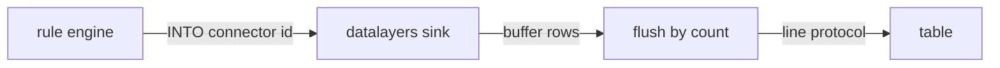

# Datalayers connector

The Datalayers connector writes rule results as table rows. It posts line protocol writes. It buffers rows and flushes by count.

Use it when time-series rows must land in Datalayers. You get one write per flush.



## Before you start

- Run Datalayers. Note the server and database.

## Settings

Set `kind` to `datalayers`.

| Setting | Required | Meaning |
|---|---|---|
| `server` | no | Server `host:port`. Default `127.0.0.1:8361`. |
| `database` | yes | Target database. |
| `table` | yes | Target table. |
| `auth_token` | no | Bearer token. Uses Basic auth otherwise. |
| `username` | no | Basic user. Needs `password` too. |
| `password` | no | Basic password. Needs `username` too. |

The action may override `table` per target. Stamps are always microseconds. The `topic` tag rides every row, and every payload field becomes a measured field.

### `server`

Server `host:port`. Type: string. Required: no. Default `127.0.0.1:8361`.

```sh test
python3 - <<'PY'
import json, os, urllib.request
port = os.environ.get("API_PORT", "18083")
key = os.environ["API_KEY"]
def post(body):
    req = urllib.request.Request(
        f"http://127.0.0.1:{port}/api/v5/connectors", data=json.dumps(body).encode(), method="POST",
        headers={"Authorization": f"Bearer {key}", "Content-Type": "application/json"})
    try:
        with urllib.request.urlopen(req, timeout=5) as res:
            return res.status, json.load(res)
    except urllib.error.HTTPError as err:
        return err.code, json.load(err)
status, created = post({"name": "dl-server-ok", "type": "datalayers",
                        "database": "db", "table": "events"})
assert status == 201, (status, created)
print("ok")
PY
```

```output
ok
```

### `database`

Target database. Type: string. Required: yes. Absent: 400 naming `database`.

```sh test
python3 - <<'PY'
import json, os, urllib.request
port = os.environ.get("API_PORT", "18083")
key = os.environ["API_KEY"]
def post(body):
    req = urllib.request.Request(
        f"http://127.0.0.1:{port}/api/v5/connectors", data=json.dumps(body).encode(), method="POST",
        headers={"Authorization": f"Bearer {key}", "Content-Type": "application/json"})
    try:
        with urllib.request.urlopen(req, timeout=5) as res:
            return res.status, json.load(res)
    except urllib.error.HTTPError as err:
        return err.code, json.load(err)
status, body = post({"name": "dl-db-bad", "type": "datalayers",
                     "server": "127.0.0.1:8361", "table": "events"})
assert status == 400 and "database" in body["message"], body
print("ok")
PY
```

```output
ok
```

### `table`

Target table. Type: string. Required: yes. Absent: 400 naming `table`.

```sh test
python3 - <<'PY'
import json, os, urllib.request
port = os.environ.get("API_PORT", "18083")
key = os.environ["API_KEY"]
def post(body):
    req = urllib.request.Request(
        f"http://127.0.0.1:{port}/api/v5/connectors", data=json.dumps(body).encode(), method="POST",
        headers={"Authorization": f"Bearer {key}", "Content-Type": "application/json"})
    try:
        with urllib.request.urlopen(req, timeout=5) as res:
            return res.status, json.load(res)
    except urllib.error.HTTPError as err:
        return err.code, json.load(err)
status, body = post({"name": "dl-table-bad", "type": "datalayers",
                     "server": "127.0.0.1:8361", "database": "db"})
assert status == 400 and "table" in body["message"], body
print("ok")
PY
```

```output
ok
```

### `auth_token`

Bearer token. Type: string. Required: no. Uses Basic auth otherwise. Never mixes with `username`/`password`.

```sh test
python3 - <<'PY'
import json, os, urllib.request
port = os.environ.get("API_PORT", "18083")
key = os.environ["API_KEY"]
def post(body):
    req = urllib.request.Request(
        f"http://127.0.0.1:{port}/api/v5/connectors", data=json.dumps(body).encode(), method="POST",
        headers={"Authorization": f"Bearer {key}", "Content-Type": "application/json"})
    try:
        with urllib.request.urlopen(req, timeout=5) as res:
            return res.status, json.load(res)
    except urllib.error.HTTPError as err:
        return err.code, json.load(err)
status, created = post({"name": "dl-token-ok", "type": "datalayers",
                        "server": "127.0.0.1:8361", "database": "db", "table": "events",
                        "auth_token": "tok-1"})
assert status == 201, (status, created)
print("ok")
PY
```

```output
ok
```

### `username`

Basic user. Type: string. Required: no. Needs `password` too. A half pair is 400.

```sh test
python3 - <<'PY'
import json, os, urllib.request
port = os.environ.get("API_PORT", "18083")
key = os.environ["API_KEY"]
def post(body):
    req = urllib.request.Request(
        f"http://127.0.0.1:{port}/api/v5/connectors", data=json.dumps(body).encode(), method="POST",
        headers={"Authorization": f"Bearer {key}", "Content-Type": "application/json"})
    try:
        with urllib.request.urlopen(req, timeout=5) as res:
            return res.status, json.load(res)
    except urllib.error.HTTPError as err:
        return err.code, json.load(err)
status, body = post({"name": "dl-user-bad", "type": "datalayers",
                     "server": "127.0.0.1:8361", "database": "db", "table": "events",
                     "username": "u"})
assert status == 400 and "username" in body["message"], body
print("ok")
PY
```

```output
ok
```

### `password`

Basic password. Type: string. Required: no. Needs `username` too. A half pair is 400.

```sh test
python3 - <<'PY'
import json, os, urllib.request
port = os.environ.get("API_PORT", "18083")
key = os.environ["API_KEY"]
def post(body):
    req = urllib.request.Request(
        f"http://127.0.0.1:{port}/api/v5/connectors", data=json.dumps(body).encode(), method="POST",
        headers={"Authorization": f"Bearer {key}", "Content-Type": "application/json"})
    try:
        with urllib.request.urlopen(req, timeout=5) as res:
            return res.status, json.load(res)
    except urllib.error.HTTPError as err:
        return err.code, json.load(err)
status, created = post({"name": "dl-pw-ok", "type": "datalayers",
                        "server": "127.0.0.1:8361", "database": "db", "table": "events",
                        "username": "u", "password": "p"})
assert status == 201, (status, created)
print("ok")
PY
```

```output
ok
```

Example:

```json
{
  "name": "dl-sink-1",
  "type": "datalayers",
  "server": "127.0.0.1:8361",
  "database": "factory_db",
  "table": "sensor_events"
}
```

> [!NOTE]
> The docs run creates this shape. Creation validates only; it writes nothing. The send path needs a Datalayers server. See the failure record in [Verification failures](../_verification/failures.md).

## Check that it works

Create the connector. The broker answers 201 with the kind. It prints `ok`.

```toml test
[node]
id = "docs-connector-datalayers"

[listeners.tcp]
bind = "0.0.0.0:1883"

[listeners.api]
bind = "0.0.0.0:18083"

[logging]
level = "warn"

[auth]
allow_anonymous = true
```

```sh test
python3 - <<'PY'
import json, os, urllib.request
port = os.environ.get("API_PORT", "18083")
key = os.environ["API_KEY"]
body = json.dumps({"name": "dl-sink-1", "type": "datalayers",
                   "server": "127.0.0.1:8361",
                   "database": "factory_db",
                   "table": "sensor_events"}).encode()
req = urllib.request.Request(
    f"http://127.0.0.1:{port}/api/v5/connectors", data=body, method="POST",
    headers={"Authorization": f"Bearer {key}", "Content-Type": "application/json"})
try:
    with urllib.request.urlopen(req, timeout=5) as res:
        status, created = res.status, json.load(res)
except urllib.error.HTTPError as err:
    status, created = err.code, json.load(err)
assert status == 201, (status, created)
assert created["type"] == "datalayers", created
print("ok")
PY
```

```output
ok
```

## Limits

- The wire stamps microseconds. A `precision` field is not interpreted.
- Both auth modes at once are refused. A half Basic pair is refused.
- A dead server backs off and retries. The bounded queue sheds past its bound.

## Next steps

- Feed the connector from a rule in [Actions](../rules/actions.md).
- See every kind in [Connectors](./index.md).
