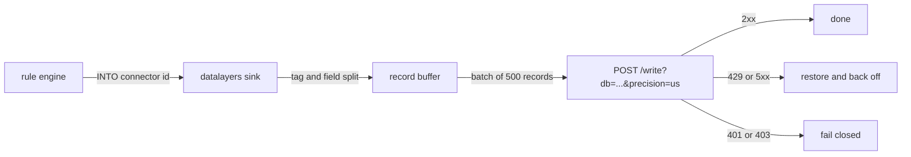

# Datalayers connector

The Datalayers connector writes each rule result as one Influx line-protocol record. It splits payload keys into tags and fields and sends microsecond timestamps to the write endpoint.

Use it when metrics must land in Datalayers tables. You get one POST per batch, tag and field selection, and Bearer or Basic authentication.



## Before you start

- Run Datalayers. Note the HTTP endpoint, the database, and the table.
- Create the target table with the tag and field columns.
- Choose one auth mode: a Bearer token or a username and password pair.
- This kind ships in the default build. No feature flag is necessary.

## Settings

Set `kind` to `datalayers` on the v1 API. The v1 route also accepts `data_layers` and `datalayers_db`. It stores the kind as `datalayers`.

| Setting | Required | Meaning |
|---|---|---|
| `endpoint` | yes | HTTP base of the server, for example `http://datalayers-node:8360`. An empty value is refused. |
| `database` | yes | Target database. An empty value is refused. |
| `table` | yes | Target table or measurement. An empty value is refused. |
| `auth_token` | no | Bearer token. An empty value is ignored. Do not set it with `username` or `password`. |
| `username` | no | Basic auth user. It needs `password`. |
| `password` | no | Basic auth password. It needs `username`. The broker never logs it or puts it in an error. |
| `timestamp_field` | no | Payload field that holds the timestamp. The default is none, which uses the current time. |
| `tag_columns` | no | List of payload keys to send as indexed tags. Default empty. |
| `field_columns` | no | List of payload keys to send as fields. Default empty, which sends every non-tag key. |
| `batch_size` | no | Records per POST. Default 500. A value of 0 is refused. |
| `buffer_capacity` | no | Maximum buffered records. Default 10000. A value of 0 is refused. A full buffer fails closed. |
| `timeout_ms` | no | Request deadline in ms. Default 5000. A value below 1 becomes 1. |

The v5 route reads a string from `endpoint`, `server`, `servers`, or `url`. The default is `http://127.0.0.1:8360`. A missing scheme gets `http://`. It reads `database` (default `factory_db`) and `table` or `measurement` (default `sensor_events`). It reads `auth_token` or `token`, plus `username` and `password`. It reads `timeout_ms`, `timeout`, or `request_timeout_ms`. It fixes `timestamp_field` to `timestamp`, `tag_columns` to `["sensor", "client_id"]`, `field_columns` to `["temperature"]`, `batch_size` to 1, and `buffer_capacity` to the default 10000. It registers the name and the alias `datalayers:name`.

Example:

```json
{
  "id": "datalayers-1",
  "kind": "datalayers",
  "config": {
    "endpoint": "http://127.0.0.1:8360",
    "database": "factory_db",
    "table": "sensor_events",
    "auth_token": "example-token",
    "timestamp_field": "timestamp",
    "tag_columns": ["sensor", "client_id"],
    "field_columns": ["temperature"],
    "batch_size": 500,
    "buffer_capacity": 10000,
    "timeout_ms": 5000
  }
}
```

> [!NOTE]
> The docs run creates this shape. Creation validates only; it opens no socket. The send path needs a Datalayers server. See the failure record in [Verification failures](../_verification/failures.md).

## Check that it works

Create the connector on the v1 and v5 routes. The broker answers 201 with the kind.

```toml test
[node]
id = "docs-connector-datalayers"

[listeners.tcp]
bind = "0.0.0.0:1883"

[listeners.api]
bind = "0.0.0.0:18083"

[logging]
level = "warn"

[auth]
allow_anonymous = true
```

```sh test
python3 - <<'PY'
import json, os, urllib.request
port = os.environ.get("API_PORT", "18083")
key = os.environ["API_KEY"]

def call(method, path, body):
    req = urllib.request.Request(
        f"http://127.0.0.1:{port}{path}", data=json.dumps(body).encode(),
        method=method,
        headers={"Authorization": f"Bearer {key}", "Content-Type": "application/json"})
    with urllib.request.urlopen(req, timeout=5) as res:
        return res.status, json.load(res)

config = {"endpoint": "http://127.0.0.1:8360",
          "database": "factory_db", "table": "sensor_events",
          "auth_token": "example-token", "timestamp_field": "timestamp",
          "tag_columns": ["sensor", "client_id"],
          "field_columns": ["temperature"], "batch_size": 500,
          "buffer_capacity": 10000, "timeout_ms": 5000}
s1, b1 = call("POST", "/api/v1/connectors",
              {"id": "datalayers-1", "kind": "datalayers", "config": config})
assert s1 == 201 and b1["kind"] == "datalayers", (s1, b1)
s2, b2 = call("POST", "/api/v5/connectors",
              {"name": "datalayers-2", "type": "datalayers",
               "endpoint": "http://127.0.0.1:8360",
               "database": "factory_db", "table": "sensor_events",
               "token": "example-token", "timeout_ms": 5000})
assert s2 == 201 and b2["type"] == "datalayers", (s2, b2)
print("datalayers")
PY
```

```output
datalayers
```

## Limits

- An empty `endpoint`, `database`, or `table` is refused with 400.
- A Bearer token with a username or password is refused with 400. A username without a password, or a password without a username, is refused with 400.
- A `batch_size` or `buffer_capacity` of 0 is refused.
- A payload must be JSON. A non-object value becomes one field `val`. A top-level `payload` object is also flattened into the record.
- Keys in `tag_columns` become tags. Keys in `field_columns` become fields. When `field_columns` is empty, every non-tag key becomes a field.
- When no tag is present, the sink adds `topic=<topic>`. A record with no field sends no line. A batch with no lines is a dispatch error and sends no request.
- The body is line protocol: `table,tag=value field=value <microseconds>`. Tag and field keys sort for stable output.
- The measurement escapes commas and spaces. Tag and field keys escape comma, equals, and space. String fields escape backslash and quote. Integer fields carry the `i` suffix. Boolean fields are `true` or `false`.
- A missing, zero, negative, or non-numeric timestamp uses the current time. An integer below 10^10 is seconds, below 10^13 is milliseconds, and a larger value is microseconds. A float uses the same thresholds.
- The sink posts to `{endpoint}/write?db={database}&precision=us` with `Content-Type: text/plain`. The auth header is `Bearer <token>` or `Basic <base64>`.
- A 429 or 5xx status restores the batch and engages the cooldown. A 401 or 403 status fails closed and is not retried. Any other non-2xx status is terminal.
- The cooldown starts at 2 s and doubles to 30 s. Flushes fail fast during the cooldown.
- The sink checks the batch age when it buffers the next record. It has no background timer.
- The connector runs behind the rule engine bounded queue. A slow server never stalls publishers.
- The tier is enterprise. The kind ships in the default build.

## Next steps

- Feed the connector from a rule in [Actions](../rules/actions.md).
- See every kind in [Connectors](./index.md).
