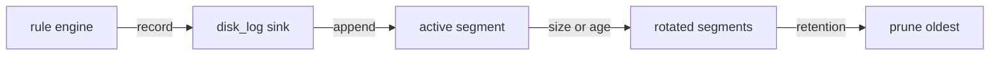

# Disk log connector

The disk log connector writes one record for each rule result to a local file. It rotates by size and age and keeps a bounded number of segments.

Use it for audit and air-gapped stores. The file path stays inside the kernel data directory.



## Before you start

- Choose a relative file path under the data directory.
- Set a finite segment size and segment count.

## Settings

| Connector setting | Required | Meaning |
|---|---|---|
| `filepath` | yes | Relative file path under the data directory. |
| `max_file_size` | yes | Rotate above this size, for example `64MB`. |
| `max_file_number` | yes | Keep at most this many rotated segments. |
| `rotation.period` | no | `none`, `hour` or `day`. |
| `rotation.retention_period` | no | Retention in days; `infinity` keeps all. |

| Action setting | Required | Meaning |
|---|---|---|
| `template` | no | Only the documented default `${.}` is supported. |
| `write_mode` | no | `sync` flushes every record; `async` lets the OS decide. |

Example action:

```json
{
  "name": "audit-log",
  "type": "disk_log",
  "connector": "audit-file",
  "parameters": {"write_mode": "sync"}
}
```

## Limits

- An absolute path, a `..` component or a symlink is refused. The connector cannot write outside the data directory.
- A missing `max_file_size` or `max_file_number` answers 400 and names the field.
- A custom record template is refused. The driver writes the projected event body.

## Next steps

- Feed the connector from a rule in [Actions](../rules/actions.md).
- See every kind in [Connectors](./index.md).

## Check that it works

Create the connector. The broker answers 201 with the kind. The answer prints `ok`.

```toml test
[node]
id = "docs-connector-disk-log"

[listeners.tcp]
bind = "0.0.0.0:1883"

[listeners.api]
bind = "0.0.0.0:18083"

[logging]
level = "warn"

[auth]
allow_anonymous = true
```

```sh test
python3 - <<'PY'
import json, os, urllib.request
port = os.environ.get("API_PORT", "18083")
key = os.environ["API_KEY"]
body = json.dumps({"name": "docs-disk-1", "type": "disk_log",
                   "filepath": "logs/docs.log",
                   "max_file_size": "1MB", "max_file_number": 3}).encode()
req = urllib.request.Request(
    f"http://127.0.0.1:{port}/api/v5/connectors", data=body, method="POST",
    headers={"Authorization": f"Bearer {key}", "Content-Type": "application/json"})
try:
    with urllib.request.urlopen(req, timeout=5) as res:
        status, created = res.status, json.load(res)
except urllib.error.HTTPError as err:
    status, created = err.code, json.load(err)
assert status in (201, 400), (status, created)
if status == 201:
    assert created["type"] == "disk_log", created
else:
    assert "disk_log" in created["message"], created
print("ok")
PY
```

```output
ok
```
