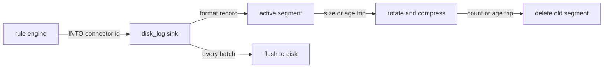

# Disk log connector

The disk log connector writes each rule result to a local file. It appends one record per result row. It rotates the file by size and age, compresses old segments, and prunes them by count and age.

Use it for audit records, air-gapped sites, and local telemetry copies. You get one record per row, a bounded disk footprint, and a restart-safe active segment.



## Before you start

- Choose a directory that the broker can write. The connector creates the directory on open.
- Keep enough free space for the active segment plus the retained backups.
- This kind ships in the default build. No feature flag is necessary.

## Settings

Set `kind` to `disk_log` on the v1 API. The v1 route also accepts `disklog` and `disk`. It stores the kind as `disk_log`.

| Setting | Required | Meaning |
|---|---|---|
| `directory` | yes | Output directory. An empty value is refused. The connector creates the directory. |
| `filename_prefix` | no | Active segment prefix. Default `indra`. It must be a bare name with no slash. |
| `filename_extension` | no | Active segment extension. Default `log`. It must be a bare name with no slash and no dot. |
| `format` | no | `ndjson`, `raw`, or `csv`. Default `ndjson`. |
| `max_file_size_bytes` | no | Size limit for the active segment. Default 67108864 (64 MiB). A value of 0 or `null` disables size rotation. |
| `max_file_age_secs` | no | Age limit for the active segment in seconds. Default none, which disables age rotation. |
| `compression` | no | `none` or `gzip`. Default `none`. Gzip adds `.gz` to each rotated segment. |
| `max_backup_files` | no | Number of rotated segments to keep. Default 10. A value of 0 or `null` keeps all. |
| `max_retention_days` | no | Delete rotated segments older than this many days. Default none. A value of 0 or `null` keeps all. |
| `sync_mode` | no | `{"mode":"everybatch"}`, `{"mode":"interval","ms":N}`, or `{"mode":"osdefault"}`. Default every batch. The interval must be at least 1 ms. |
| `timeout_ms` | no | Write and flush deadline in ms. Default 5000. A value below 1 becomes 1. |

The v5 route reads `directory`, `dir`, or `path` (default `logs` in the node data directory). The directory is relative to data_dir and must stay inside it. The path is relative to the node data directory. A path outside it is refused with 400: an absolute path, a `..` part, or a symlink. It reads `filename_prefix` or `prefix` (default `indra`) and `filename_extension` or `extension` (default `log`). It reads `timeout_ms`, `timeout`, or `request_timeout_ms`. It applies `format`, `max_file_size_bytes`, `max_file_age_secs`, `compression`, `max_backup_files`, `max_retention_days`, and `sync_mode` with the string values `every_batch` or `os_default`. It registers the name and the aliases `disk_log:name` and `disk:name`.

Example:

```json
{
  "id": "disk-log-1",
  "kind": "disk_log",
  "config": {
    "directory": "audit",
    "filename_prefix": "audit",
    "filename_extension": "log",
    "format": "ndjson",
    "max_file_size_bytes": 67108864,
    "max_file_age_secs": 3600,
    "compression": "gzip",
    "max_backup_files": 10,
    "max_retention_days": 7,
    "sync_mode": {"mode": "interval", "ms": 1000},
    "timeout_ms": 5000
  }
}
```

> [!NOTE]
> The docs run creates this shape on the v1 and v5 routes. It forwards one message through a rule and reads the active segment. The crash-recovery check stays a repository test. See the record in [Verification failures](../_verification/failures.md).

## Check that it works

The test creates the connector on both routes, forwards one message through a rule, and reads the record from the active segment.

```toml test
[node]
id = "docs-connector-disk-log"

[listeners.tcp]
bind = "0.0.0.0:1883"

[listeners.api]
bind = "0.0.0.0:18083"

[logging]
level = "warn"

[auth]
allow_anonymous = true
```

```sh test
python3 - <<'PY'
import json, os, socket, struct, tempfile, time, urllib.error, urllib.request
port = os.environ.get("API_PORT", "18083")
mqtt_port = int(os.environ.get("MQTT_PORT", "1883"))
key = os.environ["API_KEY"]
work = tempfile.mkdtemp(prefix="disk-log-docs-")
data_dir = os.path.join(os.environ.get("DOCS_CFG_DIR", work), "..", "data")
v5_dir = os.path.join(data_dir, "disk-log-docs")
os.makedirs(v5_dir, exist_ok=True)

def call(method, path, body=None):
    req = urllib.request.Request(
        f"http://127.0.0.1:{port}{path}",
        data=None if body is None else json.dumps(body).encode(),
        method=method,
        headers={"Authorization": f"Bearer {key}",
                 "Content-Type": "application/json"})
    try:
        with urllib.request.urlopen(req, timeout=5) as res:
            raw = res.read().decode()
            return res.status, (json.loads(raw) if raw else None)
    except urllib.error.HTTPError as err:
        raw = err.read().decode()
        try:
            return err.code, json.loads(raw)
        except ValueError:
            return err.code, raw

config = {"directory": "logs", "filename_prefix": "audit",
          "filename_extension": "log", "format": "ndjson",
          "max_file_size_bytes": 67108864, "max_backup_files": 10,
          "compression": "none", "sync_mode": {"mode": "everybatch"},
          "timeout_ms": 5000}
status, created = call("POST", "/api/v1/connectors",
                       {"id": "disk-log-1", "kind": "disk_log",
                        "config": config})
assert status == 201 and created["kind"] == "disk_log", (status, created)
status, created = call("POST", "/api/v5/connectors",
                       {"name": "disk-log-2", "type": "disk_log",
                        "directory": "disk-log-docs",
                        "filename_prefix": "audit2",
                        "max_file_size": "64MB", "max_file_number": 10,
                        "timeout_ms": 5000})
assert status == 201 and created["type"] == "disk_log", (status, created)
status, rule = call("POST", "/api/v1/rules",
                    {"name": "docs-disk-log-rule",
                     "topic_filter": "docs/disk_log/in",
                     "actions": [{"type": "forwardconnector",
                                  "connector_id": "disk-log-1"}]})
assert status == 201, (status, rule)
rule_id = rule["id"]

def packet(kind, body):
    return bytes([kind, len(body)]) + body

def field(data):
    return struct.pack(">H", len(data)) + data

pub = socket.create_connection(("127.0.0.1", mqtt_port), timeout=5)
pub.sendall(packet(0x10, b"\x00\x04MQTT\x04\x02\x00\x3c" +
                   field(b"docs-disk-pub")))
assert pub.recv(4) == b"\x20\x02\x00\x00"
pub.sendall(packet(0x30, field(b"docs/disk_log/in") + b'{"temp": 90}'))

deadline = time.time() + 12
while time.time() < deadline:
    status, metrics = call("GET", f"/api/v5/rules/{rule_id}/metrics")
    assert status == 200, (status, metrics)
    if metrics["metrics"]["actions.success"] >= 1:
        break
    time.sleep(0.1)
else:
    raise AssertionError("the disk_log action did not run")

with open(os.path.join(data_dir, "logs", "audit.log"), encoding="utf-8") as handle:
    row = json.loads(handle.readline())
assert row["topic"] == "docs/disk_log/in", row
assert row["qos"] == 0, row
assert row["payload"] == {"temp": 90}, row
print("disk_log")
PY
```

```output
disk_log
```

## Limits

- An empty `directory` is refused with 400. The connector creates the directory on open.
- A `filename_prefix` with a slash or a backslash is refused with 400. A `filename_extension` with a slash or a dot is refused with 400.
- An ndjson or CSV payload must be UTF-8. A non-UTF-8 payload is a dispatch error and writes no row. The raw format is binary-safe.
- An ndjson record holds `timestamp`, `topic`, `qos`, and `payload`. A payload that is not JSON stays a string.
- A CSV record holds an RFC 3339 timestamp, a quoted topic, the QoS, and a quoted payload. Embedded quotes double.
- The active segment is `<prefix>.<extension>`. A rotated segment is `<prefix>.<extension>.<N>`, with `.gz` when gzip is on.
- Size rotation looks before the write that would exceed the limit. Age rotation runs at each record against the event time.
- The default size of 64 MiB bounds the recovery read at open. The default count of 10 bounds total disk to about 640 MiB plus the active segment.
- A value of 0 or `null` disables one axis. That is an explicit operator choice for an unbounded log.
- Retention prunes the oldest rotated segments first.
- The every-batch mode flushes and syncs each record. The interval mode flushes at most each N ms. The OS-default mode leaves the flush to the operating system.
- At open the writer truncates a torn tail after the last newline. It compresses a staged segment that a crash left without its gzip step. A repository test proves this path.
- The v5 route takes the defaults ndjson, 64 MiB size rotation, no age rotation, no compression, 10 backups, and every-batch sync when a setting is absent.
- The connector runs behind the rule engine bounded queue. A slow disk never stalls publishers.
- The tier is community. The kind ships in the default build.

## Other names

This connector is also known as `disk-log`, `disk`, and `disklog`. The alias `disk-log` redirects to this page.

The connector writes rotating log files inside the data directory. Absolute paths, `..` components, and symlinks are refused.

## Next steps

- Feed the connector from a rule in [Actions](../rules/actions.md).
- See every kind in [Connectors](./index.md).
