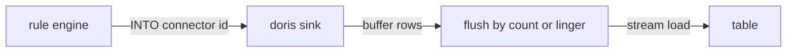

# Doris connector

The Doris connector streams rule results into Apache Doris. It loads JSON rows through stream load. It buffers rows and flushes by count or by linger.

Use it when analytic rows must land in Doris. You get one stream load per flush.



## Before you start

- Run Doris. Note the front-end host, database, and table.
- Create the database and the target table.

## Settings

Set `kind` to `doris`.

| Setting | Required | Meaning |
|---|---|---|
| `server` | yes | Front-end host, `host` or `host:port`. |
| `database` | yes | Target database. |
| `table` | yes | Target table. |
| `username` | no | Doris user. Default `root`. |
| `password` | no | Doris password. Default empty. |
| `http_port` | no | Front-end HTTP port. Default 8030. |

The action may override `table` per target. The driver writes JSON stream loads only.

### `server`

Front-end host, `host` or `host:port`. Type: string. Required: yes. A port in the value selects the HTTP port. Absent: 400 naming `server`.

```sh test
python3 - <<'PY'
import json, os, urllib.request
port = os.environ.get("API_PORT", "18083")
key = os.environ["API_KEY"]
def post(body):
    req = urllib.request.Request(
        f"http://127.0.0.1:{port}/api/v5/connectors", data=json.dumps(body).encode(), method="POST",
        headers={"Authorization": f"Bearer {key}", "Content-Type": "application/json"})
    try:
        with urllib.request.urlopen(req, timeout=5) as res:
            return res.status, json.load(res)
    except urllib.error.HTTPError as err:
        return err.code, json.load(err)
status, created = post({"name": "doris-server-ok", "type": "doris",
                        "server": "127.0.0.1:9", "database": "telemetry", "table": "events"})
assert status == 201, (status, created)
status, body = post({"name": "doris-server-bad", "type": "doris",
                     "database": "telemetry", "table": "events"})
assert status == 400 and "server" in body["message"], body
print("ok")
PY
```

```output
ok
```

### `database`

Target database. Type: string. Required: yes. Absent: 400 naming `database`.

```sh test
python3 - <<'PY'
import json, os, urllib.request
port = os.environ.get("API_PORT", "18083")
key = os.environ["API_KEY"]
def post(body):
    req = urllib.request.Request(
        f"http://127.0.0.1:{port}/api/v5/connectors", data=json.dumps(body).encode(), method="POST",
        headers={"Authorization": f"Bearer {key}", "Content-Type": "application/json"})
    try:
        with urllib.request.urlopen(req, timeout=5) as res:
            return res.status, json.load(res)
    except urllib.error.HTTPError as err:
        return err.code, json.load(err)
status, body = post({"name": "doris-db-bad", "type": "doris",
                     "server": "127.0.0.1", "table": "events"})
assert status == 400 and "database" in body["message"], body
print("ok")
PY
```

```output
ok
```

### `table`

Target table. Type: string. Required: yes. Absent: 400 naming `table`.

```sh test
python3 - <<'PY'
import json, os, urllib.request
port = os.environ.get("API_PORT", "18083")
key = os.environ["API_KEY"]
def post(body):
    req = urllib.request.Request(
        f"http://127.0.0.1:{port}/api/v5/connectors", data=json.dumps(body).encode(), method="POST",
        headers={"Authorization": f"Bearer {key}", "Content-Type": "application/json"})
    try:
        with urllib.request.urlopen(req, timeout=5) as res:
            return res.status, json.load(res)
    except urllib.error.HTTPError as err:
        return err.code, json.load(err)
status, body = post({"name": "doris-table-bad", "type": "doris",
                     "server": "127.0.0.1", "database": "telemetry"})
assert status == 400 and "table" in body["message"], body
print("ok")
PY
```

```output
ok
```

### `username`

Doris user. Type: string. Required: no. Default `root`.

```sh test
python3 - <<'PY'
import json, os, urllib.request
port = os.environ.get("API_PORT", "18083")
key = os.environ["API_KEY"]
def post(body):
    req = urllib.request.Request(
        f"http://127.0.0.1:{port}/api/v5/connectors", data=json.dumps(body).encode(), method="POST",
        headers={"Authorization": f"Bearer {key}", "Content-Type": "application/json"})
    try:
        with urllib.request.urlopen(req, timeout=5) as res:
            return res.status, json.load(res)
    except urllib.error.HTTPError as err:
        return err.code, json.load(err)
status, created = post({"name": "doris-user-ok", "type": "doris",
                        "server": "127.0.0.1", "database": "telemetry", "table": "events",
                        "username": "admin", "password": "pw"})
assert status == 201, (status, created)
print("ok")
PY
```

```output
ok
```

### `password`

Doris password. Type: string. Required: no. Default empty.

```sh test
python3 - <<'PY'
import json, os, urllib.request
port = os.environ.get("API_PORT", "18083")
key = os.environ["API_KEY"]
def post(body):
    req = urllib.request.Request(
        f"http://127.0.0.1:{port}/api/v5/connectors", data=json.dumps(body).encode(), method="POST",
        headers={"Authorization": f"Bearer {key}", "Content-Type": "application/json"})
    try:
        with urllib.request.urlopen(req, timeout=5) as res:
            return res.status, json.load(res)
    except urllib.error.HTTPError as err:
        return err.code, json.load(err)
status, created = post({"name": "doris-pw-ok", "type": "doris",
                        "server": "127.0.0.1", "database": "telemetry", "table": "events",
                        "password": "pw"})
assert status == 201, (status, created)
print("ok")
PY
```

```output
ok
```

### `http_port`

Front-end HTTP port. Type: integer. Required: no. Default 8030. An explicit value wins over the `server` port.

```sh test
python3 - <<'PY'
import json, os, urllib.request
port = os.environ.get("API_PORT", "18083")
key = os.environ["API_KEY"]
def post(body):
    req = urllib.request.Request(
        f"http://127.0.0.1:{port}/api/v5/connectors", data=json.dumps(body).encode(), method="POST",
        headers={"Authorization": f"Bearer {key}", "Content-Type": "application/json"})
    try:
        with urllib.request.urlopen(req, timeout=5) as res:
            return res.status, json.load(res)
    except urllib.error.HTTPError as err:
        return err.code, json.load(err)
status, created = post({"name": "doris-port-ok", "type": "doris",
                        "server": "127.0.0.1", "database": "telemetry", "table": "events",
                        "http_port": 8030})
assert status == 201, (status, created)
print("ok")
PY
```

```output
ok
```

Example:

```json
{
  "name": "doris-sink-1",
  "type": "doris",
  "server": "127.0.0.1",
  "database": "telemetry",
  "table": "events"
}
```

> [!NOTE]
> The docs run creates this shape. Creation validates only; it loads nothing. The send path needs a Doris server. See the failure record in [Verification failures](../_verification/failures.md).

## Check that it works

Create the connector. The broker answers 201 with the kind. It prints `ok`.

```toml test
[node]
id = "docs-connector-doris"

[listeners.tcp]
bind = "0.0.0.0:1883"

[listeners.api]
bind = "0.0.0.0:18083"

[logging]
level = "warn"

[auth]
allow_anonymous = true
```

```sh test
python3 - <<'PY'
import json, os, urllib.request
port = os.environ.get("API_PORT", "18083")
key = os.environ["API_KEY"]
body = json.dumps({"name": "doris-sink-1", "type": "doris",
                   "server": "127.0.0.1",
                   "database": "telemetry", "table": "events"}).encode()
req = urllib.request.Request(
    f"http://127.0.0.1:{port}/api/v5/connectors", data=body, method="POST",
    headers={"Authorization": f"Bearer {key}", "Content-Type": "application/json"})
try:
    with urllib.request.urlopen(req, timeout=5) as res:
        status, created = res.status, json.load(res)
except urllib.error.HTTPError as err:
    status, created = err.code, json.load(err)
assert status == 201, (status, created)
assert created["type"] == "doris", created
print("ok")
PY
```

```output
ok
```

## Limits

- The front-end redirects the load to a back-end. The transport replays auth on that hop.
- A dead server backs off and retries. The bounded queue sheds past its bound.
- A terminal load status stops the batch with a failure.

## Next steps

- Feed the connector from a rule in [Actions](../rules/actions.md).
- See every kind in [Connectors](./index.md).
