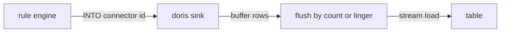
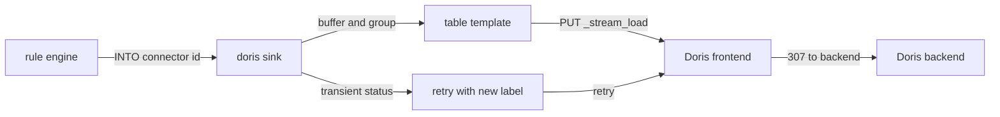

# Doris connector

The Doris connector streams rule results into Apache Doris. It loads JSON rows through stream load. It buffers rows and flushes by count or by linger.

Use it when analytic rows must land in Doris. You get one stream load per flush.



## Before you start

- Run Doris. Note the front-end host, database, and table.
- Create the database and the target table.

## Settings

Set `kind` to `doris`.

| Setting | Required | Meaning |
|---|---|---|
| `server` | yes | Front-end host, `host` or `host:port`. |
| `database` | yes | Target database. |
| `table` | yes | Target table. |
| `username` | no | Doris user. Default `root`. |
| `password` | no | Doris password. Default empty. |
| `http_port` | no | Front-end HTTP port. Default 8030. |

The action may override `table` per target. The driver writes JSON stream loads only.

### `server`

Front-end host, `host` or `host:port`. Type: string. Required: yes. A port in the value selects the HTTP port. Absent: 400 naming `server`.

```sh test
python3 - <<'PY'
import json, os, urllib.request
port = os.environ.get("API_PORT", "18083")
key = os.environ["API_KEY"]
def post(body):
    req = urllib.request.Request(
        f"http://127.0.0.1:{port}/api/v5/connectors", data=json.dumps(body).encode(), method="POST",
        headers={"Authorization": f"Bearer {key}", "Content-Type": "application/json"})
    try:
        with urllib.request.urlopen(req, timeout=5) as res:
            return res.status, json.load(res)
    except urllib.error.HTTPError as err:
        return err.code, json.load(err)
status, created = post({"name": "doris-server-ok", "type": "doris",
                        "server": "127.0.0.1:9", "database": "telemetry", "table": "events"})
assert status == 201, (status, created)
status, body = post({"name": "doris-server-bad", "type": "doris",
                     "database": "telemetry", "table": "events"})
assert status == 400 and "server" in body["message"], body
print("ok")
PY
```

```output
ok
```

### `database`

Target database. Type: string. Required: yes. Absent: 400 naming `database`.

```sh test
python3 - <<'PY'
import json, os, urllib.request
port = os.environ.get("API_PORT", "18083")
key = os.environ["API_KEY"]
def post(body):
    req = urllib.request.Request(
        f"http://127.0.0.1:{port}/api/v5/connectors", data=json.dumps(body).encode(), method="POST",
        headers={"Authorization": f"Bearer {key}", "Content-Type": "application/json"})
    try:
        with urllib.request.urlopen(req, timeout=5) as res:
            return res.status, json.load(res)
    except urllib.error.HTTPError as err:
        return err.code, json.load(err)
status, body = post({"name": "doris-db-bad", "type": "doris",
                     "server": "127.0.0.1", "table": "events"})
assert status == 400 and "database" in body["message"], body
print("ok")
PY
```

```output
ok
```

### `table`

Target table. Type: string. Required: yes. Absent: 400 naming `table`.

```sh test
python3 - <<'PY'
import json, os, urllib.request
port = os.environ.get("API_PORT", "18083")
key = os.environ["API_KEY"]
def post(body):
    req = urllib.request.Request(
        f"http://127.0.0.1:{port}/api/v5/connectors", data=json.dumps(body).encode(), method="POST",
        headers={"Authorization": f"Bearer {key}", "Content-Type": "application/json"})
    try:
        with urllib.request.urlopen(req, timeout=5) as res:
            return res.status, json.load(res)
    except urllib.error.HTTPError as err:
        return err.code, json.load(err)
status, body = post({"name": "doris-table-bad", "type": "doris",
                     "server": "127.0.0.1", "database": "telemetry"})
assert status == 400 and "table" in body["message"], body
print("ok")
PY
```

```output
ok
```

### `username`

Doris user. Type: string. Required: no. Default `root`.

```sh test
python3 - <<'PY'
import json, os, urllib.request
port = os.environ.get("API_PORT", "18083")
key = os.environ["API_KEY"]
def post(body):
    req = urllib.request.Request(
        f"http://127.0.0.1:{port}/api/v5/connectors", data=json.dumps(body).encode(), method="POST",
        headers={"Authorization": f"Bearer {key}", "Content-Type": "application/json"})
    try:
        with urllib.request.urlopen(req, timeout=5) as res:
            return res.status, json.load(res)
    except urllib.error.HTTPError as err:
        return err.code, json.load(err)
status, created = post({"name": "doris-user-ok", "type": "doris",
                        "server": "127.0.0.1", "database": "telemetry", "table": "events",
                        "username": "admin", "password": "pw"})
assert status == 201, (status, created)
print("ok")
PY
```

```output
ok
```

### `password`

Doris password. Type: string. Required: no. Default empty.

```sh test
python3 - <<'PY'
import json, os, urllib.request
port = os.environ.get("API_PORT", "18083")
key = os.environ["API_KEY"]
def post(body):
    req = urllib.request.Request(
        f"http://127.0.0.1:{port}/api/v5/connectors", data=json.dumps(body).encode(), method="POST",
        headers={"Authorization": f"Bearer {key}", "Content-Type": "application/json"})
    try:
        with urllib.request.urlopen(req, timeout=5) as res:
            return res.status, json.load(res)
    except urllib.error.HTTPError as err:
        return err.code, json.load(err)
status, created = post({"name": "doris-pw-ok", "type": "doris",
                        "server": "127.0.0.1", "database": "telemetry", "table": "events",
                        "password": "pw"})
assert status == 201, (status, created)
print("ok")
PY
```

```output
ok
```

### `http_port`

Front-end HTTP port. Type: integer. Required: no. Default 8030. An explicit value wins over the `server` port.

```sh test
python3 - <<'PY'
import json, os, urllib.request
port = os.environ.get("API_PORT", "18083")
key = os.environ["API_KEY"]
def post(body):
    req = urllib.request.Request(
        f"http://127.0.0.1:{port}/api/v5/connectors", data=json.dumps(body).encode(), method="POST",
        headers={"Authorization": f"Bearer {key}", "Content-Type": "application/json"})
    try:
        with urllib.request.urlopen(req, timeout=5) as res:
            return res.status, json.load(res)
    except urllib.error.HTTPError as err:
        return err.code, json.load(err)
status, created = post({"name": "doris-port-ok", "type": "doris",
                        "server": "127.0.0.1", "database": "telemetry", "table": "events",
                        "http_port": 8030})
assert status == 201, (status, created)
print("ok")
PY
```

```output
ok
```

Example:

```json
{
  "name": "doris-sink-1",
  "type": "doris",
  "server": "127.0.0.1",
  "database": "telemetry",
  "table": "events"
}
```

> [!NOTE]
> The docs run creates this shape. Creation validates only; it loads nothing. The send path needs a Doris server. See the failure record in [Verification failures](../_verification/failures.md).

## Check that it works

Create the connector. The broker answers 201 with the kind. It prints `ok`.

```toml test
[node]
id = "docs-connector-doris"

[listeners.tcp]
bind = "0.0.0.0:1883"

[listeners.api]
bind = "0.0.0.0:18083"

[logging]
level = "warn"

[auth]
allow_anonymous = true
```

```sh test
python3 - <<'PY'
import json, os, urllib.request
port = os.environ.get("API_PORT", "18083")
key = os.environ["API_KEY"]
body = json.dumps({"name": "doris-sink-1", "type": "doris",
                   "server": "127.0.0.1",
                   "database": "telemetry", "table": "events"}).encode()
req = urllib.request.Request(
    f"http://127.0.0.1:{port}/api/v5/connectors", data=body, method="POST",
    headers={"Authorization": f"Bearer {key}", "Content-Type": "application/json"})
try:
    with urllib.request.urlopen(req, timeout=5) as res:
        status, created = res.status, json.load(res)
except urllib.error.HTTPError as err:
    status, created = err.code, json.load(err)
assert status == 201, (status, created)
assert created["type"] == "doris", created
print("ok")
PY
```

```output
ok
```

## Limits

- The front-end redirects the load to a back-end. The transport replays auth on that hop.
- A dead server backs off and retries. The bounded queue sheds past its bound.
- A terminal load status stops the batch with a failure.

## Next steps

- Feed the connector from a rule in [Actions](../rules/actions.md).
- See every kind in [Connectors](./index.md).

## Reference form (v1 API)

The reference form uses the v1 connector API. The v5 form above uses connector and action documents. This section keeps the reference page.

The Doris connector writes each rule result as one row in an Apache Doris table. It uses the HTTP Stream Load protocol. It groups rows by table, sends one load per group, and retries transient statuses with a fresh label.

Use it when rule results must land in a Doris table. You get one stream load per table group with JSON or CSV encoding and Basic authentication.



### Before you start

- Run an Apache Doris cluster. Note the frontend host, the HTTP port, and the credentials.
- Create the database and the target table. Its columns must match the result fields.
- The account needs the load privilege on the table.
- This kind ships in the default build. No feature flag is necessary.

### Settings

Set `kind` to `doris` on the v1 API. It stores the kind as `doris`.

| Setting | Required | Meaning |
|---|---|---|
| `fe_host` | yes | Frontend host or load-balancer address. An empty value is refused. |
| `http_port` | no | Frontend HTTP port. Default 8030. A value of 0 is refused. |
| `database` | yes | Target database. It must match `[A-Za-z0-9_]+`. |
| `table_template` | yes | Table name template. It accepts `${topic}`, `${client_id}`, `${qos}`, and `${timestamp}`. The rendered name must match `[A-Za-z0-9_]+`. |
| `auth` | yes | Object with `username` and `password`. The username must not be empty. The password may be empty. |
| `format` | no | `json` or `csv`. Default `json`. |
| `jsonpaths` | no | Custom `jsonpaths` header value. Default none. |
| `strip_outer_array` | no | Send `strip_outer_array: true`. Default true. |
| `max_filter_ratio` | no | Tolerated bad-row ratio. Default none, which sends no header. A value must be 0.0 to 1.0. |
| `batch_size` | no | Rows per load. Default 1000. A value of 0 is refused. `null` means no row limit. |
| `batch_bytes` | no | Byte limit for one buffer. Default 4194304 (4 MiB). A value of 0 is refused. `null` means no byte limit. |
| `linger_ms` | no | Age in ms that makes a buffered row stale. Default 10. `null` means a row never becomes stale. |
| `max_retries` | no | Retries of one failed load. Default 4. `null` means no limit. A value of 0 means no retry. |
| `initial_backoff_ms` | no | First retry delay in ms. Default 100. A value below 1 becomes 1. |
| `max_backoff_ms` | no | Retry delay ceiling in ms. Default 2000. A value below 1 becomes 1. |
| `timeout_ms` | no | Request deadline in ms. Default 5000. A value below 1 becomes 1. |

The v5 route reads `server`, `fe_host`, `host`, or `endpoint`. It defaults to `127.0.0.1`. It reads `http_port` or `port` (default 8030), `database` (default `telemetry`), `table_template` or `table` (default `events`), `username` (default `root`), and `password` (default empty). It reads `timeout_ms`, `timeout`, or `request_timeout_ms`. It fixes `format` to `json`, `jsonpaths` to none, `strip_outer_array` to true, and `max_filter_ratio` to 0.0. It fixes `batch_size` to 1, `batch_bytes` to 4194304, and `linger_ms` to 10. It fixes `max_retries` to 3, `initial_backoff_ms` to 100, and `max_backoff_ms` to 2000. It registers the name and the alias `doris:name`.

Example:

```json
{
  "id": "doris-1",
  "kind": "doris",
  "config": {
    "fe_host": "127.0.0.1",
    "http_port": 8030,
    "database": "telemetry",
    "table_template": "events",
    "auth": {"username": "root", "password": ""},
    "format": "json",
    "strip_outer_array": true,
    "max_filter_ratio": 0.0,
    "batch_size": 100,
    "batch_bytes": 65536,
    "linger_ms": 10,
    "max_retries": 2,
    "initial_backoff_ms": 10,
    "max_backoff_ms": 100,
    "timeout_ms": 5000
  }
}
```

> [!NOTE]
> The docs run creates this shape on the v1 and v5 routes. Creation validates only; it opens no socket. The send path needs a Doris cluster. See the record in [Verification failures](../_verification/failures.md).

### Check that it works

Create the connector on both routes. The broker answers 201 with the kind.

```toml test
# Reference form run.
[node]
id = "docs-connector-doris"

[listeners.tcp]
bind = "0.0.0.0:1883"

[listeners.api]
bind = "0.0.0.0:18083"

[logging]
level = "warn"

[auth]
allow_anonymous = true
```

```sh test
python3 - <<'PY'
import json, os, urllib.request
port = os.environ.get("API_PORT", "18083")
key = os.environ["API_KEY"]

def call(method, path, body):
    req = urllib.request.Request(
        f"http://127.0.0.1:{port}{path}", data=json.dumps(body).encode(),
        method=method,
        headers={"Authorization": f"Bearer {key}",
                 "Content-Type": "application/json"})
    with urllib.request.urlopen(req, timeout=5) as res:
        return res.status, json.load(res)

config = {"fe_host": "127.0.0.1", "http_port": 8030,
          "database": "telemetry", "table_template": "events",
          "auth": {"username": "root", "password": ""},
          "format": "json", "strip_outer_array": True,
          "max_filter_ratio": 0.0, "batch_size": 100,
          "batch_bytes": 65536, "linger_ms": 10, "max_retries": 2,
          "initial_backoff_ms": 10, "max_backoff_ms": 100,
          "timeout_ms": 5000}
s1, b1 = call("POST", "/api/v1/connectors",
              {"id": "doris-1", "kind": "doris", "config": config})
assert s1 == 201 and b1["kind"] == "doris", (s1, b1)
s2, b2 = call("POST", "/api/v5/connectors",
              {"name": "doris-2", "type": "doris",
               "server": "127.0.0.1", "http_port": 8030,
               "database": "telemetry", "table": "events",
               "username": "root", "password": "",
               "timeout_ms": 5000})
assert s2 == 201 and b2["type"] == "doris", (s2, b2)
print("doris")
PY
```

```output
doris
```

### Limits

- An empty `fe_host` is refused with 400. A `database` or rendered table outside `[A-Za-z0-9_]+` is refused with 400.
- An empty `table_template` or `username` is refused with 400. An unknown or unclosed template variable is refused at creation.
- A `max_filter_ratio` outside 0.0 to 1.0 is refused with 400. A `batch_size` or `batch_bytes` of 0 is refused.
- A payload must be UTF-8 JSON. A non-object value becomes one `value` field. The sink adds `topic`, `qos`, and `timestamp` to each object.
- The JSON body is an array with `strip_outer_array: true`. The CSV body holds one row per record.
- Each request is `PUT http://{fe_host}:{http_port}/api/{database}/{table}/_stream_load`. It carries Basic auth and the `format`, `strip_outer_array`, and `label` headers. It adds `Expect: 100-continue`.
- The transport follows a 307 or 308 redirect to a backend node up to 5 hops. It keeps the auth and the label on each hop. It rewrites a loopback backend host to the frontend host. Any other redirect is terminal.
- A `Success` status completes the load. `Publish Timeout` and `Label Already Exists` retry with a new label. HTTP 429 and 503 retry. Any other non-2xx status is terminal.
- A failed batch restores its rows in order and enters a cooldown of 2 s that doubles to 30 s. Flushes fail fast during the cooldown.
- The connector runs behind the rule engine bounded queue. A slow cluster never stalls publishers.
- The tier is enterprise. The kind ships in the default build.

### Next steps

- Feed the connector from a rule in [Actions](../rules/actions.md).
- See every kind in [Connectors](./index.md).

## Known limits in this release

The broker accepts the fields in this list. The broker does not apply them in this release.

- `batch_bytes` (the batch size in bytes)
- `batch_size` (the batch size)
- `initial_backoff_ms` (the first retry wait time)
- `linger_ms` (the batch wait time)
- `max_backoff_ms` (the longest retry wait time)
- `max_retries` (the retry count)

To set batching, use `resource_opts` in the action. The broker applies `resource_opts`.

A later release applies these fields.
