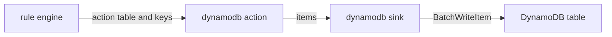

# DynamoDB connector

The DynamoDB connector writes rule results as items in one table with `BatchWriteItem`.

Use it for key-value telemetry in AWS. The action names the table, the hash key and the optional range key.



## Before you start

- Create a DynamoDB table with a hash key and an optional range key.
- Create credentials with write access.
- For a full build, enable `--features dynamodb`. The default build answers 400 and names the feature.

## Settings

| Connector setting | Required | Meaning |
|---|---|---|
| `url` | yes | DynamoDB endpoint URL. |
| `region` | yes | AWS region. |
| `aws_access_key_id` | yes | Access key ID. |
| `aws_secret_access_key` | yes | Secret access key. |

| Action setting | Required | Meaning |
|---|---|---|
| `table` | yes | Target table. |
| `hash_key` | yes | Hash key attribute name. |
| `range_key` | no | Range key attribute name. |
| `template` | no | JSON object of attribute templates. |
| `undefined_vars_as_null` | no | Treat undefined variables as null. |

Example action:

```json
{
  "name": "ddb-events",
  "type": "dynamo",
  "connector": "ddb-local",
  "parameters": {
    "table": "events",
    "hash_key": "id",
    "template": "{\"id\":\"${payload.id}\",\"temp\":\"${payload.temp}\"}"
  }
}
```

## Limits

- A missing table or hash key answers 400 and names the field.
- A missing access key or secret is refused. The connector does not invent credentials.
- A failed batch counts one failed forward on the action.

## Next steps

- Feed the connector from a rule in [Actions](../rules/actions.md).
- See every kind in [Connectors](./index.md).

## Check that it works

Create the connector. The broker answers 201 with the kind when the build holds the feature, else 400 names it. Both answers print `ok`.

```toml test
[node]
id = "docs-connector-dynamodb"

[listeners.tcp]
bind = "0.0.0.0:1883"

[listeners.api]
bind = "0.0.0.0:18083"

[logging]
level = "warn"

[auth]
allow_anonymous = true
```

```sh test
python3 - <<'PY'
import json, os, urllib.request
port = os.environ.get("API_PORT", "18083")
key = os.environ["API_KEY"]
body = json.dumps({"name": "docs-ddb-1", "type": "dynamodb",
                   "url": "http://127.0.0.1:8000", "region": "us-east-1",
                   "aws_access_key_id": "AKID",
                   "aws_secret_access_key": "secret"}).encode()
req = urllib.request.Request(
    f"http://127.0.0.1:{port}/api/v5/connectors", data=body, method="POST",
    headers={"Authorization": f"Bearer {key}", "Content-Type": "application/json"})
try:
    with urllib.request.urlopen(req, timeout=5) as res:
        status, created = res.status, json.load(res)
except urllib.error.HTTPError as err:
    status, created = err.code, json.load(err)
assert status in (201, 400), (status, created)
if status == 201:
    assert created["type"] == "dynamodb", created
else:
    assert "dynamo" in created["message"], created
print("ok")
PY
```

```output
ok
```
