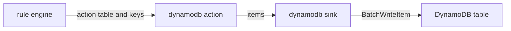
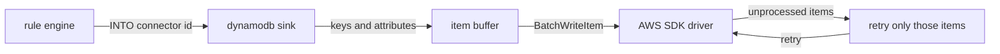

# DynamoDB connector

The DynamoDB connector writes rule results as items in one table with `BatchWriteItem`.

Use it for key-value telemetry in AWS. The action names the table, the hash key and the optional range key.



## Before you start

- Create a DynamoDB table with a hash key and an optional range key.
- Create credentials with write access.
- For a full build, enable `--features dynamodb`. The default build answers 400 and names the feature.

## Settings

| Connector setting | Required | Meaning |
|---|---|---|
| `url` | yes | DynamoDB endpoint URL. |
| `region` | yes | AWS region. |
| `aws_access_key_id` | yes | Access key ID. |
| `aws_secret_access_key` | yes | Secret access key. |

| Action setting | Required | Meaning |
|---|---|---|
| `table` | yes | Target table. |
| `hash_key` | yes | Hash key attribute name. |
| `range_key` | no | Range key attribute name. |
| `template` | no | JSON object of attribute templates. |
| `undefined_vars_as_null` | no | Treat undefined variables as null. |

Example action:

```json
{
  "name": "ddb-events",
  "type": "dynamo",
  "connector": "ddb-local",
  "parameters": {
    "table": "events",
    "hash_key": "id",
    "template": "{\"id\":\"${payload.id}\",\"temp\":\"${payload.temp}\"}"
  }
}
```

## Limits

- A missing table or hash key answers 400 and names the field.
- A missing access key or secret is refused. The connector does not invent credentials.
- A failed batch counts one failed forward on the action.

## Next steps

- Feed the connector from a rule in [Actions](../rules/actions.md).
- See every kind in [Connectors](./index.md).

## Check that it works

Create the connector. The broker answers 201 with the kind when the build holds the feature, else 400 names it. Both answers print `ok`.

```toml test
[node]
id = "docs-connector-dynamodb"

[listeners.tcp]
bind = "0.0.0.0:1883"

[listeners.api]
bind = "0.0.0.0:18083"

[logging]
level = "warn"

[auth]
allow_anonymous = true
```

```sh test
python3 - <<'PY'
import json, os, urllib.request
port = os.environ.get("API_PORT", "18083")
key = os.environ["API_KEY"]
body = json.dumps({"name": "docs-ddb-1", "type": "dynamodb",
                   "url": "http://127.0.0.1:8000", "region": "us-east-1",
                   "aws_access_key_id": "AKID",
                   "aws_secret_access_key": "secret"}).encode()
req = urllib.request.Request(
    f"http://127.0.0.1:{port}/api/v5/connectors", data=body, method="POST",
    headers={"Authorization": f"Bearer {key}", "Content-Type": "application/json"})
try:
    with urllib.request.urlopen(req, timeout=5) as res:
        status, created = res.status, json.load(res)
except urllib.error.HTTPError as err:
    status, created = err.code, json.load(err)
assert status in (201, 400), (status, created)
if status == 201:
    assert created["type"] == "dynamodb", created
else:
    assert "dynamo" in created["message"], created
print("ok")
PY
```

```output
ok
```

## Reference form (v1 API)

The reference form uses the v1 connector API. The v5 form above uses connector and action documents. This section keeps the reference page.

The `dynamodb` connector writes each rule result as one DynamoDB item. It builds keys from templates, maps payload fields to attributes, and writes batches with `BatchWriteItem`.

Use it when results must land in a DynamoDB table. You get key templates, a TTL, attribute mapping, and selective retry of unprocessed items.



### Before you start

- Run a DynamoDB table, or a local DynamoDB endpoint. Note the table name and the region.
- Create the table with the partition key and the optional sort key that the connector uses.
- Keep an access key pair. Add a session token when the credentials are temporary.
- For a full build, enable the feature: `--features dynamodb`. The default build answers 400 and names the feature.

### Settings

Set `kind` to `dynamodb` on the v1 API. The v1 route also accepts `dynamo` and `ddb`. It stores the runtime as `dynamodb`.

| Setting | Required | Meaning |
|---|---|---|
| `table_name` | yes | Target table. An empty value is refused. |
| `region` | yes | AWS region. An empty value is refused. |
| `endpoint` | no | Custom endpoint with `http://` or `https://`. Default `https://dynamodb.{region}.amazonaws.com`. |
| `access_key_id` | yes | AWS access key id. An empty value is refused. |
| `secret_access_key` | yes | AWS secret access key. An empty value is refused. |
| `session_token` | no | STS session token for temporary credentials. Default none. |
| `partition_key` | yes | Object with `name`, `template`, and `key_type`. The type is `S` or `N`. The name and template must not be empty. |
| `sort_key` | no | Optional object with the same shape as `partition_key`. |
| `ttl_attribute` | no | Attribute name for the expiry time. It needs `ttl_secs` to take effect. |
| `ttl_secs` | no | Time to live in seconds. The sink writes `now_secs + ttl_secs`. |
| `attributes_mapping` | no | Object of attribute name to value template. The value `${payload}` unpacks the whole JSON object. Default empty. |
| `batch_size` | no | Items per batch. Default 25, the service cap. A value of 0 is refused. `null` means no item limit. |
| `batch_bytes` | no | Byte limit for one buffer. Default 1048576 (1 MiB). A value of 0 is refused. `null` means no byte limit. |
| `linger_ms` | no | Age in ms that makes a buffered item stale. Default 10. `null` means an item never becomes stale. |
| `max_retries` | no | Retries of one failed batch. Default 4. `null` means no limit. A value of 0 means no retry. |
| `initial_backoff_ms` | no | First retry delay in ms. Default 100. A value below 1 becomes 1. |
| `max_backoff_ms` | no | Retry delay ceiling in ms. Default 2000. A value below 1 becomes 1. |
| `timeout_ms` | no | Request deadline in ms. Default 5000. A value below 1 becomes 1. |

A key template accepts `${topic}`, `${client_id}`, `${qos}`, `${timestamp}`, and `${payload.<field>}`. A numeric key must render as a number.

The v5 route reads `table_name` or `table` (default `sensor_events`), `region` (default `us-east-1`), `endpoint` or `url`, `access_key_id` (default `test`), and `secret_access_key` (default `test`). It reads `partition_key` as a bare attribute name (default `id`) and fixes its template to `${timestamp}` with type `S`. It reads `timeout_ms`, `timeout`, or `request_timeout_ms`. It fixes `session_token` to none, `sort_key` to none, the TTL fields to none, and `attributes_mapping` to empty. It fixes `batch_size` to 1, `batch_bytes` to 1048576, and `linger_ms` to 10. It fixes `max_retries` to 3, `initial_backoff_ms` to 100, and `max_backoff_ms` to 2000. It registers the name and the alias `dynamodb:name`.

Example:

```json
{
  "id": "dynamodb-1",
  "kind": "dynamodb",
  "config": {
    "table_name": "telemetry_table",
    "region": "us-east-1",
    "access_key_id": "AKID",
    "secret_access_key": "secret",
    "partition_key": {"name": "device_id", "template": "${client_id}", "key_type": "S"},
    "sort_key": {"name": "seq", "template": "${timestamp}", "key_type": "N"},
    "ttl_attribute": "expires_at",
    "ttl_secs": 3600,
    "attributes_mapping": {"temperature": "${payload.temperature}"},
    "batch_size": 25,
    "batch_bytes": 65536,
    "linger_ms": 10,
    "max_retries": 2,
    "initial_backoff_ms": 10,
    "max_backoff_ms": 100,
    "timeout_ms": 5000
  }
}
```

> [!NOTE]
> The docs run creates this shape on the v1 and v5 routes. The default build refuses it with 400 and names the `dynamodb` feature. A full build returns 201. The send path needs a DynamoDB table. See the record in [Verification failures](../_verification/failures.md).

### Check that it works

Create the connector on both routes. A build with the feature answers 201. The default build answers 400 and names the feature. Both answers pass the check.

```toml test
# Reference form run.
[node]
id = "docs-connector-dynamodb"

[listeners.tcp]
bind = "0.0.0.0:1883"

[listeners.api]
bind = "0.0.0.0:18083"

[logging]
level = "warn"

[auth]
allow_anonymous = true
```

```sh test
python3 - <<'PY'
import json, os, urllib.request, urllib.error
port = os.environ.get("API_PORT", "18083")
key = os.environ["API_KEY"]

def call(method, path, body):
    req = urllib.request.Request(
        f"http://127.0.0.1:{port}{path}", data=json.dumps(body).encode(),
        method=method,
        headers={"Authorization": f"Bearer {key}",
                 "Content-Type": "application/json"})
    try:
        with urllib.request.urlopen(req, timeout=5) as res:
            return res.status, json.load(res)
    except urllib.error.HTTPError as err:
        return err.code, json.load(err)

config = {"table_name": "telemetry_table", "region": "us-east-1",
          "access_key_id": "AKID", "secret_access_key": "secret",
          "partition_key": {"name": "device_id",
                            "template": "${client_id}", "key_type": "S"},
          "attributes_mapping": {"temperature": "${payload.temperature}"},
          "batch_size": 25, "batch_bytes": 65536, "linger_ms": 10,
          "max_retries": 2, "initial_backoff_ms": 10,
          "max_backoff_ms": 100, "timeout_ms": 5000}
s1, b1 = call("POST", "/api/v1/connectors",
              {"id": "dynamodb-1", "kind": "dynamodb", "config": config})
assert s1 in (201, 400), (s1, b1)
if s1 == 201:
    assert b1["kind"] == "dynamodb", b1
else:
    assert "dynamodb" in json.dumps(b1).lower(), b1
s2, b2 = call("POST", "/api/v5/connectors",
              {"name": "dynamodb-2", "type": "dynamodb",
               "table_name": "telemetry_table", "region": "us-east-1",
               "access_key_id": "AKID", "secret_access_key": "secret",
               "partition_key": "device_id", "timeout_ms": 5000})
assert s2 in (201, 400), (s2, b2)
if s2 == 201:
    assert b2["type"] == "dynamodb", b2
else:
    assert "dynamodb" in json.dumps(b2).lower(), b2
print("ok")
PY
```

```output
ok
```

### Limits

- An empty `table_name`, `region`, `access_key_id`, or `secret_access_key` is refused with 400. An endpoint without `http://` or `https://` is refused.
- A key name or key template that is empty is refused with 400. A key type other than `S` or `N` is refused. A numeric key that does not parse as a number is refused.
- A template variable that is unknown or unclosed is refused at creation. Validation renders each template with a dummy payload.
- A payload must be UTF-8 JSON. A non-UTF-8 or non-JSON payload is a dispatch error and sends no item. `${payload}` needs a JSON object.
- The sink writes the partition key and the optional sort key first. A TTL attribute holds `now_secs + ttl_secs`.
- An explicit `attributes_mapping` entry wins over an unpacked payload field. A key that names the partition key, the sort key, or the TTL attribute keeps its key value.
- A string becomes `S` and a number becomes `N`. A boolean becomes `BOOL`, `null` becomes `NULL`, an array becomes `L`, and an object becomes `M`.
- The production path uses `SdkDynamoDbTransport` on the maintained AWS SDK driver. The driver signs each request. The hand-written HTTP transport serves offline unit tests only.
- Unprocessed items retry alone. A throttle or a connection fault retries the pending set. A terminal error restores the pending set and enters a cooldown of 2 s that doubles to 30 s.
- The v5 route fixes one item per batch and a 1 MiB byte limit. It fixes a `${timestamp}` string partition key and no sort key, TTL, or attribute mapping.
- The connector runs behind the rule engine bounded queue. A slow table never stalls publishers.
- The tier is enterprise. The kind needs the `dynamodb` feature build.

### Next steps

- Feed the connector from a rule in [Actions](../rules/actions.md).
- See every kind in [Connectors](./index.md).

## Known limits in this release

The broker accepts the fields in this list. The broker does not apply them in this release.

- `batch_bytes` (the batch size in bytes)
- `batch_size` (the batch size)
- `initial_backoff_ms` (the first retry wait time)
- `linger_ms` (the batch wait time)
- `max_backoff_ms` (the longest retry wait time)
- `max_retries` (the retry count)

To set batching, use `resource_opts` in the action. The broker applies `resource_opts`.

A later release applies these fields.
