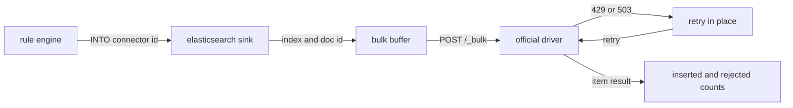

# Elasticsearch connector

The `elasticsearch` connector writes each rule result as one document. It sends a full or stale batch with one `_bulk` call, and it counts the per-item result.

Use it when results must be searchable in Elasticsearch. You get index templates, document ids, Basic or ApiKey auth, and retry on backpressure.



## Before you start

- Run an Elasticsearch server. Note the endpoint and the index name.
- Keep the auth material: a user and password, an encoded API key, or none.
- For a full build, enable the feature: `--features elasticsearch`. The default build answers 400 and names the feature.
- The v1 route accepts `elasticsearch`, `elastic`, `es`, and `opensearch`. The v5 create route accepts `elasticsearch` only.

## Settings

Set `kind` to `elasticsearch` on the v1 API. It stores the runtime as `elasticsearch`.

| Setting | Required | Meaning |
|---|---|---|
| `endpoint` | yes | Base URL with `http://` or `https://`, for example `http://127.0.0.1:9200`. |
| `index_template` | yes | Index name or template. It must not be empty. |
| `doc_id_template` | no | Document id template. Without it Elasticsearch makes the id. |
| `auth` | no | Object with `type` `none`, `basic`, or `apikey`. Default `none`. |
| `batch_size` | no | Documents per bulk call. Default 500. A value of 0 is refused. |
| `batch_timeout_ms` | no | Linger window in ms. Default 100. |
| `max_retries` | no | In-place retries on 429 or 503. Default 5. |
| `request_timeout_ms` | no | Request deadline in ms. Default 5000. A value below 1 becomes 1. |

An `index_template` accepts `${topic}`, `${YYYY}`, `${MM}`, and `${DD}`. The shorthands `${YYYY.MM.dd}`, `${YYYY-MM-dd}`, and `${YYYY/MM/dd}` also work. The broker lowercases upper-case letters and turns each illegal index character into `-`.

A `doc_id_template` accepts `${timestamp}`, `${seq}`, `${topic}`, `${YYYY}`, `${MM}`, `${DD}`, and `${field:<name>}`. The names `${client_id}` and `${device_id}` read their payload fields.

The v5 route reads `endpoint`, `index_template`, `username`, and `password`. It also reads `server`, `servers`, and `url` for the endpoint, and `index` for the index. It reads `request_timeout_ms`, `timeout_ms`, or `timeout`. It adds `http://` when the endpoint has no scheme. The default endpoint is `http://127.0.0.1:9200`. The default index is `sensor_events`. A user and a password make Basic auth. Without both, auth is none. The route fixes `doc_id_template` to none, `batch_size` to 1, `batch_timeout_ms` to 10, and `max_retries` to 3. It registers the name and the alias `elasticsearch:name`.

Example:

```json
{
  "id": "elasticsearch-1",
  "kind": "elasticsearch",
  "config": {
    "endpoint": "http://127.0.0.1:9200",
    "index_template": "iot-telemetry-${YYYY.MM.dd}",
    "doc_id_template": "${client_id}-${timestamp}",
    "auth": {"type": "basic", "username": "elastic", "password": "secret"},
    "batch_size": 500,
    "batch_timeout_ms": 100,
    "max_retries": 5,
    "request_timeout_ms": 5000
  }
}
```

> [!NOTE]
> The docs run creates this shape on the v1 and v5 routes. The default build refuses it with 400 and names the `elasticsearch` feature. A full build returns 201. The send path needs an Elasticsearch server. See the record in [Verification failures](../_verification/failures.md).

## Check that it works

Create the connector on both routes. A build with the feature answers 201. The default build answers 400 and names the feature. Both answers pass the check.

```toml test
[node]
id = "docs-connector-elasticsearch"

[listeners.tcp]
bind = "0.0.0.0:1883"

[listeners.api]
bind = "0.0.0.0:18083"

[logging]
level = "warn"

[auth]
allow_anonymous = true
```

```sh test
python3 - <<'PY'
import json, os, urllib.request, urllib.error
port = os.environ.get("API_PORT", "18083")
key = os.environ["API_KEY"]

def call(method, path, body):
    req = urllib.request.Request(
        f"http://127.0.0.1:{port}{path}", data=json.dumps(body).encode(),
        method=method,
        headers={"Authorization": f"Bearer {key}",
                 "Content-Type": "application/json"})
    try:
        with urllib.request.urlopen(req, timeout=5) as res:
            return res.status, json.load(res)
    except urllib.error.HTTPError as err:
        return err.code, json.load(err)

config = {"endpoint": "http://127.0.0.1:9200",
          "index_template": "iot-telemetry-${YYYY.MM.dd}",
          "doc_id_template": "${client_id}-${timestamp}",
          "auth": {"type": "basic", "username": "elastic",
                   "password": "secret"},
          "batch_size": 500, "batch_timeout_ms": 100,
          "max_retries": 5, "request_timeout_ms": 5000}
s1, b1 = call("POST", "/api/v1/connectors",
              {"id": "elasticsearch-1", "kind": "elasticsearch",
               "config": config})
assert s1 in (201, 400), (s1, b1)
if s1 == 201:
    assert b1["kind"] == "elasticsearch", b1
else:
    assert "elasticsearch" in json.dumps(b1).lower(), b1
s2, b2 = call("POST", "/api/v5/connectors",
              {"name": "elasticsearch-2", "type": "elasticsearch",
               "endpoint": "http://127.0.0.1:9200",
               "index_template": "iot-telemetry",
               "username": "elastic", "password": "secret",
               "request_timeout_ms": 5000})
assert s2 in (201, 400), (s2, b2)
if s2 == 201:
    assert b2["type"] == "elasticsearch", b2
else:
    assert "elasticsearch" in json.dumps(b2).lower(), b2
print("ok")
PY
```

```output
ok
```

## Limits

- On the v1 route, an `endpoint` without `http://` or `https://` is refused with 400. On the v5 route, the endpoint gets `http://` added. An empty `index_template` is refused with 400.
- An empty Basic username or an empty API key is refused with 400.
- An unknown or unclosed template variable is refused at creation. An index that resolves to an empty or illegal start is refused.
- An empty `doc_id_template` result is refused at flush time. A template typo is a dispatch error.
- A payload must be UTF-8. A non-UTF-8 payload is a dispatch error.
- Each document holds `topic`, `qos`, `payload`, and a `timestamp` in RFC 3339 form. A JSON payload stays a JSON value. Other text becomes a string.
- A 429 or 503 retries in place up to `max_retries`. The wait starts at 2 s and doubles to 30 s. After the last retry the buffer is restored and the flush fails.
- Any other non-2xx status restores the buffer and fails the flush. Flushes fail fast during backoff.
- A 2xx body with an `items` array counts each item as inserted or rejected. A partial failure returns an error and does not restore the batch, because the accepted documents are already stored. An item count that differs from the document count is an error.
- The production path uses `DriverElasticsearchTransport` on the official `elasticsearch` driver. The plain HTTP transport serves offline unit tests only.
- The v5 route fixes one document per call and a 10 ms linger. It sets no document id.
- The connector runs behind the rule engine bounded queue. A slow server never stalls publishers.
- The tier is community. The kind needs the `elasticsearch` feature build.

## Next steps

- Feed the connector from a rule in [Actions](../rules/actions.md).
- See every kind in [Connectors](./index.md).
