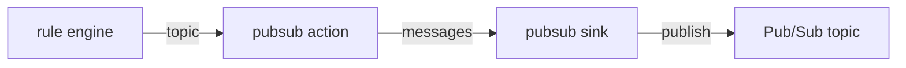

# GCP Pub/Sub connector

The GCP Pub/Sub connector publishes rule results as messages in one topic.

Use it for event streaming in GCP. The action names the topic.



## Before you start

- Create a GCP project and topic.
- Create credentials with publish access.
- For a full build, enable `--features gcp_pubsub`. The default build answers 400 and names the feature.

## Settings

| Connector setting | Required | Meaning |
|---|---|---|
| `project_id` | yes | GCP project ID. |
| `endpoint` | no | Emulator override. Absent means the public endpoint. |
| `access_token` | no | Bearer token. Absent means no header. |
| `service_account_json` | no | Service account JSON key (client_email + private_key). |
| `timeout` | no | Request timeout in milliseconds. |

| Action setting | Required | Meaning |
|---|---|---|
| `pubsub_topic` | yes | Target topic. |
| `ordering_key` | no | Ordering key template for one key. |
| `attributes` | no | Message attributes with template values. |

Example action:

```json
{
  "name": "pubsub-events",
  "type": "gcp_pubsub",
  "connector": "pubsub-local",
  "parameters": {
    "pubsub_topic": "events"
  }
}
```

## Limits

- A missing project or topic answers 400 and names the field.
- A failed publish counts one failed forward on the action.
- Live qualification runs at release. This build proves delivery with a loopback fake.

## Next steps

- Feed the connector from a rule in [Actions](../rules/actions.md).
- See every kind in [Connectors](./index.md).

## Check that it works

Create the connector. The broker answers 201 with the kind when the build holds the feature, else 400 names it. Both answers print `ok`.

```toml test
[node]
id = "docs-connector-gcp-pubsub"

[listeners.tcp]
bind = "0.0.0.0:1883"

[listeners.api]
bind = "0.0.0.0:18083"

[logging]
level = "warn"

[auth]
allow_anonymous = true
```

```sh test
python3 - <<'PY'
import json, os, urllib.request
port = os.environ.get("API_PORT", "18083")
key = os.environ["API_KEY"]
body = json.dumps({"name": "docs-gcp-1", "type": "gcp_pubsub",
                   "project_id": "demo-proj",
                   "endpoint": "http://127.0.0.1:8085"}).encode()
req = urllib.request.Request(
    f"http://127.0.0.1:{port}/api/v5/connectors", data=body, method="POST",
    headers={"Authorization": f"Bearer {key}", "Content-Type": "application/json"})
try:
    with urllib.request.urlopen(req, timeout=5) as res:
        status, created = res.status, json.load(res)
except urllib.error.HTTPError as err:
    status, created = err.code, json.load(err)
assert status in (201, 400), (status, created)
if status == 201:
    assert created["type"] == "gcp_pubsub", created
else:
    assert "gcp" in created["message"], created
print("ok")
PY
```

```output
ok
```
