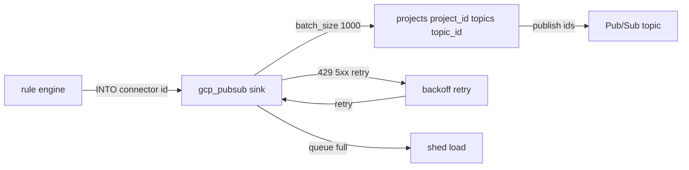

# GCP Pub/Sub connector

The GCP Pub/Sub connector publishes each rule result as one Pub/Sub message. It encodes the payload as base64 data and adds ordering keys and attributes.

Use it when downstream services read broker data from a Pub/Sub topic. You get one batched publish per flush with retry and backoff.



## Before you start

- Run a Pub/Sub service or an emulator. Note the project and the topic.
- For ordered delivery, create the subscription with message ordering enabled.
- For a full build, enable the feature: `--features gcp_pubsub`. The default build answers 400 and names the feature.

## Settings

Set `kind` to `gcp_pubsub`.

| Setting | Required | Meaning |
|---|---|---|
| `project_id` | yes | Project id, 3 to 255 chars of lower case, digits, hyphen. |
| `topic_id` | yes | Topic id, same shape as the project id. |
| `endpoint` | no | Override URL for an emulator. Default is the public service. |
| `auth` | no | Auth selector. Default is none. Also supports a bearer token and a service account key. |
| `ordering_key_template` | no | Ordering key template. Omit it to disable ordering. |
| `attributes` | no | Extra attributes with template values. Each message always carries `mqtt_topic` and `mqtt_qos`. |
| `batch_size` | no | Messages per publish. Default 1000. Must exceed 0. |
| `batch_bytes` | no | Batch byte limit. Default 8388608. Must exceed 0. |
| `linger_ms` | no | Linger before a partial batch flushes. Default 10. |
| `max_retries` | no | Retries on throttles. Default 3. Empty means no bound. |
| `initial_backoff_ms` | no | First retry delay. Default 100. |
| `max_backoff_ms` | no | Retry delay ceiling. Default 2000. |
| `timeout_ms` | no | Publish deadline. Default 5000. |

Templates accept `${topic}`, `${client_id}`, `${qos}`, `${timestamp}` and `${payload.<field>}`. An unknown name fails validation.

Example:

```json
{
  "id": "gcp-pubsub-1",
  "kind": "gcp_pubsub",
  "config": {
    "project_id": "my-iot-project",
    "topic_id": "telemetry-events",
    "auth": {"type": "none"},
    "ordering_key_template": "${client_id}",
    "attributes": {"source": "indramqtt", "device": "${payload.device_id}"},
    "batch_size": 100,
    "batch_bytes": 65536,
    "linger_ms": 10,
    "max_retries": 2,
    "initial_backoff_ms": 10,
    "max_backoff_ms": 100,
    "timeout_ms": 5000
  }
}
```

> [!NOTE]
> The docs run creates this shape. Creation validates only; it publishes nothing. The send path needs a Pub/Sub service. See the failure record in [Verification failures](../_verification/failures.md).

## Check that it works

Create the connector. The broker answers 201 with the kind when the build holds the feature, else 400 naming the feature. Both answers print `ok`.

```toml test
[node]
id = "docs-connector-gcp-pubsub"

[listeners.tcp]
bind = "0.0.0.0:1883"

[listeners.api]
bind = "0.0.0.0:18083"

[logging]
level = "warn"

[auth]
allow_anonymous = true
```

```sh test
python3 - <<'PY'
import json, os, urllib.request, urllib.error
port = os.environ.get("API_PORT", "18083")
key = os.environ["API_KEY"]
body = json.dumps({"id": "gcp-pubsub-1", "kind": "gcp_pubsub",
                   "config": {"project_id": "my-iot-project",
                              "topic_id": "telemetry-events",
                              "auth": {"type": "none"},
                              "batch_size": 100, "batch_bytes": 65536,
                              "linger_ms": 10, "max_retries": 2,
                              "initial_backoff_ms": 10,
                              "max_backoff_ms": 100}}).encode()
req = urllib.request.Request(
    f"http://127.0.0.1:{port}/api/v1/connectors", data=body, method="POST",
    headers={"Authorization": f"Bearer {key}", "Content-Type": "application/json"})
try:
    with urllib.request.urlopen(req, timeout=5) as res:
        status, created = res.status, json.load(res)
except urllib.error.HTTPError as err:
    status, created = err.code, json.load(err)
assert status in (201, 400), (status, created)
if status == 201:
    assert created["kind"] == "gcp_pubsub", created
else:
    assert "gcp_pubsub" in created["error"], created
print("ok")
PY
```

```output
ok
```

## Limits

- A `project_id` or `topic_id` outside 3 to 255 lower case, digits, hyphen is refused with 400.
- An `endpoint` without an `http://` or `https://` prefix is refused.
- An empty bearer token and an empty service account mail or key are refused.
- An unknown template name such as `${nope}` is refused.
- A `batch_size` or `batch_bytes` of 0 is refused.
- Without `ordering_key_template` the body omits `orderingKey`.
- Each message always carries `mqtt_topic` and `mqtt_qos`.
- Throttles retry in place up to `max_retries`. Terminal codes fail fast and keep the buffer.
- One flush runs at a time. The batch is bounded by `batch_size` and `batch_bytes`.

## Other names

This connector is also known as `gcp-pubsub`, `gcp_pubsub_producer`, `gcp_pubsub_consumer`, `gcp`, and `pubsub`. Old links to `/connectors/gcp-pubsub/`, `/connectors/gcp_pubsub_producer/`, and `/connectors/gcp_pubsub_consumer/` redirect here.

The `gcp_pubsub_producer` name serves egress actions. The `gcp_pubsub_consumer` name serves ingress sources. Both names map to this runtime.

## Next steps

- Feed the connector from a rule in [Actions](../rules/actions.md).
- See every kind in [Connectors](./index.md).

## Known limits in this release

The broker accepts the fields in this list. The broker does not apply them in this release.

- `batch_bytes` (the batch size in bytes)
- `batch_size` (the batch size)
- `initial_backoff_ms` (the first retry wait time)
- `linger_ms` (the batch wait time)
- `max_backoff_ms` (the longest retry wait time)
- `max_retries` (the retry count)

To set batching, use `resource_opts` in the action. The broker applies `resource_opts`.

A later release applies these fields.
