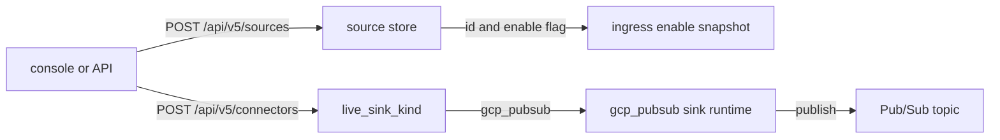

# GCP Pub/Sub consumer

The `gcp_pubsub_consumer` name is the documented Google Cloud Pub/Sub ingress source. It is not a sink. The source store keeps its registration and its enable flag, but the name is absent from the ready source list. The v5 connectors route also accepts the name and maps it to the `gcp_pubsub` sink runtime.

Use it when a tool sends the documented source name. You get a stored source row with the project and the topic parameters. This build has no Pub/Sub pull loop, so the broker does not read messages from a subscription.



## Before you start

- Note the GCP project id and the topic or subscription name.
- For the connector route, run a Pub/Sub service or an emulator.
- For a full build, enable the feature: `--features gcp_pubsub`. The default build answers 400 and names the feature.
- The v1 connectors route does not accept `gcp_pubsub_consumer`. Use the v5 route for this name.

## Settings

Register the source with `POST /api/v5/sources`.

| Setting | Required | Meaning |
|---|---|---|
| `id` or `name` | yes | Source id. Its length is capped at 256 bytes. |
| `type` | yes | Source type. Use `gcp_pubsub_consumer`. |
| `enable` | no | Enable flag. Default `true`. |
| `connector` | no | Documented connector reference. Default empty. |
| `parameters` | no | Object of source parameters. Default empty. |
| `resource_opts` | no | Object of resource options. Default empty. |

The source catalogue documents `parameters.project_id` and `parameters.topic`. The source store validates the type and keeps `parameters` unchanged. It does not validate the two parameter names. The store holds at most 512 sources.

The v5 connectors route runs the `gcp_pubsub` runtime. It reads `project_id` or `project` (default `test-project`) and `topic_id` or `topic` (default `test-topic`). It reads `endpoint` or `url`. It reads `timeout_ms` or `timeout`. It fixes `auth` to none, `ordering_key_template` to none, and `attributes` to empty. It fixes `batch_size` to 1, `batch_bytes` to 1048576, and `linger_ms` to 10. It fixes `max_retries` to 3, `initial_backoff_ms` to 100, and `max_backoff_ms` to 2000. It registers the name and the aliases `gcp_pubsub:name` and `pubsub:name`.

The `gcp_pubsub` page documents the full sink settings.

Example:

```json
{
  "id": "gcp-pubsub-consumer-1",
  "name": "gcp-pubsub-consumer-1",
  "type": "gcp_pubsub_consumer",
  "enable": true,
  "parameters": {
    "project_id": "my-iot-project",
    "topic": "telemetry-events"
  },
  "resource_opts": {}
}
```

> [!NOTE]
> The docs run registers this source and creates the connector name. The source stores no message path. The default build refuses the connector route with 400 and names the `gcp_pubsub` feature. A full build returns 201. The sink send path needs a Pub/Sub service. See the record in [Verification failures](../_verification/failures.md).

## Check that it works

Register the source and create the connector name. The source answers 201. The connector route answers 201 or 400. Both answers print `ok`.

```toml test
[node]
id = "docs-connector-gcp-pubsub-consumer"

[listeners.tcp]
bind = "0.0.0.0:1883"

[listeners.api]
bind = "0.0.0.0:18083"

[logging]
level = "warn"

[auth]
allow_anonymous = true
```

```sh test
python3 - <<'PY'
import json, os, urllib.request, urllib.error
port = os.environ.get("API_PORT", "18083")
key = os.environ["API_KEY"]

def call(method, path, body=None):
    data = None if body is None else json.dumps(body).encode()
    req = urllib.request.Request(
        f"http://127.0.0.1:{port}{path}", data=data, method=method,
        headers={"Authorization": f"Bearer {key}",
                 "Content-Type": "application/json"})
    try:
        with urllib.request.urlopen(req, timeout=5) as res:
            return res.status, json.load(res)
    except urllib.error.HTTPError as err:
        return err.code, json.load(err)

status, types = call("GET", "/api/v5/source_types")
assert status == 200, (status, types)
assert "gcp_pubsub_consumer" not in types, types

s1, b1 = call("POST", "/api/v5/sources",
              {"id": "gcp-pubsub-consumer-1",
               "type": "gcp_pubsub_consumer",
               "parameters": {"project_id": "my-iot-project",
                              "topic": "telemetry-events"}})
assert s1 == 201, (s1, b1)
assert b1["type"] == "gcp_pubsub_consumer", b1
assert b1["enable"] is True, b1

s2, b2 = call("POST", "/api/v5/connectors",
              {"name": "gcp-pubsub-consumer-2",
               "type": "gcp_pubsub_consumer",
               "project_id": "my-iot-project",
               "topic_id": "telemetry-events",
               "timeout_ms": 5000})
assert s2 in (201, 400), (s2, b2)
if s2 == 201:
    assert b2["type"] == "gcp_pubsub_consumer", b2
else:
    assert "gcp_pubsub" in json.dumps(b2).lower(), b2
print("ok")
PY
```

```output
ok
```

## Limits

- The source id must not be empty and must not exceed 256 bytes. A duplicate id is refused. A full store refuses the create at 512 entries.
- The source store validates only the type. It stores `parameters` and `resource_opts` as objects and rejects a non-object value.
- The source name is absent from `GET /api/v5/source_types`. This build has no Pub/Sub pull loop, so the source reads no subscription.
- The v1 connectors route refuses `gcp_pubsub_consumer`. It accepts only `gcp_pubsub`, `gcp`, and `pubsub`.
- The v5 connectors route maps the name to the `gcp_pubsub` runtime. It fixes one message per batch and a 1 MiB byte limit. It sets no ordering key, attributes, or auth.
- The `gcp_pubsub` runtime refuses a `project_id` or `topic_id` outside 3 to 255 lower case, digits, or hyphen.
- The connector runs behind the rule engine bounded queue. A slow topic never stalls publishers.
- The base `gcp_pubsub` runtime is enterprise. The consumer name needs the `gcp_pubsub` feature build for the connector route.

## Next steps

- Read the sink settings in [GCP Pub/Sub](./gcp_pubsub.md).
- Feed the sink from a rule in [Actions](../rules/actions.md).
- See every kind in [Connectors](./index.md).
