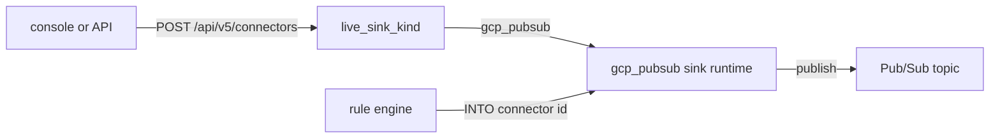

# GCP Pub/Sub producer

The `gcp_pubsub_producer` name is the documented name for the Google Cloud Pub/Sub sink. The v5 connectors route accepts the name and maps it to the `gcp_pubsub` runtime. The v1 connectors route does not accept the name.

Use it when a tool sends the documented producer name. You get a stored connector row that publishes to a topic through the `gcp_pubsub` sink.



## Before you start

- Note the GCP project id and the topic id.
- Run a Pub/Sub service or an emulator for the send path.
- For a full build, enable the feature: `--features gcp_pubsub`. The default build answers 400 and names the feature.
- The v1 connectors route does not accept `gcp_pubsub_producer`. Use the v5 route for this name.

## Settings

Create the connector with `POST /api/v5/connectors`.

| Setting | Required | Meaning |
|---|---|---|
| `id` or `name` | yes | Connector id. Its length is capped at 256 bytes. |
| `type` | yes | Connector type. Use `gcp_pubsub_producer`. |
| `enable` | no | Enable flag. Default `true`. |
| `project_id` or `project` | no | Project id. Default `test-project`. |
| `topic_id` or `topic` | no | Topic id. Default `test-topic`. |
| `endpoint` or `url` | no | Override URL for an emulator. Default is the public service. |
| `timeout_ms` or `timeout` | no | Publish deadline. Default 5000. |

The v5 route runs the `gcp_pubsub` runtime. It fixes `auth` to none, `ordering_key_template` to none, and `attributes` to empty. It fixes `batch_size` to 1, `batch_bytes` to 1048576, and `linger_ms` to 10. It fixes `max_retries` to 3, `initial_backoff_ms` to 100, and `max_backoff_ms` to 2000. It registers the name and the aliases `gcp_pubsub:name` and `pubsub:name`.

The `gcp_pubsub` page documents the full sink settings. The stored row keeps the type `gcp_pubsub_producer`.

Example:

```json
{
  "id": "gcp-pubsub-producer-1",
  "name": "gcp-pubsub-producer-1",
  "type": "gcp_pubsub_producer",
  "enable": true,
  "project_id": "my-iot-project",
  "topic_id": "telemetry-events",
  "timeout_ms": 5000
}
```

> [!NOTE]
> The docs run creates this connector name. The default build refuses the route with 400 and names the `gcp_pubsub` feature. A full build returns 201. The send path needs a Pub/Sub service. See the record in [Verification failures](../_verification/failures.md).

## Check that it works

The v1 route refuses the name. The v5 route answers 201 or 400. Both answers print `ok`.

```toml test
[node]
id = "docs-connector-gcp-pubsub-producer"

[listeners.tcp]
bind = "0.0.0.0:1883"

[listeners.api]
bind = "0.0.0.0:18083"

[logging]
level = "warn"

[auth]
allow_anonymous = true
```

```sh test
python3 - <<'PY'
import json, os, urllib.request, urllib.error
port = os.environ.get("API_PORT", "18083")
key = os.environ["API_KEY"]

def call(method, path, body=None):
    data = None if body is None else json.dumps(body).encode()
    req = urllib.request.Request(
        f"http://127.0.0.1:{port}{path}", data=data, method=method,
        headers={"Authorization": f"Bearer {key}",
                 "Content-Type": "application/json"})
    try:
        with urllib.request.urlopen(req, timeout=5) as res:
            return res.status, json.load(res)
    except urllib.error.HTTPError as err:
        return err.code, json.load(err)

s1, b1 = call("POST", "/api/v1/connectors",
              {"id": "gcp-pubsub-producer-v1",
               "kind": "gcp_pubsub_producer",
               "config": {"project_id": "my-iot-project",
                          "topic_id": "telemetry-events"}})
assert s1 == 400, (s1, b1)
assert "unknown connector kind" in json.dumps(b1).lower(), b1

s2, b2 = call("POST", "/api/v5/connectors",
              {"name": "gcp-pubsub-producer-1",
               "type": "gcp_pubsub_producer",
               "project_id": "my-iot-project",
               "topic_id": "telemetry-events",
               "timeout_ms": 5000})
assert s2 in (201, 400), (s2, b2)
if s2 == 201:
    assert b2["type"] == "gcp_pubsub_producer", b2
else:
    assert "gcp_pubsub" in json.dumps(b2).lower(), b2
print("ok")
PY
```

```output
ok
```

## Limits

- The connector id must not be empty and must not exceed 256 bytes. A duplicate id is refused.
- The v1 connectors route refuses `gcp_pubsub_producer`. It accepts only `gcp_pubsub`, `gcp`, and `pubsub`.
- The v5 route maps the name to the `gcp_pubsub` runtime. It fixes one message per batch and a 1 MiB byte limit. It sets no ordering key, attributes, or auth.
- The `gcp_pubsub` runtime refuses a `project_id` or `topic_id` outside 3 to 255 lower case, digits, or hyphen.
- The connector runs behind the rule engine bounded queue. A slow topic never stalls publishers.
- The base `gcp_pubsub` runtime is enterprise. The producer name needs the `gcp_pubsub` feature build for the connector route.

## Next steps

- Read the sink settings in [GCP Pub/Sub](./gcp_pubsub.md).
- Feed the sink from a rule in [Actions](../rules/actions.md).
- See every kind in [Connectors](./index.md).
