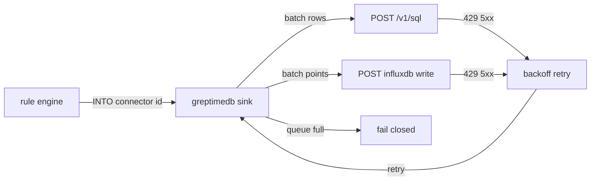

# GreptimeDB connector

The GreptimeDB connector writes each rule result as one time-series row. It sends SQL inserts or line protocol points over HTTP. It groups rows by table and retries faults with backoff.

Use it when metrics must land in GreptimeDB tables. You get one HTTP request per flush with your own table mapping.



## Before you start

- Run GreptimeDB. Note the HTTP endpoint and the database.
- Choose the table template. Match its segments to the topic.
- This kind ships in the default build. No feature flag is necessary.

## Settings

Set `kind` to `greptimedb`.

| Setting | Required | Meaning |
|---|---|---|
| `endpoint` | yes | HTTP base of the server, with or without `/v1`. The sink adds `/v1` when missing. |
| `database` | no | Target database. Default `public`. An empty value is refused. |
| `auth` | no | Object with `username` and `password`. Default is none. It sends a Basic header. |
| `format` | no | `sql_insert` default, or `influx_line_protocol`. |
| `table_template` | yes | Table name with `${topic}` and `${topic_segment_N}`. Other chars become `_`. |
| `timestamp_precision` | no | `nanosecond`, `microsecond`, `millisecond` default, or `second`. The line path sends `ns`, `u`, `ms`, `s`. |
| `batch_size` | no | Rows per flush. Default 1000. Must exceed 0. |
| `buffer_capacity` | no | Max buffered rows. Default 10000. Must exceed 0. A full buffer fails closed. |
| `timeout_ms` | no | Request deadline in ms. Default 5000. A value below 1 reads as 1. |

Example:

```json
{
  "id": "greptime-1",
  "kind": "greptimedb",
  "config": {
    "endpoint": "http://127.0.0.1:4000/v1",
    "database": "public",
    "format": "sql_insert",
    "table_template": "metrics_${topic_segment_1}",
    "timestamp_precision": "millisecond",
    "batch_size": 100,
    "buffer_capacity": 10000,
    "timeout_ms": 5000
  }
}
```

> [!NOTE]
> The docs run creates this shape. Creation validates only; it writes no row. The send path needs a GreptimeDB server. See the failure record in [Verification failures](../_verification/failures.md).

## Check that it works

Create the connector. The broker answers 201 with the kind.

```toml test
[node]
id = "docs-connector-greptimedb"

[listeners.tcp]
bind = "0.0.0.0:1883"

[listeners.api]
bind = "0.0.0.0:18083"

[logging]
level = "warn"

[auth]
allow_anonymous = true
```

```sh test
python3 - <<'PY'
import json, os, urllib.request
port = os.environ.get("API_PORT", "18083")
key = os.environ["API_KEY"]
body = json.dumps({"id": "greptime-1", "kind": "greptimedb",
                   "config": {"endpoint": "http://127.0.0.1:4000/v1",
                              "database": "public",
                              "format": "sql_insert",
                              "table_template": "metrics_${topic_segment_1}",
                              "timestamp_precision": "millisecond",
                              "batch_size": 100,
                              "buffer_capacity": 10000,
                              "timeout_ms": 5000}}).encode()
req = urllib.request.Request(
    f"http://127.0.0.1:{port}/api/v1/connectors", data=body, method="POST",
    headers={"Authorization": f"Bearer {key}", "Content-Type": "application/json"})
with urllib.request.urlopen(req, timeout=5) as res:
    assert res.status == 201
    print(json.load(res)["kind"])
PY
```

```output
greptimedb
```

## Limits

- An empty `endpoint`, `database`, or `table_template` is refused with 400.
- A `batch_size` or `buffer_capacity` of 0 is refused with 400.
- A payload that is not JSON is refused. An empty field name is refused.
- The SQL path groups rows by table. It sends one INSERT per table.
- A NaN or infinite number reads as NULL in SQL. The line path skips it.
- A null field reads as NULL in SQL. The line path skips it.
- A name outside `^[a-z_][a-z0-9_]*$` is quoted in SQL. A hostile name stays one identifier.
- A 429 or 5xx status retries with backoff. Other 4xx statuses fail fast.
- Backoff waits 2s, then doubles to 30s. Rows stay queued during backoff.
- A full buffer fails closed with a connection error. Buffered rows are kept.

## Next steps

- Feed the connector from a rule in [Actions](../rules/actions.md).
- See every kind in [Connectors](./index.md).
