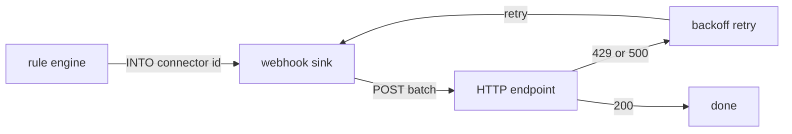

# HTTP webhook connector

The HTTP webhook connector posts rule results to a URL. It supports POST, PUT, and PATCH with Basic, Bearer, or HMAC authentication. It retries 429 and 500-504 faults with backoff.

Use it when any HTTP service must receive broker data. You get one request per batch with the exact event bytes.



## Before you start

- Run an HTTP receiver. Note its URL.
- Pick the method and the credentials.
- This kind ships in the default build. No feature flag is necessary.

## Settings

Set `kind` to `webhook`.

| Setting | Required | Meaning |
|---|---|---|
| `url` | yes | Target URL with `${topic}`, `${client_id}`, `${qos}`, `${timestamp}` substitution. HTTP or HTTPS only. |
| `method` | no | `POST` (default), `PUT`, or `PATCH`. |
| `headers` | no | Extra headers with the same substitution. |
| `auth` | no | Authentication; default none. |
| `body_format` | no | Body encoding; default raw JSON per event. |
| `signature` | no | HMAC signature over the exact body bytes. |
| `batch_size` | no | Flush trigger record count; default 100. |
| `batch_bytes` | no | Flush trigger byte limit; default 1 MiB. |
| `linger_ms` | no | Linger flush window in ms; default 50. |
| `timeout_ms` | no | Per-request timeout in ms; default 5000. |
| `max_retries` | no | Retries on 429 and 500-504; default 3. |
| `initial_backoff_ms` | no | First retry delay in ms; default 100. |
| `max_backoff_ms` | no | Retry delay ceiling in ms; default 2000. |

Example:

```json
{
  "id": "hook-1",
  "kind": "webhook",
  "config": {
    "url": "https://hooks.example.com/ingest/${topic}",
    "method": "post",
    "headers": {},
    "auth": {"type": "none"},
    "body_format": "rawjson",
    "batch_size": 50,
    "batch_bytes": 65536,
    "linger_ms": 25,
    "timeout_ms": 1000,
    "max_retries": 2,
    "initial_backoff_ms": 10,
    "max_backoff_ms": 100
  }
}
```

## Check that it works

This test runs the full path through the broker. It starts a local HTTP receiver. It creates the connector and a forwarding rule. It publishes one message. It reads the post back. The receiver prints `delivered` when the post arrives.

```toml test
[node]
id = "docs-connector-http"

[listeners.tcp]
bind = "0.0.0.0:1883"

[listeners.api]
bind = "0.0.0.0:18083"

[logging]
level = "warn"

[auth]
allow_anonymous = true
```

```sh test
python3 - <<'PY'
import json, os, socket, struct, threading, time, urllib.request
from http.server import BaseHTTPRequestHandler, HTTPServer

received = []

class Handler(BaseHTTPRequestHandler):
    def do_POST(self):
        length = int(self.headers.get("Content-Length", 0))
        received.append(self.rfile.read(length))
        self.send_response(200)
        self.end_headers()
        self.wfile.write(b"ok")
    def log_message(self, *args):
        pass

server = HTTPServer(("127.0.0.1", 0), Handler)
hook_port = server.server_address[1]
threading.Thread(target=server.serve_forever, daemon=True).start()

mqtt_port = int(os.environ.get("MQTT_PORT", "1883"))
api_port = os.environ.get("API_PORT", "18083")
key = os.environ["API_KEY"]

def call(method, path, body=None):
    req = urllib.request.Request(
        f"http://127.0.0.1:{api_port}{path}",
        data=None if body is None else json.dumps(body).encode(),
        method=method,
        headers={"Authorization": f"Bearer {key}", "Content-Type": "application/json"})
    with urllib.request.urlopen(req, timeout=5) as res:
        raw = res.read().decode()
        return res.status, (json.loads(raw) if raw else None)

status, created = call("POST", "/api/v1/connectors", {
    "id": "docs-hook", "kind": "webhook",
    "config": {"url": f"http://127.0.0.1:{hook_port}/hook", "batch_size": 1}})
assert status == 201 and created["kind"] == "webhook", (status, created)
status, _ = call("POST", "/api/v1/rules", {
    "name": "docs-hook-rule", "topic_filter": "docs/hook/in",
    "actions": [{"type": "forwardconnector", "connector_id": "docs-hook"}]})
assert status == 201, status

def packet(kind, body):
    return bytes([kind, len(body)]) + body

def field(data):
    return struct.pack(">H", len(data)) + data

pub = socket.create_connection(("127.0.0.1", mqtt_port), timeout=5)
pub.sendall(packet(0x10, b"\x00\x04MQTT\x04\x02\x00\x3c" + field(b"docs-hook-pub")))
assert pub.recv(4) == b"\x20\x02\x00\x00"
pub.sendall(packet(0x30, field(b"docs/hook/in") + b'{"temp": 90}'))
deadline = time.time() + 12
while not received and time.time() < deadline:
    time.sleep(0.1)
assert received, "no post arrived"
print("delivered")
PY
```

```output
delivered
```

## The `http` name

`http` is the inventory name for the same webhook sink. Set `kind` to `http` on the v1 route. The v1 route stores the runtime as `webhook` and returns `webhook` in the answer. On the v5 route, send `type` as `http`. The v5 route keeps the name `http` and registers the webhook runtime.

The `http` name accepts the same settings as `webhook` above.

Example:

```json
{
  "id": "http-1",
  "kind": "http",
  "config": {
    "url": "https://hooks.example.com/ingest/${topic}",
    "method": "post",
    "headers": {},
    "auth": {"type": "none"},
    "body_format": "rawjson",
    "batch_size": 50,
    "batch_bytes": 65536,
    "linger_ms": 25,
    "timeout_ms": 1000,
    "max_retries": 2,
    "initial_backoff_ms": 10,
    "max_backoff_ms": 100
  }
}
```

### Check that it works

This test runs the full path with `kind` set to `http`. It starts a local HTTP receiver. It creates the connector and a forwarding rule. It publishes one message. It reads the post back. The receiver prints `http` when the post arrives.

```sh test
python3 - <<'PY'
import json, os, socket, struct, threading, time, urllib.request
from http.server import BaseHTTPRequestHandler, HTTPServer

received = []

class Handler(BaseHTTPRequestHandler):
    def do_POST(self):
        length = int(self.headers.get("Content-Length", 0))
        received.append(self.rfile.read(length))
        self.send_response(200)
        self.end_headers()
        self.wfile.write(b"ok")
    def log_message(self, *args):
        pass

server = HTTPServer(("127.0.0.1", 0), Handler)
hook_port = server.server_address[1]
threading.Thread(target=server.serve_forever, daemon=True).start()

mqtt_port = int(os.environ.get("MQTT_PORT", "1883"))
api_port = os.environ.get("API_PORT", "18083")
key = os.environ["API_KEY"]

def call(method, path, body=None):
    req = urllib.request.Request(
        f"http://127.0.0.1:{api_port}{path}",
        data=None if body is None else json.dumps(body).encode(),
        method=method,
        headers={"Authorization": f"Bearer {key}", "Content-Type": "application/json"})
    with urllib.request.urlopen(req, timeout=5) as res:
        raw = res.read().decode()
        return res.status, (json.loads(raw) if raw else None)

status, created = call("POST", "/api/v1/connectors", {
    "id": "docs-http", "kind": "http",
    "config": {"url": f"http://127.0.0.1:{hook_port}/hook", "batch_size": 1}})
assert status == 201 and created["kind"] == "webhook", (status, created)
status, created5 = call("POST", "/api/v5/connectors", {
    "name": "docs-http-v5", "type": "http",
    "url": f"http://127.0.0.1:{hook_port}/hook-v5"})
assert status == 201 and created5["type"] == "http", (status, created5)
status, _ = call("POST", "/api/v1/rules", {
    "name": "docs-http-rule", "topic_filter": "docs/http-alias/in",
    "actions": [{"type": "forwardconnector", "connector_id": "docs-http"}]})
assert status == 201, status

def packet(kind, body):
    return bytes([kind, len(body)]) + body

def field(data):
    return struct.pack(">H", len(data)) + data

pub = socket.create_connection(("127.0.0.1", mqtt_port), timeout=5)
pub.sendall(packet(0x10, b"\x00\x04MQTT\x04\x02\x00\x3c" + field(b"docs-http-pub")))
assert pub.recv(4) == b"\x20\x02\x00\x00"
pub.sendall(packet(0x30, field(b"docs/http-alias/in") + b'{"temp": 91}'))
deadline = time.time() + 12
while not received and time.time() < deadline:
    time.sleep(0.1)
assert received, "no post arrived"
print("http")
PY
```

```output
http
```

## Limits

- A non-HTTP URL is refused with 400.
- Only 429 and 500-504 retry. Other 4xx answers drop the batch and log the miss.
- The queue holds 10000 rows by default. A slow receiver sheds past the bound.

## Next steps

- Feed the connector from a rule in [Actions](../rules/actions.md).
- See every kind in [Connectors](./index.md).
