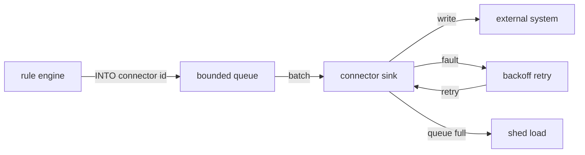

# Connectors

A connector sends rule results to an external system. A rule names the connector in `INTO connector("<id>")` or in a `forwardconnector` action. The connector batches sends and retries faults. Each connector holds a bounded queue, so a slow system never stalls publishers.

Use connectors when results must leave the broker. You get one binary with all sinks; the default build holds light sinks only, and the full build compiles every kind. A kind that is not ready is still refused in a full build. The complete MQTT platform in one small binary: broker, SQL rules, data connectors and multi-tenancy in a single process.



## Before you start

- Read [Rules](../rules/index.md) for the rule that feeds a connector.
- Run the external system, or point the connector at a test instance.
- Create the connector with `POST /api/v1/connectors`, then name its id in a rule.

## Every connector

Direction `out` means the broker writes to the system. State `implemented` means the code exists with offline tests only. State `tested end to end` means a repository test proves the write path with no mocks in the path. No row claims a live vendor run unless such a test exists.

| Name | Direction | Necessary on the other side | State |
|---|---|---|---|
| `kafka` | out | A Kafka cluster at `bootstrap_servers`. | implemented |
| `rabbitmq` | out | A RabbitMQ server at `endpoint`. | implemented |
| `console` (`logger` alias) | out | Nothing; writes to the broker log. | implemented |
| `postgres` | out | A PostgreSQL server at `connection_url`. | implemented |
| `redis` | out | A Redis server at `endpoint`. | implemented |
| `mysql` | out | A MySQL or MariaDB server at `connection_url`. | implemented |
| `clickhouse` | out | A ClickHouse server at `endpoint`. | implemented |
| `influxdb` | out | An InfluxDB server with org, bucket, and token. | implemented |
| `s3` | out | An S3 or MinIO endpoint and bucket. | implemented |
| `elasticsearch` | out | An Elasticsearch server at `endpoint`. | implemented |
| `timescaledb` | out | A TimescaleDB server at `connection_url`. | implemented |
| `webhook` | out | Any HTTP endpoint at `url`. | implemented |
| `mqtt_bridge` | out | A remote MQTT broker at `broker_address`. | implemented |
| `disk_log` | out | A writable local directory. | tested end to end |
| `sparkplug_b` | out | A Sparkplug B host. | implemented |
| `kinesis` | out | An AWS Kinesis stream and credentials. | implemented |
| `gcp_pubsub` | out | A GCP project, topic, and credentials. | implemented |
| `azure_eventhubs` | out | An Azure Event Hubs namespace and key. | implemented |
| `pulsar` | out | An Apache Pulsar broker at `service_url`. | implemented |
| `mongodb` | out | A MongoDB server at `connection_string`. | implemented |
| `mssql` | out | A SQL Server instance. | implemented |
| `cassandra` | out | A Cassandra cluster. | implemented |
| `couchbase` | out | A Couchbase cluster. | implemented |
| `tdengine` | out | A TDengine server. | implemented |
| `iotdb` | out | An IoTDB server. | implemented |
| `timestream` | out | An AWS Timestream database and credentials. | implemented, not verified against the live service |
| `dynamodb` | out | An AWS DynamoDB table and credentials. | implemented |
| `snowflake` | out | A Snowflake account and stage. | implemented, not verified against the live service |
| `databricks` | out | A Databricks SQL warehouse and token. | implemented |
| `doris` | out | An Apache Doris cluster. | implemented |
| `bigquery` | out | A BigQuery dataset and credentials. | implemented |
| `redshift` | out | A Redshift cluster and credentials. | implemented |
| `oracle` | out | An Oracle database. | implemented |
| `cockroachdb` | out | A CockroachDB cluster. | implemented |
| `alloydb` | out | An AlloyDB instance. | implemented |
| `opentsdb` | out | An OpenTSDB server. | implemented |
| `greptimedb` | out | A GreptimeDB server. | implemented |
| `datalayers` | out | A Datalayers server and token. | implemented |
| `oci_streaming` | out | An OCI Streaming stream. | implemented, not verified against the live service |
| `aws_iot` | out | AWS IoT Core with client certificates. | implemented |
| `azure_iot` | out | An Azure IoT Hub with SAS or certificates. | implemented |
| `gcp_iot` | out | A compatible MQTT endpoint with device JWT. | implemented |
| `opc_ua` | out | An OPC UA server. | implemented |
| `azure_blob` | out | An Azure storage account and container. | implemented |
| `tablestore` | out | An Alibaba TableStore instance. | implemented, not verified against the live service |
| `confluent` | out | A Kafka cluster with Schema Registry. | implemented |
| `rocketmq` | out | An Apache RocketMQ broker. | implemented |

> [!NOTE]
> `disk_log` is `tested end to end` because a repository test writes 5000 rows through a real directory, kills mid-write, and reads the log back. Every other row stays `implemented` until a repository test proves it with a real server. The docs run checks the validation step for each page, not the send path.

> [!NOTE]
> The S3 Tables connector is removed. A new connector of type `s3_tables`, `s3tables` or `iceberg` gets `400` with `connector type s3_tables is not available in this broker`. A state file from an earlier version still starts and reports the stored connector and action as `disconnected`. See [Removed connectors](../reference/removed-connectors.md) for the stored-state behaviour and the delete order.

> [!WARNING]
> Heavy vendor SDKs need a feature build. A kind that is not ready answers 400 and names the kind. Build with `--features full` or the named feature (for example `--features kafka`). The container image compiles all kinds. A pending kind stays refused in every build.

## Common connectors

| Page | System |
|---|---|
| [Kafka](./kafka.md) | Event streaming. |
| [PostgreSQL](./postgres.md) | Relational rows. |
| [MySQL](./mysql.md) | Relational rows. |
| [MongoDB](./mongodb.md) | Documents. |
| [Redis](./redis.md) | Streams and keys. |
| [InfluxDB](./influxdb.md) | Metrics. |
| [ClickHouse](./clickhouse.md) | Analytics rows. |
| [HTTP webhook](./http.md) | Any HTTP receiver. |
| [MQTT bridge](./mqtt-bridge.md) | A remote broker. |
| [S3](./s3.md) | Object files. |

## Check that it works

Ask the broker for its action type names. The list holds the documented action kinds that are ready in this build.

```toml test
[node]
id = "docs-connectors"

[listeners.tcp]
bind = "0.0.0.0:1883"

[listeners.api]
bind = "0.0.0.0:18083"

[logging]
level = "warn"

[auth]
allow_anonymous = true
```

```sh test
python3 - <<'PY'
import json, os, urllib.request
port = os.environ.get("API_PORT", "18083")
key = os.environ["API_KEY"]
req = urllib.request.Request(
    f"http://127.0.0.1:{port}/api/v5/action_types",
    headers={"Authorization": f"Bearer {key}"})
with urllib.request.urlopen(req, timeout=5) as res:
    names = set(json.load(res))
assert names == {"pgsql"}, names
for pending in ("http", "mqtt", "kafka_producer", "redis", "mysql"):
    assert pending not in names, pending
print("ok")
PY
```

```output
ok
```

## Next steps

- Open one page above for the configuration shape.
- Feed the connector from a rule in [Actions](../rules/actions.md).
