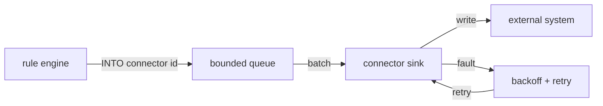

# Connectors

A connector sends rule results to an external system. A rule names the connector in `INTO connector("<id>")`. The connector batches sends and backs off on faults. Each connector has a bound on queued sends.



## Kinds

Message systems: Kafka, RabbitMQ, Pulsar, Kinesis, Google Cloud Pub/Sub, Azure Event Hubs and an MQTT bridge. Databases: PostgreSQL, MySQL, Redis, MongoDB, Cassandra and Microsoft SQL Server. Time series: InfluxDB, TimescaleDB, ClickHouse, TDengine, GreptimeDB and OpenTSDB. Storage and search: S3, Azure Blob and Elasticsearch. Industrial: Sparkplug B and OPC UA. Other: HTTP webhook and a rotating disk log.

## Test level

`crates/broker-connectors/CAPABILITY.md` shows what each connector speaks and what it was tested against. Most connectors have tests with a test transport only. A default build holds the light sinks only. Build with `--features full` for all kinds. The container image holds all kinds.

## Configure

Create a connector through the management API, then name its id in a rule. The connector runs behind the rule engine queue, so a slow external system cannot stall publishers.

## Check that it works

Start the broker with this file. The health endpoint returns `OK`.

```toml test
[node]
id = "docs-connectors"

[listeners.tcp]
bind = "0.0.0.0:1883"

[listeners.api]
bind = "0.0.0.0:18083"

[logging]
level = "warn"
```

```sh test
python3 - <<'PY'
import os, socket
port = int(os.environ.get("API_PORT", "18083"))
sock = socket.create_connection(("127.0.0.1", port), timeout=5)
sock.sendall(b"GET /healthz HTTP/1.0\r\nHost: docs\r\n\r\n")
print(sock.makefile().read().strip().splitlines()[-1])
PY
```

```output
OK
```
