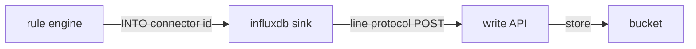

# InfluxDB connector

The InfluxDB connector posts rule results as line protocol. It batches points and posts them to one bucket. It authenticates with a token.

Use it when metrics must land in InfluxDB for dashboards. You get one HTTP post per batch.



## Before you start

- Run InfluxDB. Note the endpoint, org, bucket, and token.
- Pick the measurement template.
- This kind ships in the default build. No feature flag is necessary.

## Settings

Set `kind` to `influxdb`.

| Setting | Required | Meaning |
|---|---|---|
| `endpoint` | yes | Base HTTP endpoint, `http://` or `https://`. |
| `bucket` | yes | Target bucket. |
| `org` | yes | Target organization. |
| `token` | yes | API token. |
| `measurement_template` | yes | Measurement name or `{topic}` template. |
| `precision` | yes | One of `s`, `ms`, `us`, `ns`. |
| `batch_size` | yes | Points per post. |
| `batch_timeout_ms` | yes | Linger before a partial batch flushes. |
| `request_timeout_ms` | no | Per-request timeout in ms; default 5000. |

Example:

```json
{
  "id": "influx-sink-1",
  "kind": "influxdb",
  "config": {
    "endpoint": "http://127.0.0.1:8086",
    "bucket": "mqtt",
    "org": "indra",
    "token": "secret",
    "measurement_template": "mqtt_events",
    "precision": "ms",
    "batch_size": 100,
    "batch_timeout_ms": 50
  }
}
```

> [!NOTE]
> The docs run creates this shape. Creation validates only; it posts nothing. The send path needs an InfluxDB server. See the failure record in [Verification failures](../_verification/failures.md).

## Check that it works

Create the connector. The broker answers 201 with the kind.

```toml test
[node]
id = "docs-connector-influxdb"

[listeners.tcp]
bind = "0.0.0.0:1883"

[listeners.api]
bind = "0.0.0.0:18083"

[logging]
level = "warn"

[auth]
allow_anonymous = true
```

```sh test
python3 - <<'PY'
import json, os, urllib.request
port = os.environ.get("API_PORT", "18083")
key = os.environ["API_KEY"]
body = json.dumps({"id": "influx-sink-1", "kind": "influxdb",
                   "config": {"endpoint": "http://127.0.0.1:8086",
                              "bucket": "mqtt", "org": "indra",
                              "token": "secret",
                              "measurement_template": "mqtt_events",
                              "precision": "ms", "batch_size": 100,
                              "batch_timeout_ms": 50}}).encode()
req = urllib.request.Request(
    f"http://127.0.0.1:{port}/api/v1/connectors", data=body, method="POST",
    headers={"Authorization": f"Bearer {key}", "Content-Type": "application/json"})
with urllib.request.urlopen(req, timeout=5) as res:
    assert res.status == 201
    print(json.load(res)["kind"])
PY
```

```output
influxdb
```

## Limits

- A non-HTTP endpoint is refused with 400.
- An empty bucket or org is refused with 400.
- A dead server backs off and retries. The bounded queue sheds past its bound.

## Next steps

- Feed the connector from a rule in [Actions](../rules/actions.md).
- See every kind in [Connectors](./index.md).
