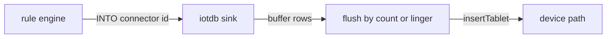

# IoTDB connector

The IoTDB connector writes rule results as tablet rows. It posts tablets to the REST API. It buffers rows and flushes by count or by linger.

Use it when device rows must land in IoTDB. You get one tablet per device per flush.



## Before you start

- Run IoTDB. Note the endpoint, user, and password.
- Pick the device path. It starts with `root.`.

## Settings

Set `kind` to `iotdb`.

| Setting | Required | Meaning |
|---|---|---|
| `endpoint` | yes | REST endpoint, `host:port`. Reads as `http`. The broker appends `/rest/v2`. |
| `username` | yes | IoTDB user. |
| `password` | yes | IoTDB password. |
| `device` | yes | Device path template. Starts with `root.`. |
| `measurements` | yes | Column names, a non-empty list. |
| `types` | yes | Column types, one per measurement: `boolean`, `int32`, `int64`, `float`, `double`, `text`. |

The action may override `device`, `measurements` and `types` per target. Rows are never aligned.

### `endpoint`

REST endpoint, `host:port`. Type: string. Required: yes. Reads as `http`. The broker appends `/rest/v2`. Absent: 400 naming `endpoint`.

```sh test
python3 - <<'PY'
import json, os, urllib.request
port = os.environ.get("API_PORT", "18083")
key = os.environ["API_KEY"]
def post(body):
    req = urllib.request.Request(
        f"http://127.0.0.1:{port}/api/v5/connectors", data=json.dumps(body).encode(), method="POST",
        headers={"Authorization": f"Bearer {key}", "Content-Type": "application/json"})
    try:
        with urllib.request.urlopen(req, timeout=5) as res:
            return res.status, json.load(res)
    except urllib.error.HTTPError as err:
        return err.code, json.load(err)
status, body = post({"name": "iot-ep-bad", "type": "iotdb", "username": "root"})
assert status == 400 and "endpoint" in body["message"], body
print("ok")
PY
```

```output
ok
```

### `username`

IoTDB user. Type: string. Required: yes. Absent: 400 naming `username`.

```sh test
python3 - <<'PY'
import json, os, urllib.request
port = os.environ.get("API_PORT", "18083")
key = os.environ["API_KEY"]
def post(body):
    req = urllib.request.Request(
        f"http://127.0.0.1:{port}/api/v5/connectors", data=json.dumps(body).encode(), method="POST",
        headers={"Authorization": f"Bearer {key}", "Content-Type": "application/json"})
    try:
        with urllib.request.urlopen(req, timeout=5) as res:
            return res.status, json.load(res)
    except urllib.error.HTTPError as err:
        return err.code, json.load(err)
status, body = post({"name": "iot-user-bad", "type": "iotdb",
                     "endpoint": "127.0.0.1:18080", "password": "root"})
assert status == 400 and "username" in body["message"], body
print("ok")
PY
```

```output
ok
```

### `password`

IoTDB password. Type: string. Required: yes. Absent: 400 naming `password`.

```sh test
python3 - <<'PY'
import json, os, urllib.request
port = os.environ.get("API_PORT", "18083")
key = os.environ["API_KEY"]
def post(body):
    req = urllib.request.Request(
        f"http://127.0.0.1:{port}/api/v5/connectors", data=json.dumps(body).encode(), method="POST",
        headers={"Authorization": f"Bearer {key}", "Content-Type": "application/json"})
    try:
        with urllib.request.urlopen(req, timeout=5) as res:
            return res.status, json.load(res)
    except urllib.error.HTTPError as err:
        return err.code, json.load(err)
status, body = post({"name": "iot-pw-bad", "type": "iotdb",
                     "endpoint": "127.0.0.1:18080", "username": "root"})
assert status == 400 and "password" in body["message"], body
print("ok")
PY
```

```output
ok
```

### `device`

Device path template. Type: string. Required: yes. Starts with `root.`. Absent: 400 naming `device`.

```sh test
python3 - <<'PY'
import json, os, urllib.request
port = os.environ.get("API_PORT", "18083")
key = os.environ["API_KEY"]
def post(body):
    req = urllib.request.Request(
        f"http://127.0.0.1:{port}/api/v5/connectors", data=json.dumps(body).encode(), method="POST",
        headers={"Authorization": f"Bearer {key}", "Content-Type": "application/json"})
    try:
        with urllib.request.urlopen(req, timeout=5) as res:
            return res.status, json.load(res)
    except urllib.error.HTTPError as err:
        return err.code, json.load(err)
status, body = post({"name": "iot-device-bad", "type": "iotdb",
                     "endpoint": "127.0.0.1:18080", "username": "root", "password": "root"})
assert status == 400 and "device" in body["message"], body
print("ok")
PY
```

```output
ok
```

### `measurements`

Column names, a non-empty list. Type: array of strings. Required: yes. Empty: 400 naming `measurements`.

```sh test
python3 - <<'PY'
import json, os, urllib.request
port = os.environ.get("API_PORT", "18083")
key = os.environ["API_KEY"]
def post(body):
    req = urllib.request.Request(
        f"http://127.0.0.1:{port}/api/v5/connectors", data=json.dumps(body).encode(), method="POST",
        headers={"Authorization": f"Bearer {key}", "Content-Type": "application/json"})
    try:
        with urllib.request.urlopen(req, timeout=5) as res:
            return res.status, json.load(res)
    except urllib.error.HTTPError as err:
        return err.code, json.load(err)
status, body = post({"name": "iot-m-bad", "type": "iotdb",
                     "endpoint": "127.0.0.1:18080", "username": "root", "password": "root",
                     "device": "root.d", "measurements": [], "types": []})
assert status == 400 and "measurements" in body["message"], body
print("ok")
PY
```

```output
ok
```

### `types`

Column types, one per measurement. Type: array of strings. Allowed: `boolean`, `int32`, `int64`, `float`, `double`, `text`. A wrong entry: 400 naming `types`.

```sh test
python3 - <<'PY'
import json, os, urllib.request
port = os.environ.get("API_PORT", "18083")
key = os.environ["API_KEY"]
def post(body):
    req = urllib.request.Request(
        f"http://127.0.0.1:{port}/api/v5/connectors", data=json.dumps(body).encode(), method="POST",
        headers={"Authorization": f"Bearer {key}", "Content-Type": "application/json"})
    try:
        with urllib.request.urlopen(req, timeout=5) as res:
            return res.status, json.load(res)
    except urllib.error.HTTPError as err:
        return err.code, json.load(err)
status, created = post({"name": "iot-types-ok", "type": "iotdb",
                        "endpoint": "127.0.0.1:18080", "username": "root", "password": "root",
                        "device": "root.d", "measurements": ["temperature"], "types": ["float"]})
assert status == 201, (status, created)
print("ok")
PY
```

```output
ok
```

Example:

```json
{
  "name": "iot-sink-1",
  "type": "iotdb",
  "endpoint": "127.0.0.1:18080",
  "username": "root",
  "password": "root",
  "device": "root.factory.d1",
  "measurements": ["temperature"],
  "types": ["float"]
}
```

> [!NOTE]
> The docs run creates this shape. Creation validates only; it inserts nothing. The send path needs an IoTDB server. See the failure record in [Verification failures](../_verification/failures.md).

## Check that it works

Create the connector. The broker answers 201 with the kind. It prints `ok`.

```toml test
[node]
id = "docs-connector-iotdb"

[listeners.tcp]
bind = "0.0.0.0:1883"

[listeners.api]
bind = "0.0.0.0:18083"

[logging]
level = "warn"

[auth]
allow_anonymous = true
```

```sh test
python3 - <<'PY'
import json, os, urllib.request
port = os.environ.get("API_PORT", "18083")
key = os.environ["API_KEY"]
body = json.dumps({"name": "iot-sink-1", "type": "iotdb",
                   "endpoint": "127.0.0.1:18080",
                   "username": "root", "password": "root",
                   "device": "root.factory.d1",
                   "measurements": ["temperature"],
                   "types": ["float"]}).encode()
req = urllib.request.Request(
    f"http://127.0.0.1:{port}/api/v5/connectors", data=body, method="POST",
    headers={"Authorization": f"Bearer {key}", "Content-Type": "application/json"})
try:
    with urllib.request.urlopen(req, timeout=5) as res:
        status, created = res.status, json.load(res)
except urllib.error.HTTPError as err:
    status, created = err.code, json.load(err)
assert status == 201, (status, created)
assert created["type"] == "iotdb", created
print("ok")
PY
```

```output
ok
```

## Limits

- The driver speaks the REST API only. There is no thrift form.
- A dead server backs off and retries. The bounded queue sheds past its bound.
- A value that misses its column type stops the batch with a failure.

## Next steps

- Feed the connector from a rule in [Actions](../rules/actions.md).
- See every kind in [Connectors](./index.md).
